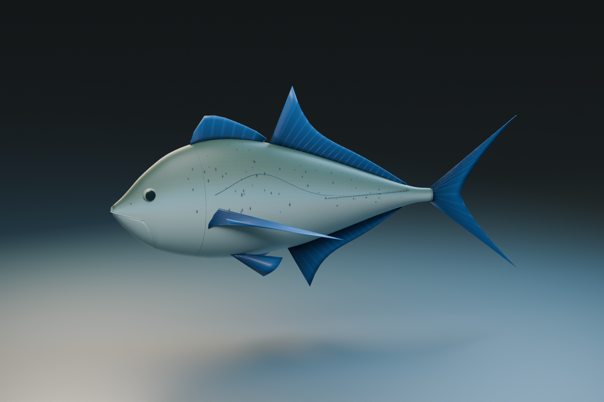

# OceanAngler · 海洋小钓手

[GitHub 开源仓库](https://github.com/arthurwangwsx-code/OceanAngler) · [完整验收总账](reports/acceptance-ledger.md)

儿童与家庭向的 3D 海洋钓鱼探索游戏。真实比例鱼类、漂亮水下世界、易懂钓具、积分成长、图鉴与放流。正式名称待商标检查。

**当前已具备可试玩的钓鱼/进度闭环。0.1.0 (3)已通过Apple处理并分配至本人授权账号的内部TestFlight组，包含首条鱼、首套钓组、首处海湾候选及放流/任务/音频/水面/图鉴改进；[发布回执](reports/testflight-0.1.0-3.json)与实际安装分别记录。各项实现与检查另行保留证据；美术、实际触控、真机与完整产品验收未完成。** 首发 iPhone/iPad，最低iOS/iPadOS 17，Unity 6000.3.29f1 + URP 17.3.0 + C# + Blender；离线单人、无广告、无内购、无聊天。

| 阅读目的 | 文件 |
|---|---|
| 完整产品、玩法、范围与交互 | [产品方案](docs/01-product.md) |
| 鱼类、装备、海域与积分 | [内容与数值](docs/02-content-and-economy.md) |
| 漂亮拟真的模型如何制作和验收 | [美术与资产标准](docs/03-art-pipeline.md) |
| 引擎、架构、AI、物理、存档与性能 | [技术方案](docs/04-technology.md) |
| 联网研究及旧项目参考 | [参考研究](docs/05-research.md) |
| 分阶段任务、投入、风险与质量 | [路线及验收](docs/06-delivery.md) |
| GitHub 开源流程 | [开源流程](docs/07-open-source.md) |
| App Store Connect 与本人 TestFlight | [发布流程](docs/08-testflight.md) |
| 本次候选如何在设备上复核 | [build 3设备检查](docs/12-beta3-review.md) |
| 当前真实结果 | [完整总账](reports/acceptance-ledger.md)、[移动布局与发行](reports/mobile-layout.md)、[逻辑与Mac运行](reports/progression-validation.md) |
| 首条独立源模型 | [蓝鳍鲹候选及验收边界](reports/bluefin-art.md)、[源资产重建](art/source/bluefin/README.md) |
| 第一套完整钓组候选 | [纺车钓组与验证边界](reports/spinning-rig-art.md)、[源资产重建](art/source/spinning-rig/README.md) |
| 第一处独立海域候选 | [珊瑚海湾与验证边界](reports/coral-bay-art.md)、[海湾源资产重建](art/source/coral-bay/README.md) |
| 物种资料和仅观察生物 | [学名、辨识与建模交接](docs/10-species-production.md) |
| 原创音频与实际画面 | [音频控制](docs/11-feedback-audio.md)、[三档原生截图与问题](reports/integrated-native-render.md) |
| 礁岩破面修复与对照 | [源网格检查和同镜头实际游戏画面](reports/coral-bay-solid-geometry.md) |
| 鱼体表面与鉴赏标题 | [鳃盖/高光迭代、标题消失回归及实际对照](reports/bluefin-surface-and-ui.md) |
| 图鉴物种详情 | [12物种学名、辨识与窄卡片滚动](reports/journal-species.md) |
| 口部、下颌与鳍条 | [真实下唇变形、内壁和导入资产离屏检查](reports/bluefin-mouth-and-fins.md) |
| 海湾水面与倒影 | [深度顺序修复、离屏GPU对照及验收边界](reports/water-rendering.md) |
| 拟饵接近与收鱼表现 | [阶段路径、嘴部鱼线、几何检查与八张离屏图](reports/fishing-encounter.md) |
| 海湾环境鱼群 | [三条现有蓝鳍鲹的游动、空间检查与离屏对照](reports/bay-school.md) |
| 岸线与沙地 | [连续陆地、沙地材质及同镜头离屏对照](reports/bay-shoreline.md) |

需求合同在 ispec/specs，首批变更在 ispec/changes/product-technical-foundation；planning/backlog.csv 管理任务。仅此目录可写，不修改赛车和枪战项目。

```sh
python3 tools/validate.py
python3 tools/game.py prepare
python3 tools/game.py tests
python3 tools/game.py mac
ASC_ENV_FILE=/path/to/private/asc.env python3 tools/asc.py status
```

代码采用 MIT；资产逐项登记，未取得可再分发许可的模型不得进入公开仓库。后续开源不包含 Unity 引擎。支持与隐私请求：arthur.wang.wsx@gmail.com。



[360度源模型转台](art/previews/bluefin-anatomy/turntable.mp4)。首条蓝鳍鲹与完整纺车钓组均有独立Blend/FBX、PBR、骨骼/动作和三档LOD；另有[钓组近景](art/previews/spinning-rig/reel.png)和[卷线器转台](art/previews/spinning-rig/turntable.mp4)。这些仍是候选，A1–A3、科学/用户审阅和真机尚未通过；其余11鱼种、其他钓具、两海域及观察生物仍需完整制作。

当前开发源码包含保存成功后的转向/放流与空载竿恢复、18任务指引、12候选学名和3个仅观察目录保护，以及原创水下底音/探索音乐及独立保存的开关。初始装备20次确定性模拟、逐次重载、重复记录不加分和全装备解锁已有[逻辑证据](reports/task-journey.json)，不代表儿童首鱼时间、随机遭遇耗时或实际20次UI试玩。观察生物的模型/场景交互尚未实现。

海湾已有独立源地形、码头、小船、岩礁/珊瑚/海草、水上/水下观察、缓存倒影与深度透射。源网格朝向/封闭、鱼体鳃缘/材质及鉴赏标题修复分别保留证据；岸线从孤立沙脊改为连接陆地的缓坡，沙地波纹与颜色分离。蓝鳍鲹新增实际向下张开的下颌、口腔内颊及逐段鳍纹，修复隔离场景首次绘制的子材质颜色异常。开发分支又加入三条复用模型的环境鱼群，固定实例、局部聚合/分离，暂停和减弱动态停止；图鉴/钓具鉴赏隐藏，背景鱼不参与结算。开发分支还加入抛投、接近、控线收鱼的阶段路径，鱼线保持到收鱼并跟随动画嘴部。最新39项Editor、8项无画面PlayMode及Mac编译通过，源文件工程检查和Editor离屏GPU图分别审阅；当前原生窗口与实际iPhone/iPad画面、触控、听感/触觉及20分钟性能仍未通过。旧版三档Mac流程各12截图属于其历史源码，不能替代新资产的验收。

Mac构建入口为`python3 tools/game.py mac`；原生检查为`python3 tools/runtime_smoke.py --label unique-run`，使用隔离存档，须在桌面窗口可用后实际运行并核对图像/回执。Editor离屏诊断为`python3 tools/game.py water-review --label unique-review`，不能据此宣布玩家UI或设备通过。Unity和资产写入串行，每轮用新label保留证据；字体重建见tools/requirements.txt。

TestFlight 0.1.0 (3)冻结于05c8cc7，已包含发行前累计修复，不含其后新增的环境鱼群、接近与收鱼表现。[发行回执](reports/testflight-0.1.0-3.json)记录Apple VALID/INTERNAL_ONLY、本人两账号组分配及测试说明；指定邮箱邀请仍待接受，实际安装启动未验。按[build 3设备复核](docs/12-beta3-review.md)继续记录。历史[build 1](reports/testflight-0.1.0-1.json)、[build 2](reports/testflight-0.1.0-2.json)产物与回执保留。新构建须按[冻结源码发布流程](docs/08-testflight.md)使用新build号。ASC工具另需PyJWT与cryptography，凭据显式在本机配置，不进入公开仓库。
