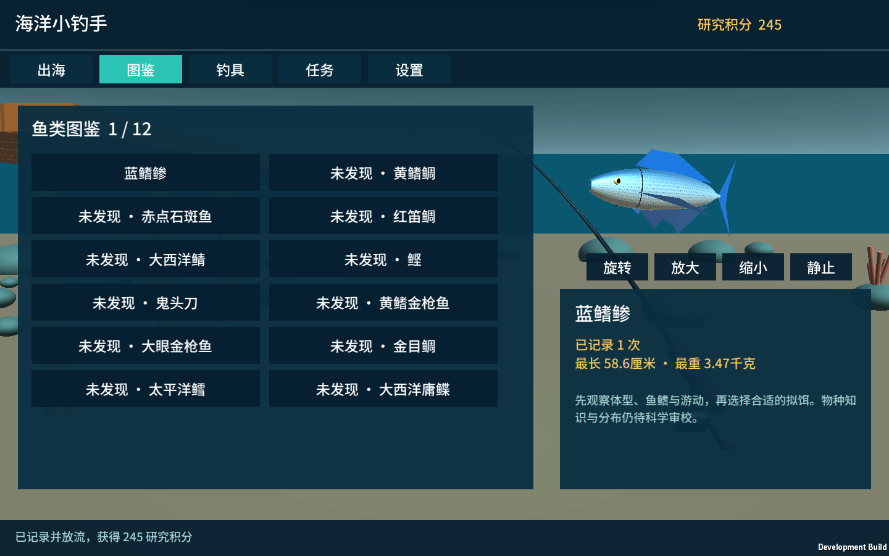

# OceanAngler · 海洋小钓手

儿童与家庭向的 3D 海洋钓鱼探索游戏。真实比例鱼类、漂亮水下世界、易懂钓具、积分成长、图鉴与放流。正式名称待商标检查。

**当前已具备可试玩的钓鱼/进度闭环，21项规则与存档测试、宽屏和4:3 Mac界面冒烟通过。模型与环境仍是待验收样板；真机和TestFlight分发尚未完成。** 首发 iPhone/iPad，Unity 6000.3.29f1 + URP 17.3.0 + C# + Blender；离线单人、无广告、无内购、无聊天。

| 阅读目的 | 文件 |
|---|---|
| 完整产品、玩法、范围与交互 | [产品方案](docs/01-product.md) |
| 鱼类、装备、海域与积分 | [内容与数值](docs/02-content-and-economy.md) |
| 漂亮拟真的模型如何制作和验收 | [美术与资产标准](docs/03-art-pipeline.md) |
| 引擎、架构、AI、物理、存档与性能 | [技术方案](docs/04-technology.md) |
| 联网研究及旧项目参考 | [参考研究](docs/05-research.md) |
| 分阶段任务、投入、风险与质量 | [路线及验收](docs/06-delivery.md) |
| GitHub 开源流程 | [开源流程](docs/07-open-source.md) |
| App Store Connect 与本人 TestFlight | [发布流程](docs/08-testflight.md) |
| 当前真实结果 | [本轮验收](reports/progression-validation.md)、[历史基础验收](reports/foundation.md) |

需求合同在 ispec/specs，首批变更在 ispec/changes/product-technical-foundation；planning/backlog.csv 管理任务。仅此目录可写，不修改赛车和枪战项目。

```sh
python3 tools/validate.py
python3 tools/game.py prepare
python3 tools/game.py tests
python3 tools/game.py ios --build 1
ASC_ENV_FILE=/path/to/private/asc.env python3 tools/asc.py status
```

代码采用 MIT；资产逐项登记，未取得可再分发许可的模型不得进入公开仓库。后续开源不包含 Unity 引擎。支持与隐私请求：arthur.wang.wsx@gmail.com。



Mac验证：`python3 tools/game.py mac`，再运行`python3 tools/runtime_smoke.py --label unique-run`。字体重建见tools/requirements.txt；ASC发行工具另需PyJWT与cryptography，并显式配置本机凭据。
