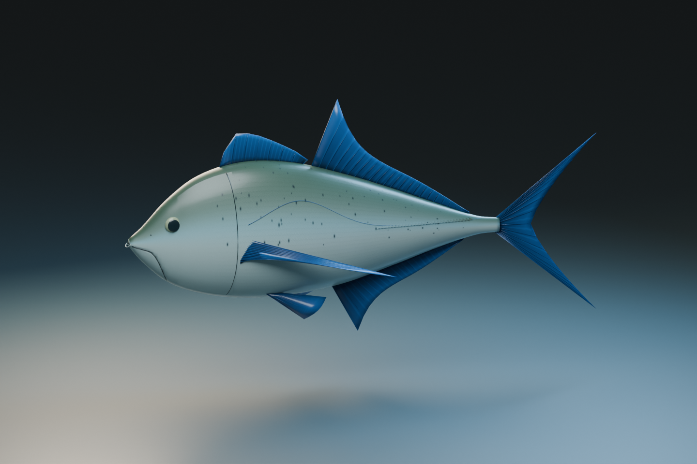

# OceanAngler · 海洋小钓手

[GitHub 开源仓库](https://github.com/arthurwangwsx-code/OceanAngler) · [完整验收总账](reports/acceptance-ledger.md)

儿童与家庭向的 3D 海洋钓鱼探索游戏。真实比例鱼类、漂亮水下世界、易懂钓具、积分成长、图鉴与放流。正式名称待商标检查。

**当前已具备可试玩的钓鱼/进度闭环。0.1.0 (2)已通过Apple处理并分配至本人授权账号的内部TestFlight组，包含首条鱼、首套钓组和首处海湾候选；[发布回执](reports/testflight-0.1.0-2.json)与实际安装分别记录。后续源码另行保留检查结果；美术、实际触控、真机与完整产品验收未完成。** 首发 iPhone/iPad，最低iOS/iPadOS 17，Unity 6000.3.29f1 + URP 17.3.0 + C# + Blender；离线单人、无广告、无内购、无聊天。

| 阅读目的 | 文件 |
|---|---|
| 完整产品、玩法、范围与交互 | [产品方案](docs/01-product.md) |
| 鱼类、装备、海域与积分 | [内容与数值](docs/02-content-and-economy.md) |
| 漂亮拟真的模型如何制作和验收 | [美术与资产标准](docs/03-art-pipeline.md) |
| 引擎、架构、AI、物理、存档与性能 | [技术方案](docs/04-technology.md) |
| 联网研究及旧项目参考 | [参考研究](docs/05-research.md) |
| 分阶段任务、投入、风险与质量 | [路线及验收](docs/06-delivery.md) |
| GitHub 开源流程 | [开源流程](docs/07-open-source.md) |
| App Store Connect 与本人 TestFlight | [发布流程](docs/08-testflight.md) |
| 本次候选如何在设备上复核 | [首轮设备检查](docs/09-current-beta-review.md) |
| 当前真实结果 | [完整总账](reports/acceptance-ledger.md)、[移动布局与发行](reports/mobile-layout.md)、[逻辑与Mac运行](reports/progression-validation.md) |
| 首条独立源模型 | [蓝鳍鲹候选及验收边界](reports/bluefin-art.md)、[源资产重建](art/source/bluefin/README.md) |
| 第一套完整钓组候选 | [纺车钓组与验证边界](reports/spinning-rig-art.md)、[源资产重建](art/source/spinning-rig/README.md) |
| 第一处独立海域候选 | [珊瑚海湾与验证边界](reports/coral-bay-art.md)、[海湾源资产重建](art/source/coral-bay/README.md) |
| 物种资料和仅观察生物 | [学名、辨识与建模交接](docs/10-species-production.md) |

需求合同在 ispec/specs，首批变更在 ispec/changes/product-technical-foundation；planning/backlog.csv 管理任务。仅此目录可写，不修改赛车和枪战项目。

```sh
python3 tools/validate.py
python3 tools/game.py prepare
python3 tools/game.py tests
python3 tools/game.py ios --build 2 --label unique
ASC_ENV_FILE=/path/to/private/asc.env python3 tools/asc.py status
```

代码采用 MIT；资产逐项登记，未取得可再分发许可的模型不得进入公开仓库。后续开源不包含 Unity 引擎。支持与隐私请求：arthur.wang.wsx@gmail.com。



[360度源模型转台](art/previews/bluefin/turntable.mp4)。首条蓝鳍鲹和第一套完整纺车钓组已接入本次候选包；另有[钓组工作室近景](art/previews/spinning-rig/reel.png)及[卷线器转台](art/previews/spinning-rig/turntable.mp4)，源文件与5项无画面机构检查通过。新界面及实际画面仍待核验；其余鱼种、钓具和海域仍待成品制作与验收。

integration/art-candidates已串行集成蓝鳍鲹、完整纺车钓组和珊瑚海湾，25项Editor及6项无画面PlayMode检查通过，涵盖真实场景内的海湾观察、暂停返回、钓组试摇、恢复抛竿、战斗中导航停止收线及实际机构/蒙皮；Mac原生包编译通过。[集成记录](reports/integrated-art-candidates.md)与源图另行保留。TestFlight 0.1.0 (2)冻结于2971b11；此前(1)的[历史回执](reports/testflight-0.1.0-1.json)保留，新包实际安装与画面待验。

Mac验证：`python3 tools/game.py mac`，再运行`python3 tools/runtime_smoke.py --label unique-run`。字体重建见tools/requirements.txt；ASC发行工具另需PyJWT与cryptography，并显式配置本机凭据。

build 2之后的开发源码补充了成功保存后的转向与放流游离，并恢复空载竿形；暂停、减弱动态、图鉴中断、快速再抛竿及写盘失败重试另行检查，见[放流表现证据](reports/fish-release-playmode.json)。这项后续源码尚未进入TestFlight，不能用现有build 2验收它的实际画面。

后续源码还补充18项任务的完成指引及轻柔控线结果。26项Editor与7项PlayMode检查通过，包含初始装备20次模拟中完成全部任务、逐次重载、重复记录不加分和装备解锁，以及任务指引的逻辑排版；Mac编译通过。[任务检查](reports/task-journey.json)保留确定性模拟与实际试玩的边界，新任务界面尚未进入build 2。

物种后续源码已有12候选学名、3个独立仅观察条目及可钓目录入口保护；[资料与目录检查](reports/species-catalog-checks.json)记录27项Editor、7项PlayMode与Mac编译通过。15条[科学参考](planning/species-references.json)供后续制作，科学人工审阅仍待完成；观察模型、场景出现和交互尚未实现，相关变化未进build 2。
