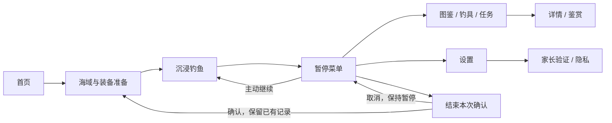

# 沉浸式游玩与页面层级

实际钓鱼时，海洋、鱼和钓具占据画面主体。顶部不再显示积分/全局导航，左右不常驻大面板；仅边缘显示暂停和当前动作，收线时额外显示小型张力与进度。已学会后的准备/等待短提示会收起，放流反馈复用提示位置。收鱼结果复用底部三行提示，不另放遮住鱼体的结果卡，也纳入游玩HUD指标；暂停与退出确认属于主动进入的临时页面。

首页/暂停菜单 → 海域与装备准备 → 开始钓鱼。准备页的主要出发按钮固定在可见区，海域/装备内容独立滚动，最下行预留空间，避免互相覆盖。首页/暂停菜单还可进入图鉴、钓具、任务与设置；鱼类/钓组/保护观察详情都有上一级返回，家长和隐私仍在设置下。非游玩页面保留快捷导航，便于儿童从较深页面返回；这些入口不常驻于实际游玩画面。

暂停/系统失焦首先取消按住输入并冻结当前鱼获。返回菜单或设置后必须明确点“继续探索”，不自动恢复收线或抛竿。“结束本次”先进入统一确认页：取消仍保留当前鱼获且保持暂停；确认放回尚未记录的鱼，转入准备页，已有记录与积分不变。不用程序强制关闭iOS应用，也不承诺尚未记录的单次钓鱼能跨进程继续。

暂停、出海、收线、放流、图鉴、任务、设置等采用原创矢量形状图标，均配中文短标签；不用emoji代替控件。主动作按钮按阶段切换图形和文字，左右手镜像。最小触控44点，张力警戒同时显示固定刻线、“！”与松手文字，不能只看颜色。

验收按三层区分：自动规则/射线和存档保护；iPhone/iPad原生Simulator截图；儿童可发现性、图标理解及真实触控。HUD以实际活跃区域和所有可见Image背景矩形的并集计算，目标≤安全区15%；中央观察区定义为横向25%–75%、纵向45%–85%，包含Landed的游玩HUD不得相交。该几何指标不代替实际画面审阅，也不证明模型/场景达到拟真标准。

复核入口为开发构建参数`--ocean-immersive-review <output>`，必须同时指定新的`--ocean-save-root <isolated-root>`。它走真实可见按钮和EventSystem射线，两档左右手、自然抛竿/咬钩/控线、一次实际放流、另一次未记录退出；记录HUD、冻结、取消/确认及落盘结果。原生检查可使用真实成长存档的字节副本，或新隔离存档中的正常首次教学；均不注入鱼种、记录或积分。原有存档须逐字节保护；无画面PlayMode也使用隔离新存档。不将自动输入或模拟失焦算作系统触摸/真实后台验收。

最新冻结9e2b9dd的同一原生包在两端分别15帧复核上述界面；HUD含收鱼最高12.228%/4.526%，中央检查区净空。另有各14帧钓组流程、15份旧QA主文件字节保护与新进程原4622分核对。串行重跑、启动等待和未通过项见[当前画面与回执范围](../reports/spinning-rig-detail.md)。
