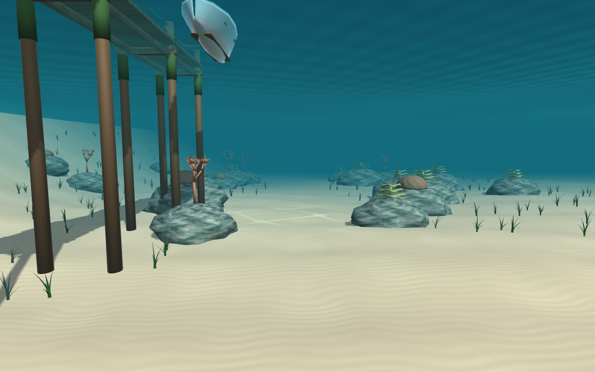
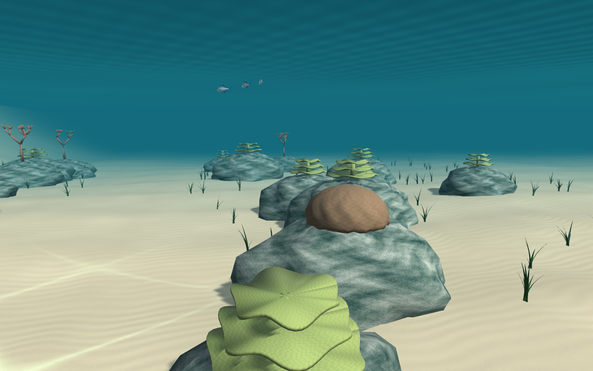

# 海湾环境鱼群候选

2026-11-24。首海湾新增三条环境蓝鳍鲹，复用现有同一独立模型、骨骼、材质和LOD，不计作三个新物种。它们只做水下表现：不进入鱼获结算，实例碰撞器关闭；当前可钓目标用OceanWorld.TargetFish明确标识，避免从全场景取到环境鱼。

## 游动与空间

固定30Hz模拟组合局部方向/聚合、分离和引导路径，参考[Craig Reynolds的原始Boids说明](https://www.red3d.com/cwr/boids/)，没有复制其代码、图像或动画。三条实例只创建一次，图鉴/钓具鉴赏隐藏时复用；暂停、后台暂停和减弱动态保持位置及动画停止，返回后从原位置继续。模型动画继续使用已有swim动作；这不是经过生物学验证的鱼群模拟，也没有完成可钓鱼对拟饵的感知/咬钩AI。

生成器读取实际导入网格，对指定区域求保守最高实体面，结合0.48米身体安全球和额外0.1米间隙划定中心游动范围。初选范围没有足够净空，生成器拒绝；移动到开阔水域后通过，没有减小间隙。独立检查覆盖全部三档环境LOD的137054个三角面，整个扫掠身体体积不相交，且保持在水面下。它是静态网格/体积证明，不是动态场景通用碰撞或寻路。

蒙皮检查对七个swim采样姿态和三个LOD烘焙实际顶点。首轮测试重复应用导入renderer缩放而失败；按[Unity BakeMesh坐标补偿说明](https://docs.unity.com/en-us/engine/6000.0/script-reference/unityengine/skinnedmeshrenderer/bakemesh)显式使用useScale=true后，最大实例世界半径约0.404米，小于0.48米安全半径。这里修正的是测量方法，未放大安全阈值或改变模型尺寸。

20分钟模拟为36000步：邻近和分离响应实际发生，最小中心距约1.103米，边界钳制次数为0；分成60Hz输入所得轨迹一致。该模拟不是设备20分钟性能/温升验收。场景检查另验证暂停、减弱动态、隐藏/恢复、固定实例数、目标身份和已有捕获/保存/图鉴流程。

## 画面与范围

Editor Metal离屏场景分别采样起点与模拟6秒后的水上、水下和礁石镜头，另保留同镜头移除鱼群的控制图。使用真实海湾/蓝鳍鲹prefab及材质，固定LOD0并手动采样动作；这是资产/场景诊断，不含玩家UI、原生窗口或设备性能。七张原始PNG逐张检查，未裁切或重画。鱼群在远处比较小，水面仅见微弱轮廓，当前观感仍为PARTIAL。

源码身份、实际数值、测量ID与失败见[脱敏记录](bay-school.json)。原始日志保留本机。每条环境鱼复用只读共享材质，仍使用子材质PropertyBlock，因此相关renderer不使用SRP Batcher；额外蒙皮和draw call成本须在iPhone/iPad实测。

本轮CUA确认Mac仍锁定，未重复启动此前超时的原生流程。成品美术、科学/用户审阅、当前玩家画面/触控、真机20分钟、其他11鱼种、三观察生物及其他海域仍未完成。环境鱼群不替代保护观察生物，也不通过A1–A3。TestFlight build 3仍冻结05c8cc7，不含本轮新增鱼群。
