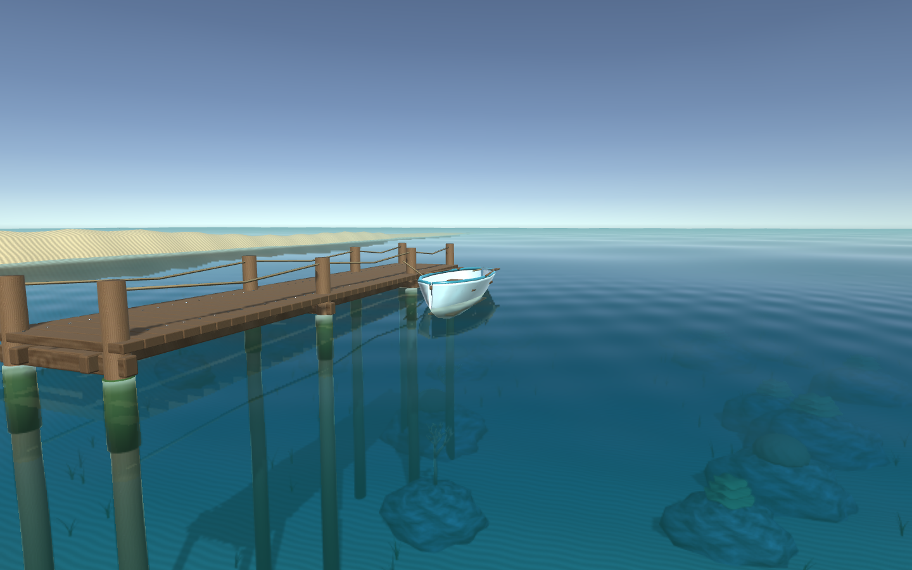
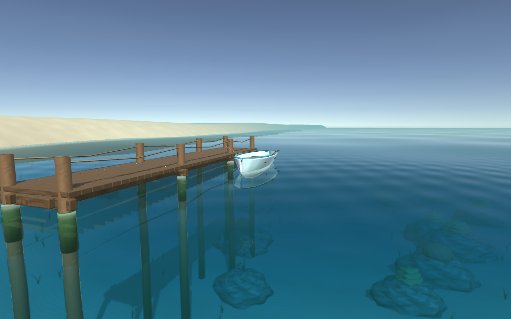
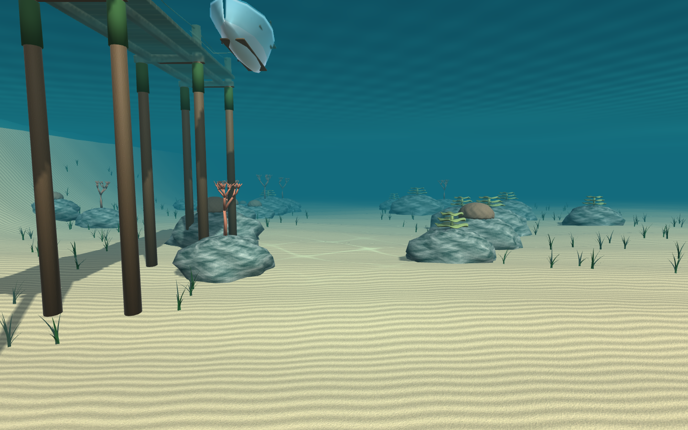
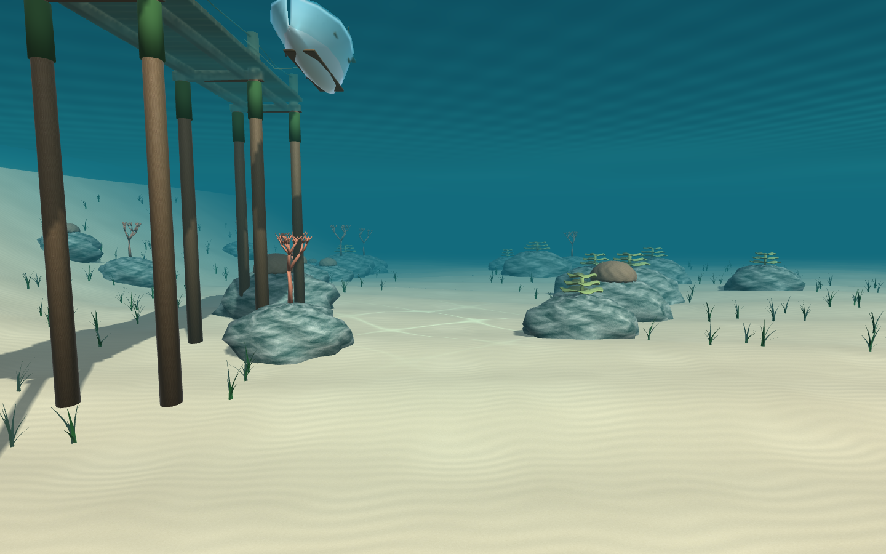

# 海湾岸线与沙地迭代

2026-11-24。首海湾原来的西侧“海岸”实际上是一条狭窄沙脊，两侧都落入水下；沙纹还在baseColor中形成明显的重复条带。本轮修改保存源模型与原创PBR贴图，保留.meta、旧版本及首轮失败记录。首海湾仍是候选，其他两海域、完整美术和真机验收尚未完成。

## 形状与材质

地形由沙脊改为连接西侧陆地的弧形缓坡，岸线沿纵向变化，并留出凹入的小湾。陆地高度独立于远处海床坡降，避免远端陆地再次沉入水下；近处主要钓鱼通道、水位和相机标尺保持原位置。岩礁、珊瑚、海草与码头桩底按实际地形重新生成，船体继续使用共用剖面。此次实际重新保存Blend、导出FBX并由Unity重新生成prefab。

沙色改为低对比沉积分布及细颗粒，波纹主要进入法线；使用独立固定种子，避免改动其他材质的随机序列。第一版法线在Unity中仍显得规整，后续减弱起伏并增加局部扭曲。没有下载外部图片或复制旧游戏资产。

## 独立几何检查

validator从已保存Blend的实际三角网格建立BVH，用竖直射线读取海岸剖面，不调用生成器的高度函数。旧模型的四条剖面均复现两次水位穿越，西端又低于水面，构成沙脊；保留FAIL。新模型对三个LOD、各四条剖面检查连续覆盖、西端陆地、东端水下，以及一次水位穿越。检查还保留24块岩礁及8块丘状珊瑚在三档LOD的封闭实体、法向/体积、UV、坐标与面数预算验证。它们是几何检查，不等于自然景观或科学人工审阅通过。

## 画面证据和范围

相同Unity离屏镜头的修改前、修改后：

图像为项目场景直接渲染的未修改PNG，未裁切或重画，不含玩家UI，也不是手机截图。保存源文件四视角与这些离屏图分别登记，当前检查及原始失败的测量ID见[脱敏记录](bay-shoreline.json)。源网格检查、29项Editor、7项无画面PlayMode、Mac编译及离屏GPU检查通过；不以旧版三档Mac原生结果证明新地形的UI或设备行为。

实际审图确认狭窄沙脊已连接陆地，重复条纹的颜色/明暗减轻；沙地仍使用平铺纹理，岸线远景锯齿、植被变化、珊瑚形态及整体丰富度仍需继续处理与人工审阅。没有将这些局部改进记为A1–A3通过。

TestFlight 0.1.0 (2)仍冻结于2971b11，不包含本轮资产。实际安装、iPhone/iPad触控、20分钟温升/内存/流畅度、儿童首鱼时间、科学/用户审阅及其他海域与物种仍未通过。本轮不修改发行范围或降低A1–A3要求。
