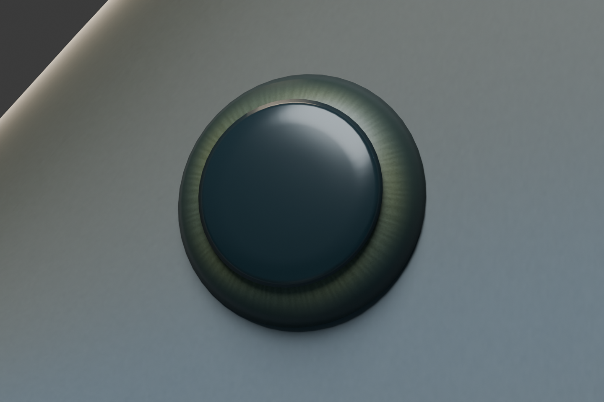
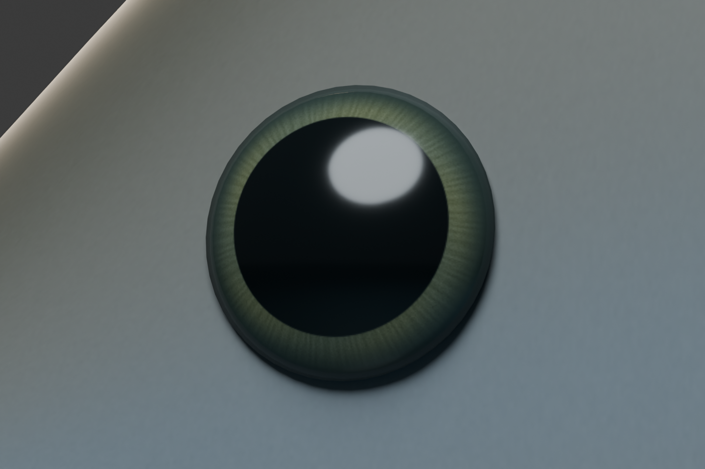
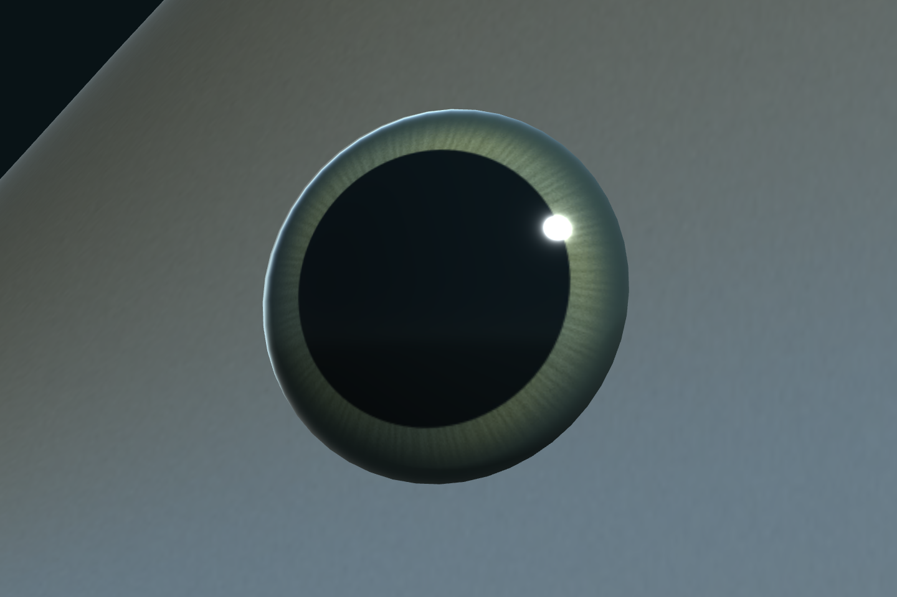

# 蓝鳍鲹连续眼表候选

连续眼表局部已实现，afa8fed源文件与Editor检查通过，双端原生待并入整体页面优化后的新包核对。完整美术与产品继续PARTIAL。该眼部冻结不改变游玩、积分、随机和存档规则；随后页面改动另行记录。

原保存模型用独立球体表示黑色瞳孔，两侧近景都有凸起边缘。本轮去掉这层几何，用既有256×256色图中的深色区域表示瞳孔，与虹膜共享连续弧面及反光。深色区RGB为6/13/15，没有画入高光；棚拍光源与游戏灯光产生各自反射。这是不透明眼表的移动端美术近似，不是透明角膜/折射的生物光学模型。眼睛径向轮廓、UV及头骨权重保持，前表曲率与湿润度为原创美术选择，不能称为来源实测。

保存源局部更新后的三LOD为23320/9450/3598三角面，原为24664/9864/3698，没有增加材质槽或渲染通道。17985个非眼表面记录的几何、UV与权重保持，静态12骨及七套源动作的全部关键帧/切线保持。虹膜外圈36044像素与八张其他PNG逐字保持。源32项检查含216条实际眼部首命中射线，均通过；有限眼部射线不能证明所有视角和完整美术。

常规Unity导入曾重写运行时动作的浮点末位和prefab。因本轮没有动作修改，新增局部导入入口，保留原七套运行时动作、prefab和控制器的实际文件；本轮不需要的重写副本留在本机记录中。独立摘要确认614份其他既有源码保持，包含这些运行时文件、其他模型/海域与全部玩法代码。更新后的实际动画范围重新生成，原图鉴构图与沉浸行为继续回归。

最终74项Editor与10项定向PlayMode通过，后者包含3456个实际图鉴网格/控件净空组合、同帧旋转、缓存、缩放、暂停/返回及存档保护。iOS目标Metal输出8张当前视图和2张首绘，闭口/张口首绘与重绘的RGB差均为0；两侧眼部及闭口/张口侧视原图已查看。保存源的两侧前后近景也已查看，旧瞳孔凸片边缘已消除。棚拍AgX与Unity Gamma、局部Metal夹具与原生游戏必须分别理解，不能互相替代。

失败与纠正保留：源红测在三LOD都识别旧凸片；制作入口遗漏Python导入，在任何资产改写前失败。下一次则在贴图完成后发现既有低LOD眼轮廓约43.07/43.82毫米，不完全等于近景理想43毫米，未保存失败的内存网格；后续保持其真实径向坐标，在球面有效域内调整前表，并将贴图步骤改为不重复叠色的幂等更新。新源径向轮廓、UV、权重和非眼表记录检查均通过。Editor运行未结束时误读的旧1项XML明确排除，最后74项结果在该进程结束后单独保存。

afa8fed的原生编译因空间保护线拒绝，未冒称已安装。随后按用户新要求优先进行整体页面优化，原生导出保留；新来源核对见[页面方案](../docs/43-immersive-pages.md)。本文件614份不变源码的核对仅属于afa8fed冻结，不能用于声称后续UI源码仍未变。整体眼部、口鼻/鳃缘、鱼体/鳍、材质和海洋环境仍有样板感；两套原创鱼及其余样板、钓具库尚未达到完整拟真成品。科学/用户A1–A3、儿童图标理解及首鱼体验、真实触控/最低系统/双真机20分钟和当前来源TestFlight安装继续开放。前轮庸鲽严格GPU首idle18像素1级差异未由本轮解决。2.4及apply不勾选，master保持基线，PR保持Draft。

制作与来源见[本轮方案和复现](../docs/42-bluefin-continuous-eye.md)。本轮仅本地模拟器，不操作个人iPhone或上传TestFlight；本地0.1.0(8)与历史Apple build8来源不同。

以上为分别标明的棚拍与Editor夹具，不是玩家原生画面。八张原创图已登记许可；未画入高光、调色或曝光修改。
