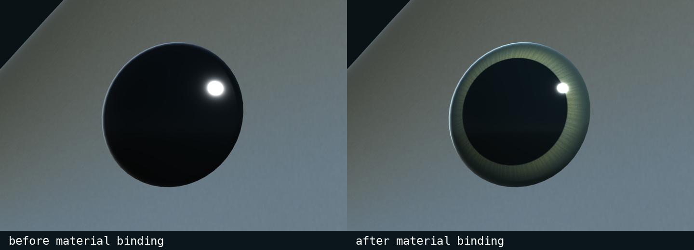
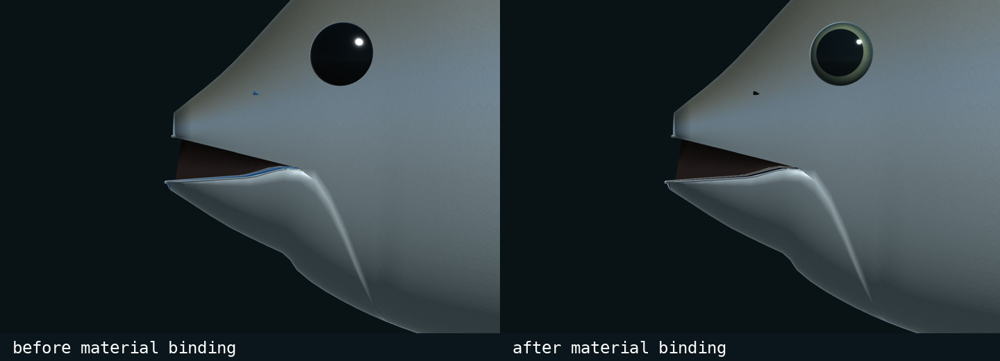

# 鳃缘导入实图与材质绑定修复

实际Metal图发现新鳃缘FBX导入后虹膜全黑、嘴缘和鼻部发蓝，鳍面也使用了错误材质。源网格和PNG保持不变不等于画面正确：子网格文件ID不变，但导入材质顺序改变，已保存prefab仍沿用旧数组。

局部导入路径现在从当前FBX取得对应三LOD的材质数组，保持其他prefab内容。独立检查在修复前失败，修复后通过三个LOD；首次补丁变量重名编译失败保留并更正。实际差异只有三个材质数组重排，其他prefab字节完全相同；源Blend/FBX、九PNG、七套运行时动作与图鉴几何包络保持，包络仅更新prefab输入摘要。1297份原文件中1290份逐字节不变，另外七份分别为导入器、prefab、包络、资产登记、QA入口、截图命名及开发者模式确认返回；截图区分正常/测试模式，防止同阶段重复入口覆盖原图；切换成功后的上级返回经独立红测，修复为回首页而不是旧确认页。

修复后84项Editor、5项定向PlayMode通过，包含开发者模式的零积分全内容、隔离正常文件、场景重载与保存失败，以及实际七动作、世界和图鉴取景。iOS目标Metal实际运行时七动作、三LOD、两侧、05%/50%/95%采样共126个离散视角、252张首/重原图，像素差全为0，鳃缘顶点最小视口余量20.775%。这些是强制LOD的头部诊断，不能代替自动LOD、连续自然游动、真实Player或最终美术验收。

下图为相同网格、贴图、相机和姿态，仅修复材质绑定；左旧右新。图像只作缩放和文字标注，没有修饰或调色。

[修复后全鱼](../art/previews/bluefin-gill-import/after-idle-side.png) · [张口](../art/previews/bluefin-gill-import/after-bite-side.png) · [鳃缘近侧](../art/previews/bluefin-gill-import/after-gill-near.png) · [另一侧](../art/previews/bluefin-gill-import/after-gill-opposite.png)。

[LOD0近侧总览](../art/previews/bluefin-gill-import/lod0-near.jpg) · [另一侧](../art/previews/bluefin-gill-import/lod0-opposite.jpg) · [LOD1近侧](../art/previews/bluefin-gill-import/lod1-near.jpg) · [另一侧](../art/previews/bluefin-gill-import/lod1-opposite.jpg) · [LOD2近侧](../art/previews/bluefin-gill-import/lod2-near.jpg) · [另一侧](../art/previews/bluefin-gill-import/lod2-opposite.jpg)。六张总览覆盖126姿态，另已看原尺寸与两幅对照；18份自产媒体登记MIT，原图/重复帧和日志本地保留。

原生模拟器新包正在准备。此前639144a的空间拒绝仍为历史事实，不能用旧App结果证明当前材质修复；当前原生、TestFlight与实际安装结果另记。模型仍为prototype，完整拟真、科学/用户A1–A3、儿童和双真机20分钟未通过，完整产品与apply继续PARTIAL。

[材质红测](../ispec/changes/product-technical-foundation/measurements/bluefin-gill-binding-red.json) · [修复后检查](../ispec/changes/product-technical-foundation/measurements/bluefin-gill-binding-green.json) · [126视角](../ispec/changes/product-technical-foundation/measurements/bluefin-gill-seven-motion-gpu-a.json) · [源保护](../ispec/changes/product-technical-foundation/measurements/bluefin-gill-source-protection-b.json) · [返回页红测](../ispec/changes/product-technical-foundation/measurements/developer-mode-back-route-red.json) · [修复后返回页](../ispec/changes/product-technical-foundation/measurements/developer-mode-back-route-green.json)。
