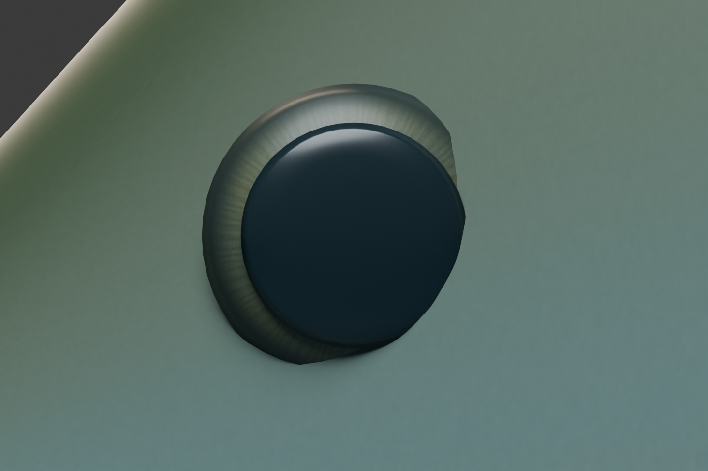
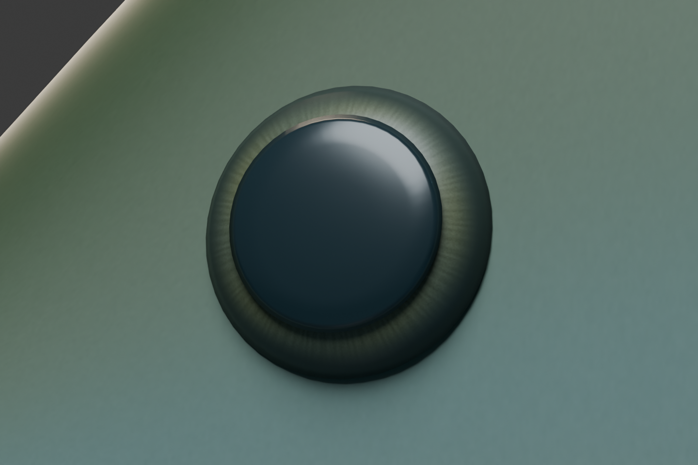
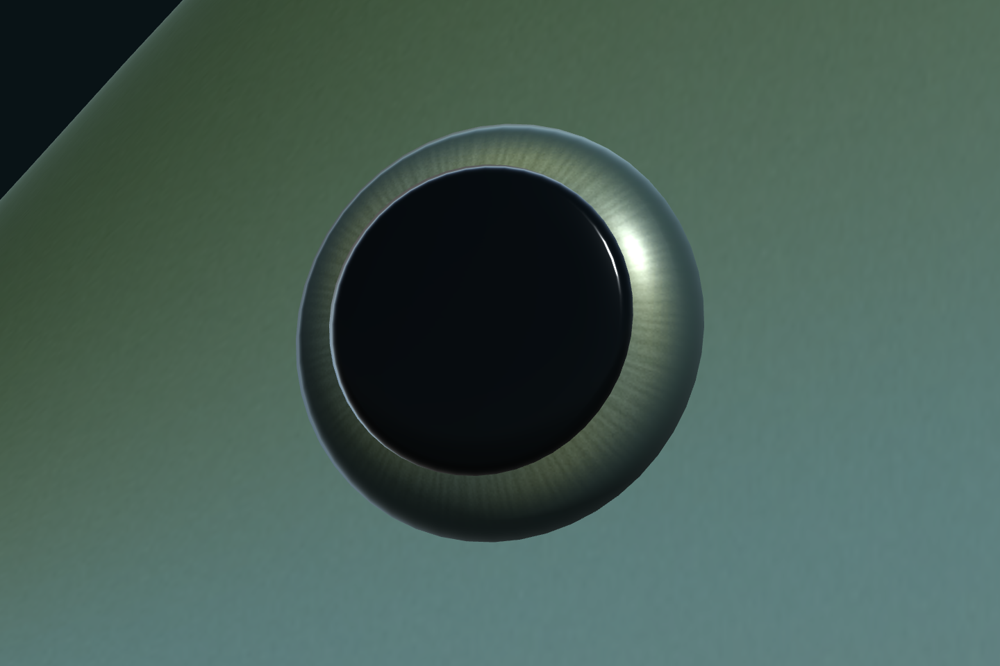
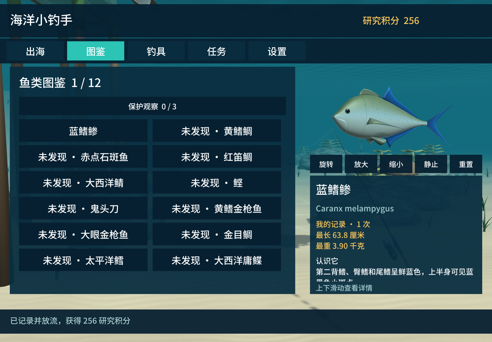
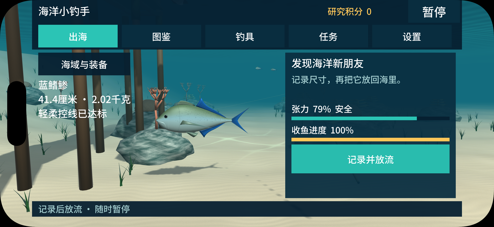

# 蓝鳍鲹虹膜与眼部候选

**本轮改进眼部纹理、轮廓和贴合；完整美术与产品仍 PARTIAL。** 当前仅修改既有英雄鱼，没有据此批量生产其他鱼种。运行时玩法源码未改变，旧版双模拟器20轮证据仍绑定原冻结提交，不能代替本轮新模型的原生画面。

## 改动与实际否决

新增原创256×256径向虹膜色图，眼球正面使用独立投影UV，保持六个材质槽、12骨骼和七动作。减小虹膜/瞳孔突出深度，把球体极轴转向眼球浅深度，以48段周向边改善近景轮廓；两眼沿实际鱼颊法线摆放，避免浅瞳孔陷入后侧变宽的脸颊。色图源PNG为69,342字节，不据此推断实际GPU内存或真机成本。

首个近景仍有折角，未接受。加密到31,004三角面的方案触发既有25,000预算失败，未放宽阈值；停止其只读渲染时SIGINT无效，核实本次子进程后SIGTERM终止，非零回执保留。改为48×8眼球后面数合格，但双侧实图发现瞳孔被鱼颊遮挡，仍否决。最终调整方向与位置后，两侧棚拍及Unity近景未再见该缺口。

| 实际否决的鱼颊遮挡 | 最终保存源文件的眼部 |
|---|---|
|  |  |

最终三LOD为24,860 / 9,944 / 3,728三角面；LOD0比上一候选24,284增加576，约2.37%。保存Blend的独立检查确认实际贴图、sRGB、双眼UV覆盖、头骨权重、预算及既有35动作姿态检查通过。没有通过放宽预算或删除口腔/鳍片来换取眼部细分。

## 画面与验证范围

八张当前棚拍图（四方向、口、鳍、两眼）与十张导入后iOS目标Editor Metal图均逐张审阅。导入虹膜实际宽256；闭口/张口的首次与重复RGB差都为0，口内材质仍单面剔除。棚拍AgX和Unity Gamma照明不同，不把跨渲染器色差当成生物实测颜色。

当前52项Editor、12项PlayMode全部通过，后者实际包含20轮钓鱼与三观察，3,446分、382.491秒、零失败；是无画面测试。原请求的排除正则也匹配祖先套件，因此没有排除长流程，按最终XML的12项记录，不能写成11项定向检查。36方向转台已以接触表检查，编码960×640、12fps、3秒并核对解码36帧；这是素材视频参数，不是游戏帧率。

[查看转台视频](../art/previews/bluefin-iris/turntable.mp4)

## 新原生模拟器与窗口操作

冻结源码`fd23c2bae9a8f08d5f2944f50124b5c95f662d05`，摘要`c33f259e91ba24c866c68393a2ae6ae5dcbd22eecc44f64b9a9431ed0aca6e54`。Unity irisa导出与Xcode ARM64编译通过；iPhone/iPad安装同一App，摘要`b3181ad7d66744d35f3884531d2bfcf5ed21cf722117f78476c9d52cfe3e5bf4`。安装后逐文件核对，没有卸载/清档；临时Simulator SDK设置前后SHA一致。该包沿用配置0.1.0 (5)，属于本地unsigned Development模拟器产物，与a6bcf8e的TestFlight build 5分开。

| 新包检查 | iPhone 17 Pro Max / iOS 27.2 | iPad Air 11 M3 / iPadOS 27.2 |
|---|---|---|
| 自动EventSystem单轮钓鱼、记录放流与多页检查 | PASS，1条、180分 | PASS，1条、256分 |
| 当前游戏原图 | 16帧生成，全部经接触表检查，另4张原尺寸检查 | 16帧生成，全部经接触表检查，另3张原尺寸检查 |
| Metal、原生/URP 4×MSAA、HDR保留 | PASS | PASS |
| 更新后旧QA进度 | 原20条、3观察、3333分仍在 | 原20条、3观察、3444分仍在 |

本轮没有重复宣称新包完成双端20轮原生流程，旧20轮仍见[原冻结版本记录](continuous-journey.md)。上述单轮自动检查包含海湾水上/水下、反射、卷线器演示、图鉴滚动、任务、设置与暂停返回，不能把程序派发的EventSystem称为系统触摸。

另用Device Hub窗口的真实鼠标输入，在独立空QA进度中完成抛竿、咬钩后点击提竿、按住收线、收鱼及记录放流。实际界面从0到205分；磁盘只有一条唯一已放流鱼获，奖励205与总分一致，校验和有效。重新启动不同进程，显式使用同一QA存档根，实际主界面仍为205分、Ready。收鱼、放流与重启原图另逐张检查。这是Agent操作、初学辅助开启，计时126.608秒还包含取证和工具间隔，**不能当作儿童首鱼3分钟或实体触摸验收**。

| iPad新模型图鉴 | iPhone手动收鱼 |
|---|---|
|  |  |

旧进度回查曾因历史绝对容器路径失效而非零退出；重新通过Bundle查询当前数据容器，在原相对QA路径找到了原文件，两端校验和、唯一20条、3观察及3333/3444分合计均通过。未重建或恢复这些记录，初次失败保留。最终仅手机QA模拟器保持Booted并显示新包205分测试进度，iPad保留数据关闭；个人手机及TestFlight未变。

仍需改进：光滑瞳孔和高光有样板感，嘴缘/鼻部造型仍待审阅，其他鱼种及保护生物仍有A0形体，海域/钓具库未全部达到完整模型标准。A1–A3、科学/用户审阅、真实系统触摸、儿童首次上手和双真机20分钟均未通过。本轮不上传TestFlight、不操作个人手机。

## 来源与记录完整性

身体与鳍色继续参考[澳大利亚博物馆物种说明](https://australian.museum/learn/animals/fishes/bluefin-trevally-caranx-melampygus-cuvier-1833/)的灰铜色、蓝黑斑和蓝鳍描述。该机构图片访问403，另一机构页面超时，未复制或绕过访问；虹膜色值、深度和尺寸为作者的美术选择，不声称由这些来源精确测量或科学认可。

本轮曾并行运行两条iSpec测量，触发本机非profile CLI直接写状态文件的竞态：部分写入被读作损坏状态，完整历史短暂退化为只有新回执的文件。已保留损坏副本，从最后已提交的682条测量恢复历史，合并实际幸存的两条完成记录，未编造缺失启动记录。两条孤立完成记录及另九条仅能由本地工具输出佐证的新测量明确保留审计缺口。最终构建/源验证/导入/Editor/渲染已改为串行重跑，今后本项目测量及状态修改串行执行。独立receipt审计仍 INCOMPLETE，不能将恢复历史或后续PASS称为整个审计通过。

结构化结果见[本轮回执](bluefin-iris.json)。2.4、3.4、4.1–4.3及apply继续未完成，master保持稳定。
