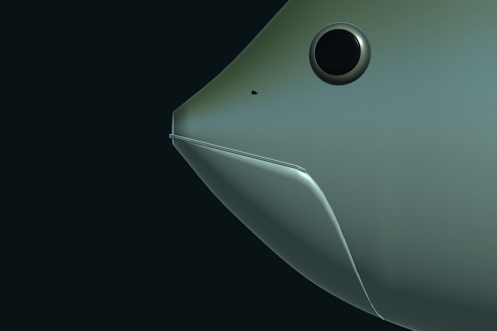
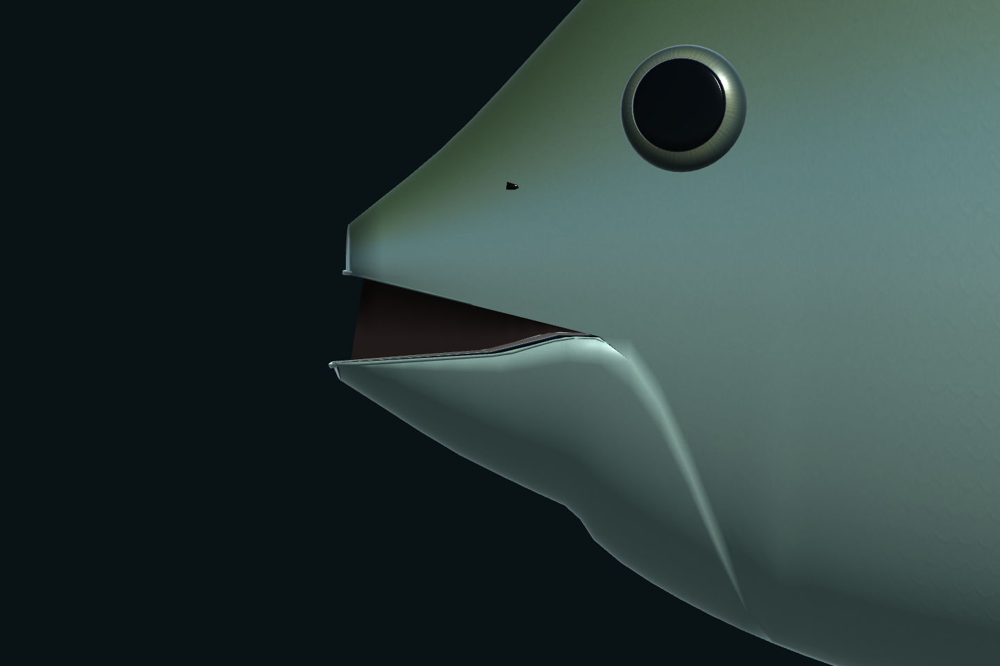
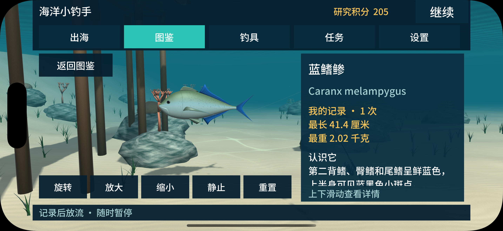

# 蓝鳍鲹嘴角与下颌皮肤连续性

**嘴角漂移和后颌分离边已修复；完整美术与产品仍PARTIAL。** 本轮只改既有英雄鱼源模型、制作工具和独立网格检查，没有改玩法，也没有据此批量制作其他物种。

## 实际问题与修正

原模型用圆管表现上下唇，嘴角仍有约88.7%的下颌权重，咬钩/挣扎抽样中移动0.004756源单位。后颌下巴的采样与鱼头不同，叠加很薄的补面，但没有真正接合。新增检查在原冻结模型和第一个中间候选分别复现嘴角漂移及后颌46条开放皮肤边；非零回执保留。

唇缘改为浅截面并向嘴角收细，嘴角提前平滑过渡至头骨。下颌沿用鱼头0.02源单位的环间距，在真实嘴角后方焊接皮肤，移除原来的重叠薄补面；前方开口仍分开，下唇继续跟随下颌。保留单面剔除和口腔纵深。

| 同镜头修正前闭口 | 修正后闭口 |
|---|---|
|  |  |

| 同镜头修正前张口 | 修正后张口 |
|---|---|
|  |  |

独立读取实际保存Blend：24个嘴角皮肤顶点的最大下颌权重约0.000000406，七动作×五姿态的嘴角漂移为0；检查区域内220条皮肤边中开放边为0。此项只覆盖明确的后颌区域，不能称整个模型全部封闭或所有连续时刻都已验。8个前下唇检查顶点仍100%绑定下颌，张嘴下移约0.060605源单位，口腔纵深约0.224，内壁侧向射线和朝向检查通过。

三LOD为24,664 / 9,864 / 3,698三角面；LOD0比上一眼部候选少196，仍低于25,000。保持六材质、12骨骼、七动作，六张PNG源贴图与上一提交逐一同哈希。证据分别覆盖实际几何、权重和画面。

## 验证范围

当前保存源网格验证及Unity导入通过。iOS目标Editor Metal十帧经接触表检查，其中闭口/张口侧面和口部四张另看原尺寸；首次与重复绘制RGB差均0，导入下颌实际转动18.0368度，口内仍单面剔除。八张棚拍、张口双侧和正前方共十一张原图逐张检查。当前36帧转台经接触表检查，编码960×640、12fps、3秒并核对实际解码36帧；这些是素材视频参数。[查看当前转台](../art/previews/bluefin-jaw-continuity/turntable.mp4)。

本轮定向Editor材质生命周期1项、PlayMode导入release动作/暂停尾骨1项通过，实际XML均为1项。上轮52项Editor/12项完整PlayMode属于上一冻结源码，结果保留；本轮没有重复标为新全量52/12。

## 新原生模拟器

源码冻结`72f0cea47cdfc46be4f402908777ff750ed36b10`，摘要`dd16ff57c9f50741a38d51eb3b379babd03ae28f4cee9a0b0b892fd82b03ed10`。Unity jaw20261124a导出和Xcode ARM64编译通过，临时SDK设置SHA恢复一致；两端安装后逐文件核对同一App，摘要`911c4376f690c9b196d30d1c0ffff3b5d31efbbbcbc24a3a367e8850c2bb5212`，未卸载/清档。包沿用配置0.1.0 (5)，属于本地unsigned Development模拟器构建，与a6bcf8e的TestFlight build 5分开。

iPhone 17 Pro Max / iOS 27.2及iPad Air 11 M3 / iPadOS 27.2各一次自动EventSystem钓鱼、放流与多页流程PASS，分别187和186分，各一条鱼获。32帧通过接触表检查，手机收鱼和平板图鉴两张另逐张原尺寸审阅。Metal、原生/URP 4×MSAA及HDR保留。两端原生20轮及本轮之前的52/12全量测试仍按各自原冻结版本留档，本轮没有冒称重跑。

手机用新进程显式加载原手动QA存档，实际主界面显示205分；OS鼠标打开图鉴及蓝鳍鲹详情后，仍为一条原记录、205分，并显示新模型，原尺寸游戏截图另经审阅。这个操作只验证恢复与模型入口，没有新增手动鱼获。

更新前保存了三份原QA文件摘要；更新后两端20条/3观察的3333和3444分，以及手机一条/205分，原文件SHA256逐字节一致，校验和、唯一ID、released及积分合计通过。重新查询当前容器曾90秒超时，保留失败回执；随后使用本轮成功安装/启动时已核实的映射，检查MCM容器归属与实际文件，完成只读比较。未重启设备、重新安装或重建这些记录。手机窗口留在新模型图鉴；个人手机和TestFlight未变。

下颌仍有较强明暗过渡和样板造型，鼻端、口内细节及整体生物比例还需继续打磨；本报告不宣称拟真美术A1–A3、科学或用户审阅通过。其余鱼种/钓具、完整海域/18任务实玩、儿童首鱼和真实双设备20分钟仍未完成。

## 参考与复核

参考了日本国立科学博物馆的[蓝鳍鲹物种页](https://www.kahaku.go.jp/research/db/zoology/Fishes_of_Andaman_Sea/contents/carangidae/18.html)。其照片由Seishi Kimura拍摄，标本标准体长18.8厘米；仅在本地查看，不再分发、不采样到贴图，也不将较小标本的颜色或二维图像当成成鱼的精确三维尺寸。本文嘴角位置、权重和截面是作者的制作选择，未获科学人工确认。FAO文件读取过大、Smithsonian页面超时，不据此声称已审阅其完整原图。

可用`tools/art.py review --mouth-only --motion bite --frame 16 --label <新标签>`生成双侧和正前方口部图。该选项限蓝鳍鲹静态review，不能与eyes-only/turntable混用。每次测量和Unity作业串行执行，保留失败及唯一标签；既有iSpec记录缺口仍见[上轮说明](bluefin-iris.md)，独立receipt审计未关闭。

结构化测量和图像摘要见[本轮记录](bluefin-jaw-continuity.json)。2.4、3.4、4.1–4.3及apply保持未完成，master不变。
