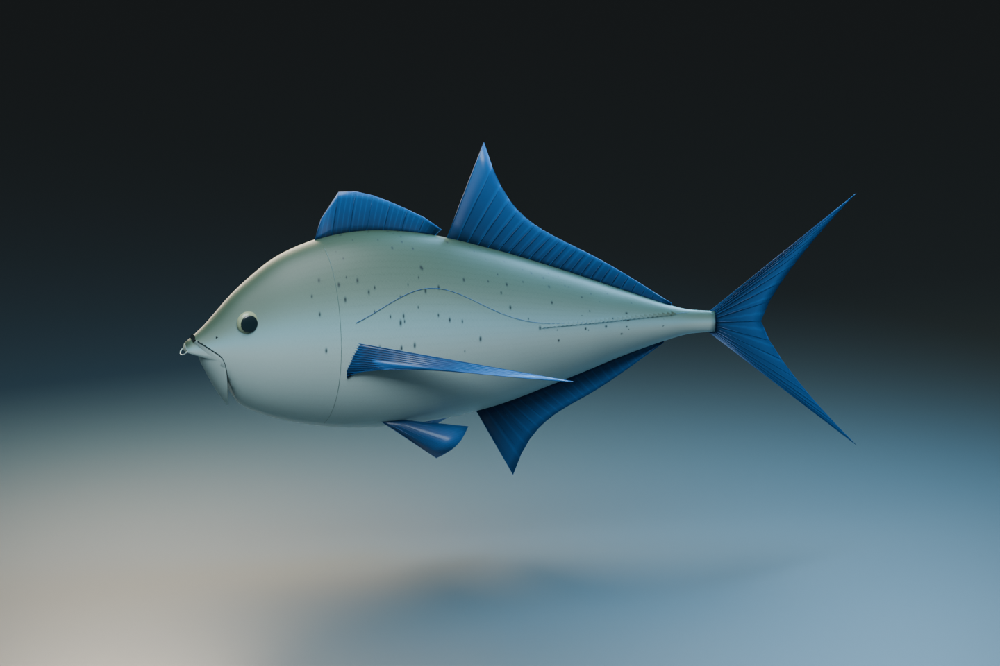
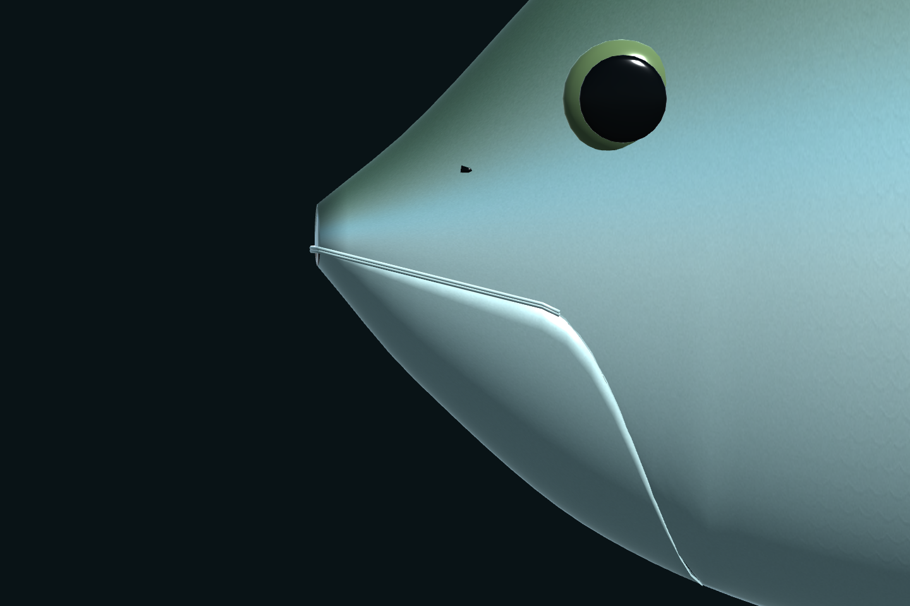
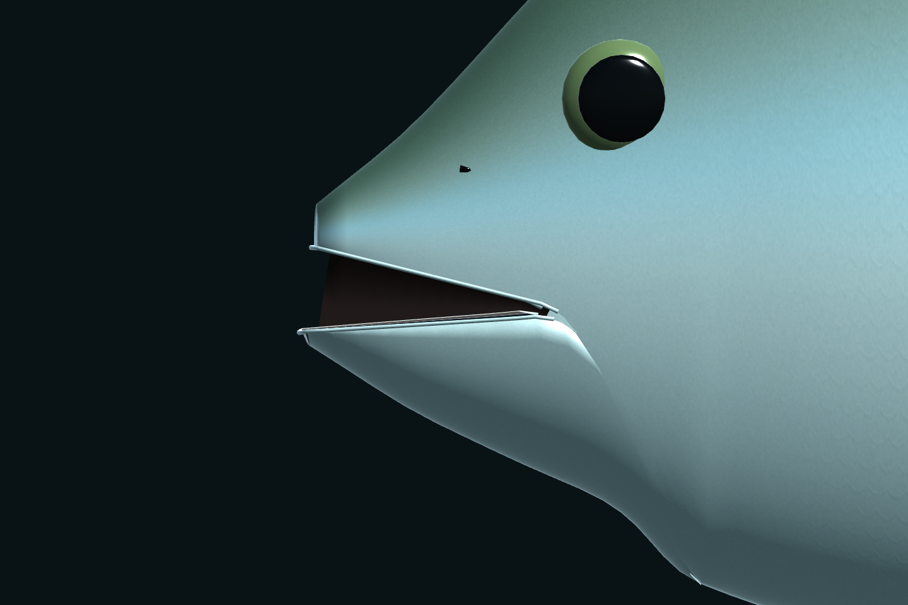
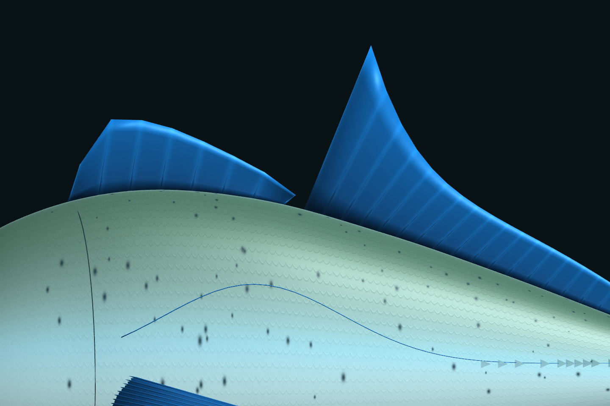
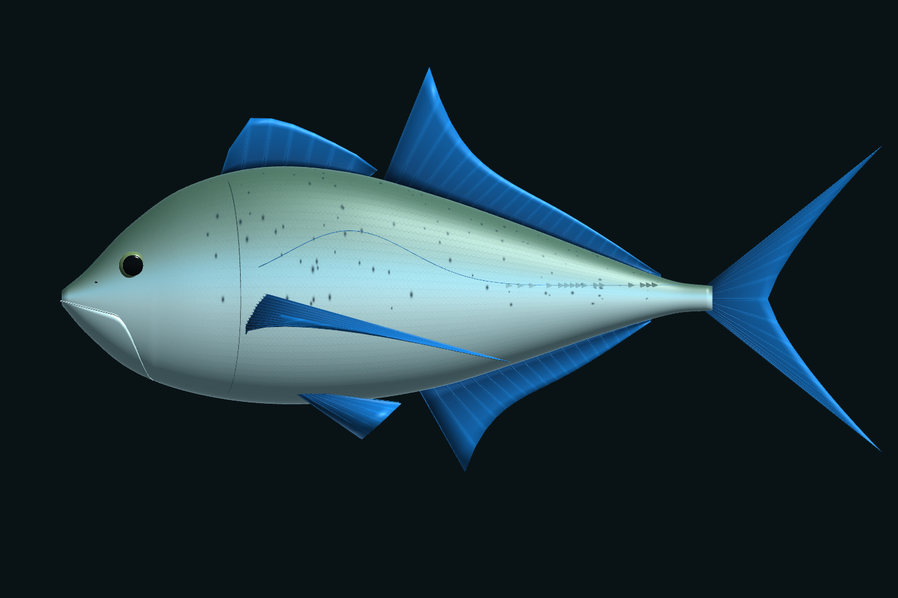

# 蓝鳍鲹口部、下颌方向与鳍条

2026-11-24。本轮修复英雄鱼候选的可见下唇绑定、下颌转轴/方向、口内结构和鳍膜贴图对应关系。源码、保存模型、Blender工作室和Unity导入资产的离屏GPU分别检查；当前玩家窗口和真机未通过，A1–A3、科学及用户审阅仍未完成。

## 实际问题与行为

原模型的整圈口唇绑定头骨。虽然下颌骨在咬钩动画里转动，保存模型的前下唇76个检查顶点平均下颌权重为0、实际位移为0。拆分口唇后，近景又暴露旧头部盖面遮住口内、颌后裂缝，以及下颌向上转入头部的问题。原转轴还带有横向分量；仅检查骨骼角度或位移绝对值会漏过方向错误。

现用独立上下唇和下颌/头骨混合权重，重新切分前部头网格，补充颌后连接皮肤。下颌轴校正后，下唇在采样咬钩中实际向下约0.06073源单位米，横向漂移约6.3e-9米；这些只是源模型的指定动作结果，运行时会随鱼长缩放，不是生物力学或真机性能结论。

口腔改为有纵深的内壁、喉壁和内侧颊壁，内表面朝向口内。Unity保留单面背面剔除，没有用双面材质掩盖反向几何。保存模型的张口姿态中，侧向射线命中朝内壁面，排除直接透过侧面看见背景；实际GPU近景再单独核对。

鳍膜原先将固定23道纹理铺在所有鳍上，和各鳍实际几何不一致。现每个膜段对应一个鳍条间隔，保留面角UV；鳍条沿膜面曲线延伸，膜厚向两侧对称，减少几何被膜面遮蔽产生的闪点。八棘第一背鳍与23条第二背鳍等是当前候选的制作设定，不能由工程计数推定科学人工验收。

## 参考与限度

口部位置的制作交接参考[FAO旧版物种识别页](https://www.fao.org/4/e9163e/E9163e1i.pdf)第5页：成体上颌延伸到眼前缘附近。蓝鳍及背侧斑点继续参考[澳大利亚博物馆](https://australian.museum/learn/animals/fishes/bluefin-trevally-caranx-melampygus-cuvier-1833/)。这些资料用于自行建模，没有复制或再分发其照片/插画；旧FAO的命名署名和现代目录不同，游戏仍采用已登记的现代学名，不据旧资料推断当前保育/法律状态。口腔和鳍的建模简化仍需科学审阅，不能据本文称为完整解剖复原。

## 检查范围

保存源文件独立检查实际权重、35个动作姿态下的鳃缘贴合、咬钩下唇方向/横向漂移、口内深度/朝向及射线、背部UV跨接缝、三LOD有限UV/归一权重和面数预算。首轮刚性口唇、内壁反向、UV跨幅与4个越界面角、反向下颌和横向扭转的失败均保留；没有放宽门槛。

Unity新增`fish-review`隔离诊断入口，读取真实prefab、材质和导入动作，用官方[AnimationClip.SampleAnimation](https://docs.unity.com/en-us/engine/6000.0/script-reference/unityengine/animationclip/sampleanimation)采样；每个姿态新建renderer，保留首次离屏绘制，再捕获同姿态后续侧面、嘴部和鳍部。初次工具误选到preview clip导致失败，改为和正式构建入口一致地排除preview clip，仍要求唯一正式动作。

首次隔离绘制曾出现眼睛/鳃缘颜色异常，重复相同镜头后正常。显式调用原来的克隆材质初始化、等待两个真实Editor更新均仍失败；两次失败回执及原始首图保留。现将正式表现路径改为按renderer的子材质索引设置MaterialPropertyBlock，复用只读共享材质，不再克隆。最终闭口、张口的首次/重复绘制RGB归一化平均差均为0；工具明确要求差值小于0.00001，不能用后续正常图替换失败首图。这个结果只证明本隔离场景中的修复，不能据此归因于普遍的引擎缺陷或证明玩家启动正常。

30项Editor检查通过，新增回归覆盖颜色恢复、重复初始化、释放及重新初始化，确认源材质不被修改、没有实例材质增长；7项无画面PlayMode和Mac编译通过，最终工程源码摘要保持一致。GPU当前六张近景和两张首图逐张检查，源模型六张静态图、两张咬钩图及转台四个代表角度分别审阅。转台保存36帧、960×640、3秒完整动作周期；编码与实际解码帧数单独核验。

MaterialPropertyBlock会使相关renderer不使用[SRP Batcher](https://docs.unity.cn/6000.0/Documentation/Manual/SRPBatcher.html)，这是明确的性能取舍；未修改全局batcher开关，移动端CPU/GPU成本仍须测量。离屏图不能代替游戏UI、后台/暂停、实际触控、真机预算或美术人工验收。

实际当前结果、源码身份、测量ID和保留的失败见[脱敏记录](bluefin-mouth-and-fins.json)。原始日志/完整隔离数据仅在本机。Mac桌面工具本轮明确返回锁定状态，原生窗口须手动解锁后再验证；没有重复启动先前超时的窗口流程。

原源模型的咬钩姿态：

当前保存源模型的相同相机/动作时刻：

当前Unity导入资产的闭口/张口近景（离屏诊断，不含玩家UI）：

修复前的首次离屏异常与当前同姿态首次绘制，分别保留原始图：

这些图片均为原始渲染字节，未裁切、修图或重画。[完整周期源模型转台](../art/previews/bluefin-anatomy/turntable.mp4)与四角/近景按MIT登记；旧目录保留历史快照。

模型的鳞片/硬鳞亮点、眼部观感、偏亮唇缘、口部局部衔接和整体自然程度仍待改善、人工及真机审阅；其他11鱼种、钓具/海域与观察生物亦未全部制作。TestFlight 0.1.0 (2)仍冻结于2971b11，不含本轮修改。
