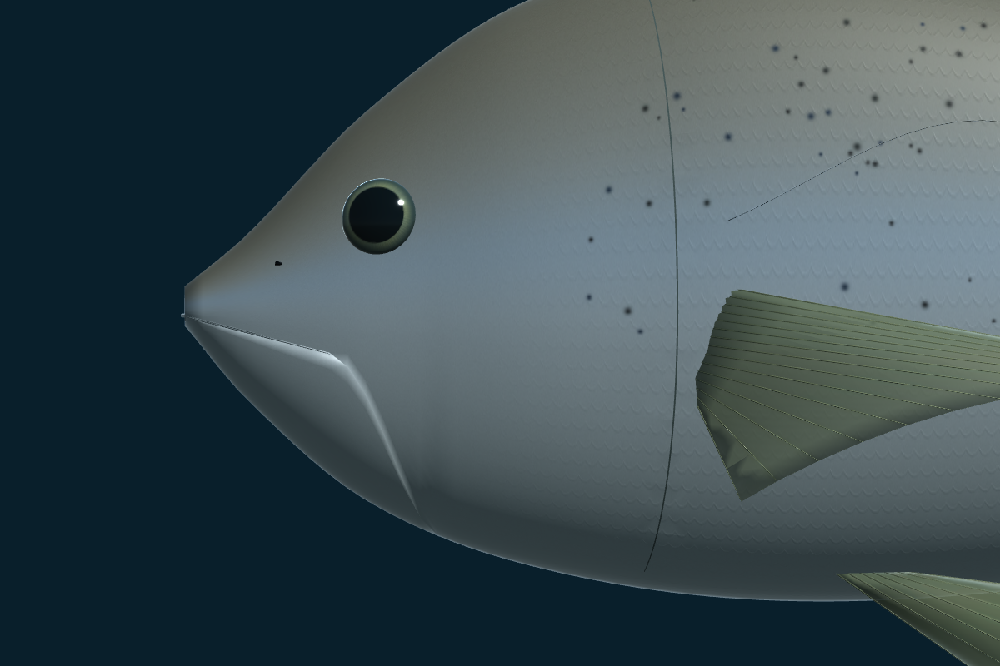
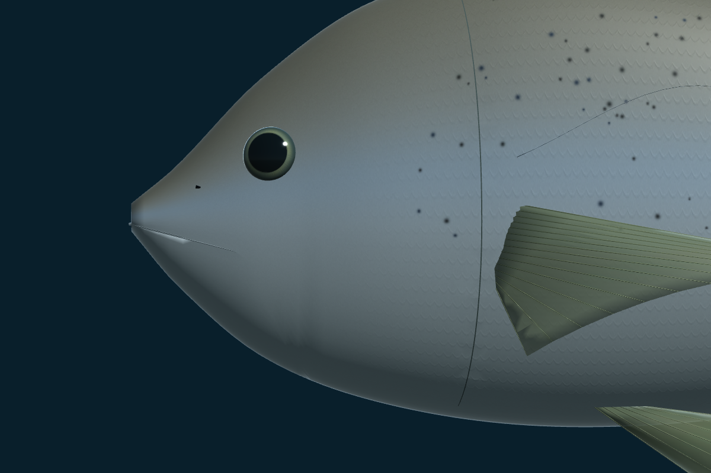
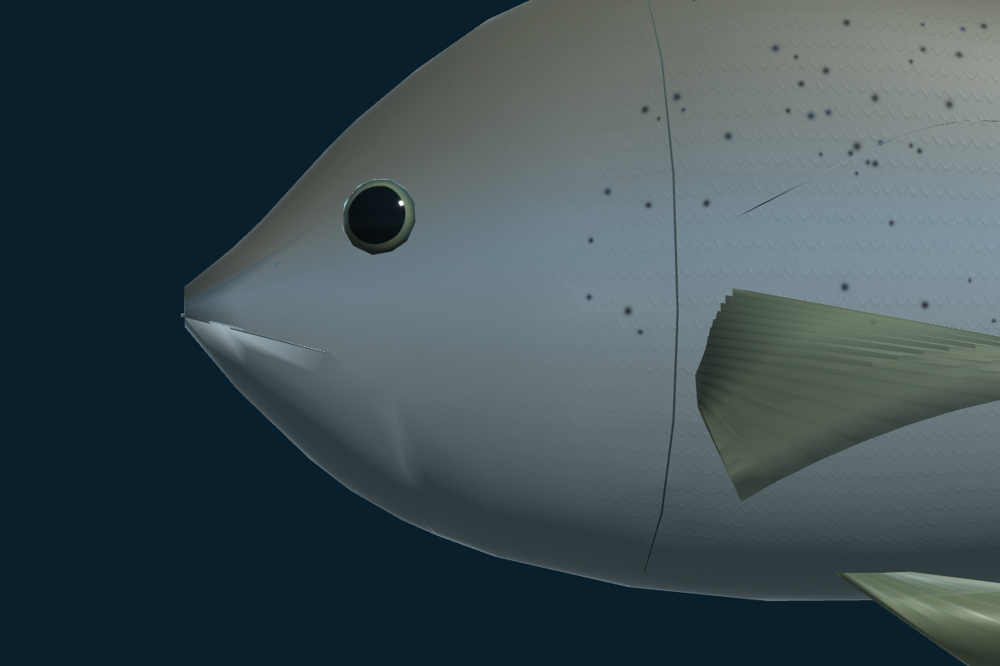

# 英雄鱼嘴角：内部面修正，整体仍未验收

当前仅完成内部盖面／法线的局部工程修正。高精度模型嘴角后方向下颌延伸的白色折痕已消失；LOD1／2仍有嘴角亮斑和表面棱角，鳃缘仍像细线，整体材质与解剖尚未达到拟真标准。**美术及完整产品保持 PARTIAL。**

保存源每档只删除五个隐藏内部盖面，分离剩余盖面与皮肤的平滑法线；保留面的坐标、绕序、UV和权重精确保持，十六骨／七动作的独立曲线快照一致。三档24739／10679／4899面，原25000近景预算未放宽；327份其他源／导入／模型文件与原dddb153的Git blob逐字一致，含九PNG和七份运行时动画。prefab只跟随实际导入顺序交换一个LOD的两个材质槽；实际图鉴包络重新生成并绑定新哈希。

190项保存源检查、88项Editor及五个独立根目录Play用例通过，包含开发者模式、完整世界、图鉴取景、分层导航和水面生命周期。两套各12近景／60图均为实际iOS目标Medium、Metal、HDR四采样，全部首／重逐像素一致。关闭法线贴图／高光仍出现旧折痕，说明不能仅调材质来隐藏内部拓扑问题；这些私有诊断材质未进入Player。旧三面共享边红测和首次Editor87／88包络过期失败均保留；后者真实重建后再验证；随后资产登记的旧哈希也被静态检查发现并同步，失败均保留，没有削弱检查。

## 已审阅的真实画面

以下为同姿态的原生产模型与当前候选；灯光、镜头、贴图和动作不变。诊断相机有意裁切鱼体，只能用于头部审阅，不能证明全鱼取景合格。

六张接触表覆盖两侧、三个LOD与swim／bite；已查看全部六表与选定原图。加上已审阅的八张原生原图，公开二十份本游戏自有媒体，没有修图或复制第三方照片。低档残余问题明确保留；源只读后续检查确认目标区域已无皮肤／盖面共享顶点，仍须继续处理较低LOD的皮肤表面与法线。

## 安装与范围

冻结1615a96／游戏工具摘要d249364f／App摘要54459264的新ARM64本地模拟器包，同包双端各三次独立进程／58PNG，手机464／平板467检查与十八个海域／四向模型视图通过；248份既有存档字节保持。手机／平板测试积分195／205分，各一条真实测试鱼获／三项观察，关闭后正常仍零分且主文件与备份不变。已查看十二张原生接触表（116PNG总览）及八张选定原图，唇角仍有小亮斑，整体美术PARTIAL；不代表OS触控、真机、儿童或最终美术验收。

本次没有更新个人iPhone或App Store Connect。此前TestFlight9已包含开发者模式，其二进制仍按原冻结记录，实际TestFlight来源安装未由本轮确认。近景重复稳定不能覆盖此前真实场景首次绘制111像素差异；该项继续开放。没有重跑上轮普通模式20／26轮成长，也不把旧成绩归给本源码。

源与Editor管线使用8GiB共享存储门禁，静态／保留收尾2GiB；新的原生完整管线通过14GiB共享门。复用稳定导出和原生缓存，保留当前与上一2ac完整原件；较旧2f生成原件先归档，再真实解压验证字节／权限／链接后才移除其旧原件，源码、日志、存档和发行包保持。本地归档不是独立备份。没有降低硬保留线、伪报预算、绕过编译路径或删除其他任务租约。

用户／科学／儿童、A1–A3、OS触控、双真机20分钟、最低系统与完整产品仍未验收；2.10及apply继续开放，独立历史审计仍INCOMPLETE。见[方案](../docs/50-bluefin-mouth-surface.md)及[本次范围回执](bluefin-mouth-surface.json)。

本增量39条测量均已结束，3条非零保留（含预期红测）；旧1826对象／回执哈希、新绑定与串行检查通过，B审计的自身回执随后以0结束。正式历史审计仍INCOMPLETE。收尾实测空闲179.23GB，低于200GB日常目标；该数值与其他作业预留、120GiB硬线及构建可用余量分别判断，没有为了本任务清理其他项目。
