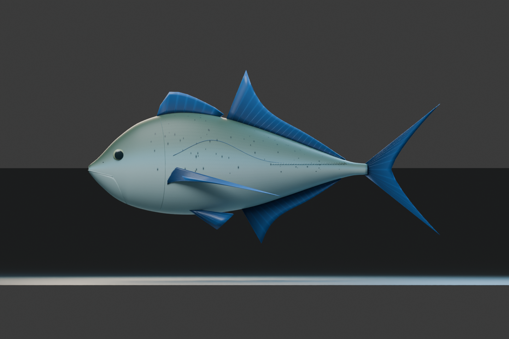
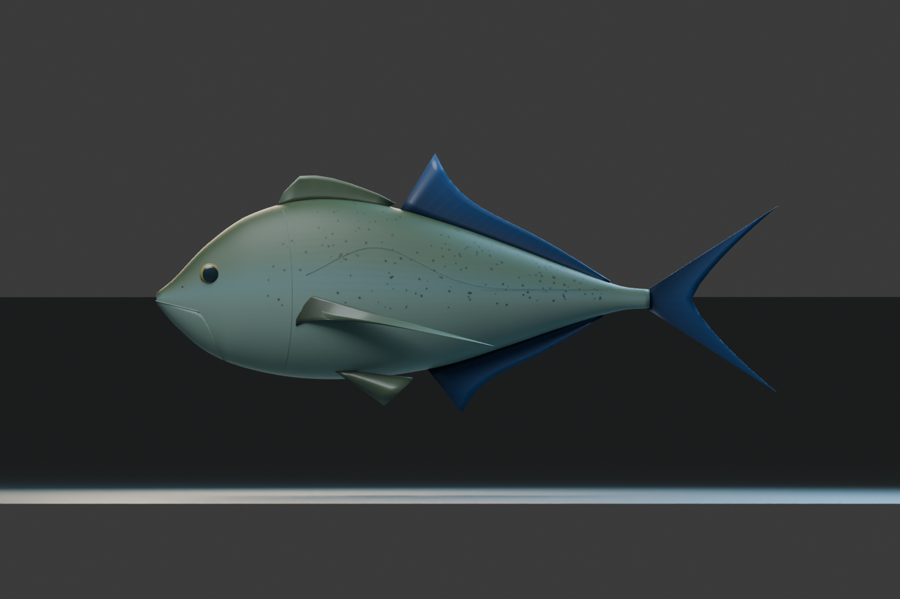
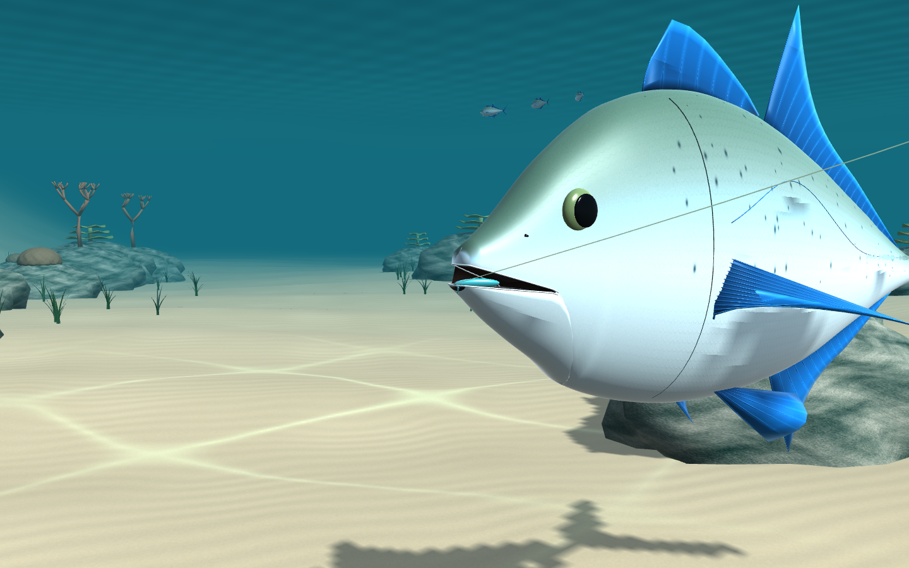
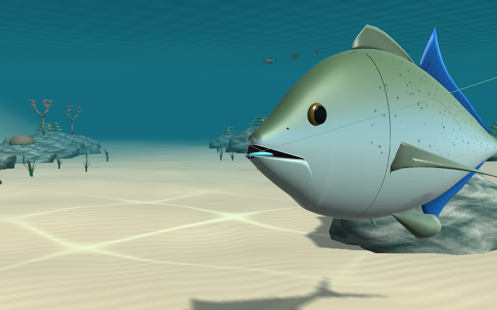

# 蓝鳍鲹鳍色、比例与水下表面

2026-11-24。实现 IMPLEMENTED，完整产品/美术 PARTIAL；科学、用户与真机验收未通过。保存源资产、导入资产、Editor Metal、Blender工作室及真实设备分别取证，机器回执见[JSON](bluefin-palette.json)。本轮仅迭代已有英雄鱼，没有把其他样板算成完整物种。

## 对照与依据

[澳大利亚博物馆](https://australian.museum/learn/animals/fishes/bluefin-trevally-caranx-melampygus-cuvier-1833/)描述灰至黄铜色上半身、蓝黑小斑与鲜蓝色第二背鳍/臀鳍/尾鳍；另经浏览器查看[Museums Victoria／Fishes of Australia物种页及摄影参考](https://fishesofaustralia.net.au/home/species/1652)。照片只用于观察，没有下载、嵌入贴图或纳入开源资产。以下原图全由本项目模型渲染，尺寸/色值是美术选择，不是机构提供的生物测量或反射率。

| 原候选工作室侧面 | 当前候选工作室侧面 |
|---|---|
|  |  |
| 原水下近景 | 当前水下近景 |
|  |  |

当前水下图为1440×900的Editor离屏场景，没有玩家UI，不是iPhone/iPad截图。[四角图](../art/previews/bluefin-palette/studio-three-quarter.png)、[俯视](../art/previews/bluefin-palette/studio-top.png)、[正视](../art/previews/bluefin-palette/studio-front.png)、[360度转台](../art/previews/bluefin-palette/turntable.mp4)、[收鱼全景](../art/previews/bluefin-palette/bay-07-landed.png)与[鉴赏位置的反向视角](../art/previews/bluefin-palette/bay-inspect-180.png)分别保留。

## 修改

- 皮肤改为灰银/灰铜层次，降低原偏亮鱼腹，减弱清漆与鳞纹的颜色对比；增加蓝黑斑，并按圆柱UV的局部尺度补偿斑点拉伸。首版过暗，保留[被否决的水下候选](../art/previews/bluefin-palette/rejected-dark.png)，再调回中间亮度。
- 第一背鳍及成对鳍使用灰铜区域，第二背鳍/臀鳍/尾鳍保留蓝色；两色共享同一张1024×512鳍纹理及原有六个材质槽。第一背鳍、第二背鳍/臀鳍及尾叶高度收敛，鳍条变细；侧线改随皮肤色，后部硬鳞贴合曲面，减弱突兀高光。
- 近景块状明暗通过[原阴影对照](../art/previews/bluefin-palette/shadow-before.png)、[关闭鱼投影的诊断](../art/previews/bluefin-palette/diagnostic-no-cast-shadow.png)、焦散/法线开关及阴影偏移网格定位。只提高分辨率/改软过滤未消除，部分偏移组合加重问题，未作为最终设置。
- 当前保持1024主光阴影图和单级联，阴影距离24米，Low软过滤、深度偏移2、法线偏移0；鱼仍投射并接收阴影。当前咬钩近景及鉴赏位置四方向采样未再看到那组块状缺陷，不等于所有动画/光照/设备均已通过。[Unity URP设置说明](https://docs.unity.cn/Packages/com.unity.render-pipelines.universal%4017.0/manual/universalrp-asset.html)及本机固定版本17.3源码分别核对；Low为4次PCF采样。

颜色图按sRGB、法线/粗糙度等按Non-Color处理，参考[Blender图像色彩管理](https://docs.blender.org/manual/en/5.3/editors/image/image_settings.html)；实际导出PNG也单独取样核对，未把摄影RGB当作物理材质真值。

## 验证范围

保存Blend的三个实际LOD为24284/9712/3642三角面，全部权重/UV与七动作存在性检查通过；七动作各五姿态的嘴唇、口内、鳃缘检查保留。验证器直接读取实际网格/UV：蓝/灰铜色区分别2262/1862面，第一背鳍186、成对鳍804、第二背鳍288、尾部527个几何面样本核对色区，六材质槽保持。只验证这些工程事实，不自动给出科学或美术通过结论。

41项Editor（含1000成长路线与132位置的海湾几何检查）、8项无画面PlayMode和Mac编译通过。最大环境鱼实际swim半径0.397106米，仍在既有0.48米安全体积内。导入单鱼的闭口/张口首次与重复绘制差均为0；海湾8阶段图、鉴赏位置4方向图、9张灯光/偏移诊断，以及鱼群的两姿态/三视角和空场对照分别生成。工程命令PASS只说明其声明的检查成立，诊断图中有未采用的视觉候选。

六张工作室图及当前场景采样逐张检查；转台由36个原始采样帧合成，960×640、12fps、3秒，解码36帧并检查接触表。它不是游戏运行帧率或真实设备证据。原图保留，没有后期涂改模型缺陷。

## 仍需验收

鳍膜仍为不透明近似，鳞纹规律性、眼部/口部精细度、科学比例和整体自然感继续由美术/科学/用户审阅。软过滤比原硬阴影增加采样，鳍纹理像素数量翻倍，远景阴影更早淡出；实际iPhone/iPad帧耗、内存、温升和20分钟恢复未测。受PropertyBlock影响的renderer仍不使用SRP Batcher，未以当前渲染代替性能结果。

本轮未运行新的原生玩家窗口或真实设备；上一次CUA确认本机锁定，本轮浏览器仅查看参考照片。当前TestFlight 0.1.0 (3)仍冻结05c8cc7，不含本轮和此前冻结后新增的鱼群/接近表现；实际安装也未确认。其他十一完整鱼种、保护观察模型/交互、钓具变体、两海域、儿童/家长试玩及A1–A3仍未完成，master和iSpec完成门槛保持。
