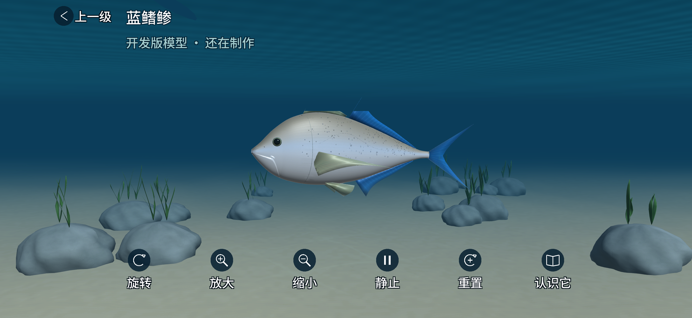
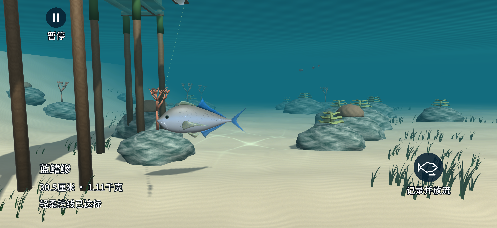
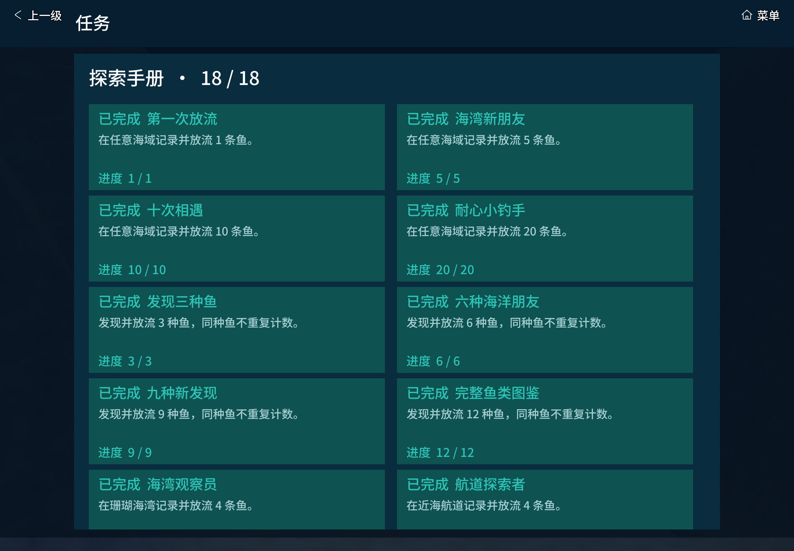

# 蓝鳍鲹胸鳍柔性与当前模拟器复核

胸鳍柔性工程已实现，当前源、导入、渲染和双端模拟器功能验收PASS；完整拟真美术仍PARTIAL。每侧新增两段弯曲控制，膜沿原三角面细分，保留全部原顶点、其他面/实体鳍条/九贴图、原十二骨静态矩阵和原七动作曲线。为保留细微运动，取消该模型的导出简化与导入动画压缩，数据量及真实设备成本继续待验。

实际模拟器来源`2f10c4f6b463d60a7a37c6b6e1a6ed4bbe5c6c6d`、游戏/工具摘要`7556e33d2477ff18fe0531c028a29791351d1ac5e6ddd95cc47684a4c089b73e`，同包摘要`b16c920bfeb35a48d24d5bbc9645c5c12eef3ccefa968125fb3939c4ac7a40d4`。本地版本号仍为0.1.0(9)，不是已签名TestFlight 9；后者仍是独立冻结的5e4f970，未新上传本候选、未操作个人手机。本轮未加载ASC配置，未刷新Apple实时状态；之前已确认的分发事实见[独立发行回执](testflight-0.1.0-9.json)。

| 验证层 | 当前结果与范围 |
|---|---|
| 保存源数据 | 309项原数据/变形检查及42项有限组织增量贴合通过；16骨，24748/10688/4908三角面。最小远端非刚性变化7.22mm，最大新增分离0.262mm；根部保持，重复编辑权重差0 |
| Editor / Play / 工具 | 85 Editor、最终5项定向Play、12工具测试及冻结2f10c4f的CI通过；Play检查实际控制器语义、自然更新、暂停/减弱动态/恢复 |
| iOS目标Editor Metal | Medium / Half HDR / 4×MSAA；84离散视角、336张active/held首重图，重复差全部0，最小消融4368像素，最小视口边距12.93%；不是原生FPS或连续自然美术证明 |
| 手机/iPad原生图鉴 | 各17个自然样本，两侧四控制最大观测跨度至少1.08度；暂停漂移0，恢复约0.476度，模型操作不改存档；生产culling，无强制AlwaysAnimate |
| 当前普通成长 | 手机20轮/4160分、iPad26轮/5417分；两端各12鱼种、18任务、20钓具、3观察，46次同帧重复放流不重复奖励；逐轮积分/任务独立重算，新进程恢复相同分数和存档SHA |
| 已有进度保护 | 安装前232份文件（115份普通主存档）逐字节保持，包含最初旧返回标签失败运行；安装未卸载或清档 |
| 实际图审 | 12张接触表覆盖98张原生帧、8张原生模型与6张正常流程原尺寸图；另看6张GPU接触表和4张原尺寸图。图标/模型区域可见；近景细线/针状轮廓、鳃缘、塑料感及反侧过暗仍开放 |

最初12骨红测证实胸鳍相对根骨没有弯曲。首16骨候选虽通过姿态检查，独立组织检查仍有41/42失败，新增分离最差43.54mm；膜细分后沿鳍条段内取样仍有39/42失败。保留失败后把新增角度改为温和候选，贴合门槛0.4mm、源可见变形2mm及导入网格消融0.5mm保持。导入压缩抹平动作、首次状态等待、网格组重建、JSON容器/浮点测量辅助器失败均保留；修正没有把原失败回执改成通过，详见[方案、测量方法和失败顺序](../docs/48-bluefin-pectoral-flex.md)。

本轮最初用既有5e4f970包完成26轮/4687分及全部内容，末尾因QA仍寻找已移除的“返回观察图鉴”而整体FAIL；只按实际页面改成“上一级”。当前双端20/26轮已完整通过，原失败及独立功能前缀检查保留，不把它说成生产游戏曾经卡死。所有自动流程通过可见按钮和EventSystem，不等于OS触摸或儿童实玩。

测试/导出/编译/安装/取证整段受14 GiB共享租约`run-b11c71f2fecf4637b3ef36f3e298bf0e`保护，复用原SDK导出/缓存。覆盖前完整核验留存5e4f970生成工程及App；更早834生成内容以本地归档及真实解包核对字节/权限/链接后才收尾，仅生成产物，不复制checkout，也不作为独立备份。两次准入扫描30秒超时未启动作业，恢复时预算和120 GiB底线保持。物理发行8/9与其符号/凭据未动。

组织指标只量相对原静态距离的新增分离，有限姿态/鳍条中心及段内采样不证明绝对零间隙或所有时刻全表面贴合，也不是鱼类生理测量。未通过首套用户/科学A1–A3、完整自然拟真、其他成品鱼/钓具/观察/环境、儿童首鱼/图标理解、最低系统/OS触控、真实iPhone/iPad20分钟或实际TestFlight安装；所有模型继续prototype。master保持稳定、PR保持Draft、原美术/真机任务及apply/完整目标不完成，正式历史审计仍INCOMPLETE。

[结构化结果](bluefin-pectoral-flex.json) · [本增量记录完整性](bluefin-pectoral-flex-records.json) · [开发者模式及独立TestFlight范围](developer-mode.md)。

收尾：本增量61条测量已结束，11条非零结果（含预期红测）保留；局部完整性检查在自身开始时验证前60条，自身随后exit 0，旧1737个对象/回执SHA保持，新绑定/结束区间串行通过。正式历史审计仍INCOMPLETE。仅收据/自有预览/最终静态工具检查另受2 GiB收尾租约`run-a2cca858d7794dc38e56b20c4c092bcf`保护，没有在此租约重跑编译安装。最后实测192.50 GB/179.28 GiB，200 GB日常目标未达到；120 GiB底线保持，未清理其他工程。
