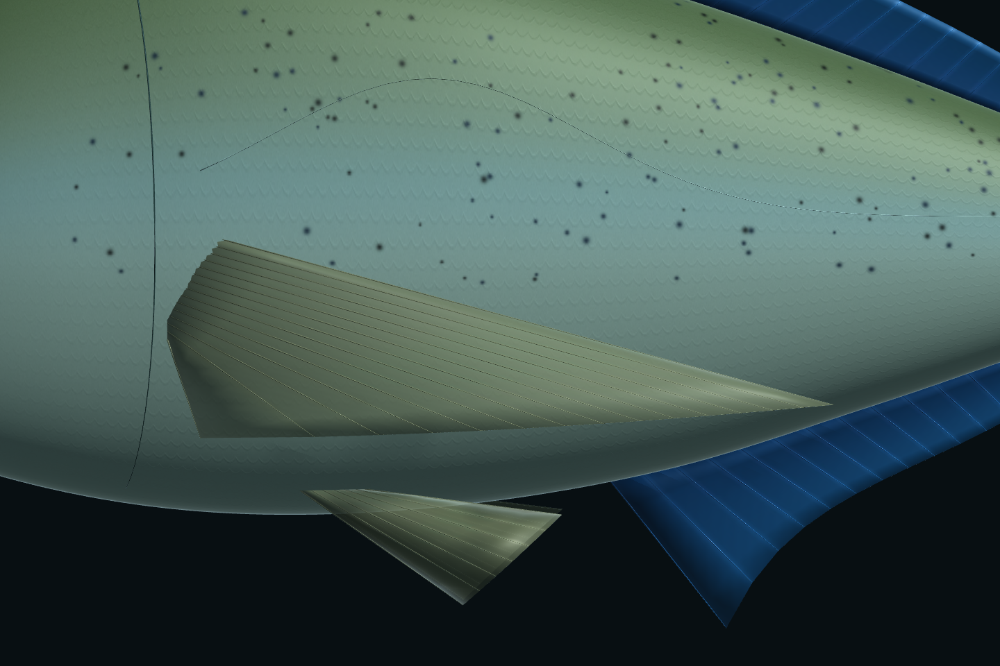
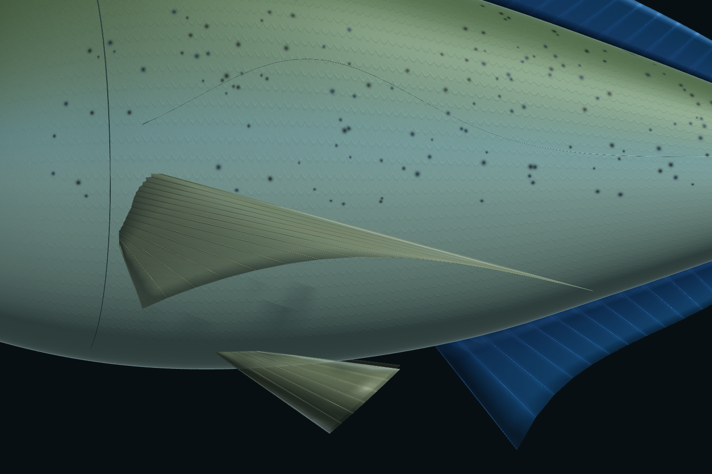
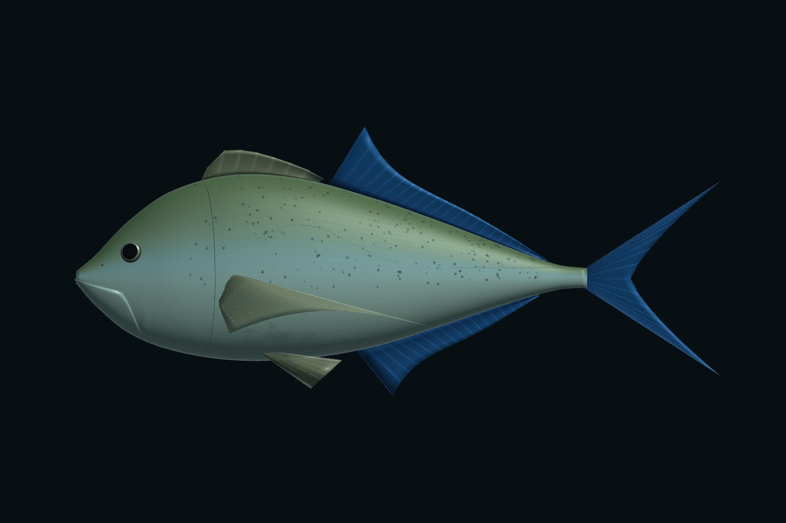

# 蓝鳍鲹胸鳍曲线候选

本次继续精修首条英雄鱼，将宽直扇片的后缘内收，保留长前缘、透明膜、实体鳍条与原有骨骼动作。当前仅源模型与Editor范围通过；整体美术仍PARTIAL，没有批量制作其他物种，也未更新本人手机或TestFlight build 7。

原版并非只需修改法线：关闭法线或阴影后宽直轮廓仍在。新增独立导入近景诊断，保留生产图、关闭法线/鳍条阴影/全部阴影、不透明膜和隐藏膜对照；临时材质不进入游戏。首轮因预览动画重名失败；第二轮取景未补偿BakeMesh缩放，鱼体过小，虽然工具返回成功仍被人工否决。按[Unity当前接口说明](https://docs.unity.com/en-us/engine/6000.3/script-reference/unityengine/skinnedmeshrenderer/bakemesh)补偿后，增加实际膜面像素门，防止空白检查冒充有效画面。

第一版曲线源检查通过，但实际导入图的根部碎片感与近丝状末端被否决，保留[失败候选原图](../art/previews/bluefin-pectoral/rejected-first-curve.png)。第二版放缓后缘，选定近景、全鱼侧面/斜面/反面及三个LOD生产图已查看；细点、刚性和绿色/塑料感仍存在，不能宣称拟真美术通过。全景仍会出现规则细点，当前对照尚不能证明其根因或修复。

| 范围 | 本次证据 |
|---|---|
| 实际三LOD面数 | 24664 / 9864 / 3698，LOD0仍受25000预算约束 |
| 源检查 | 189项条件、七动作各五姿态、72处保存网格薄壁测量通过 |
| 非胸鳍LOD0 | 11330面按面顺序/循环起点归一后，几何、UV、权重、材质角色指纹一致；保持原六位精度及面朝向/重复面数量 |
| 作者轮廓量化 | 膜面XZ投影面积/凸包比由约1.000变为约0.623；仅说明作者内收曲线，不是生物测量 |
| 正式贴图 | 与修改前逐字节一致；未取样机构照片 |
| Editor | 5项材质/薄膜/遭遇和鱼线净空定向检查通过 |
| PlayMode | 4项放流动画/整合世界/沉浸导航和休息确认通过 |
| 最后GPU采样 | iOS配置、Metal、Medium、Half HDR、4×MSAA，24张图；三档恢复生产材质后的重复图均零像素差 |

最初严格身份对照因面片顺序与循环起点不同失败。对实际面片作保留朝向和重复数量的归一，未放宽精度后通过；失败原记录保留。低LOD由源重新减面，未主张其余两档逐顶点完全相同。本轮未新跑完整60项Editor、21项全PlayMode或完整成长，也没有新Player包、系统触摸、儿童或真机资格。

参考仍为[澳大利亚博物馆物种页](https://australian.museum/learn/animals/fishes/bluefin-trevally-caranx-melampygus-cuvier-1833/)及[Fishes of Australia](https://fishesofaustralia.net.au/home/species/1652)等既有资料。机构照片仅供网页观察，没有下载、采样或收入资产。科学、用户方向、儿童、A1–A3及其他成品模型仍待完成。

本轮只清理本项目已结束的设备归档中间缓存，七份历史签名归档哈希前后相同，未操作其他项目的活动构建。原始备份、失败候选及完整诊断图在本机忽略目录保留。详细数据见[JSON回执](bluefin-pectoral.json)和[约束](../docs/30-pectoral-refinement.md)。

公开校验首次发现生成prefab的登记哈希仍旧，已按实际LOD包围盒变更更新登记后再检；该失败回执保留，没有借更新登记替代模型、画面或功能验证。

本轮22条新增开始/22条新增完成的实际回执、attempt绑定及串行区间已核对，3次真实非零失败和两类视觉否决保留。原1051条完成/1046条开始历史对象未改，既有缺口不补造；历史独立审计仍INCOMPLETE。本轮记录核对不能替代美术、用户、科学或设备验收。
