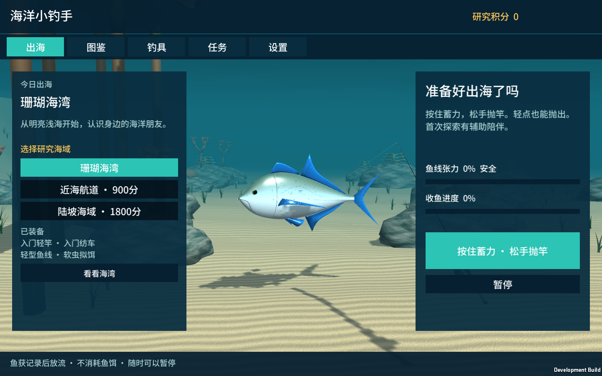
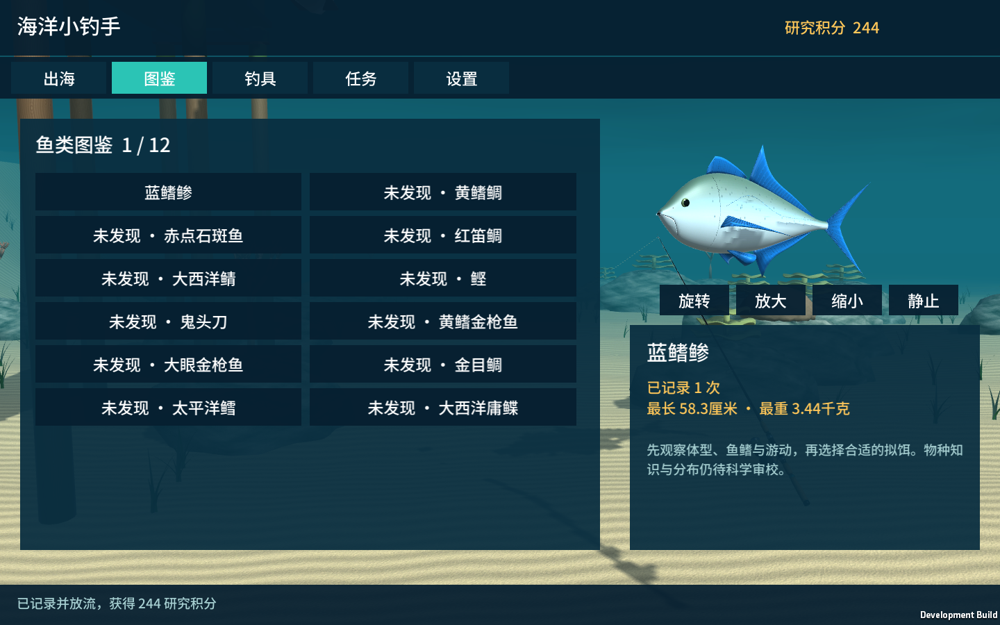
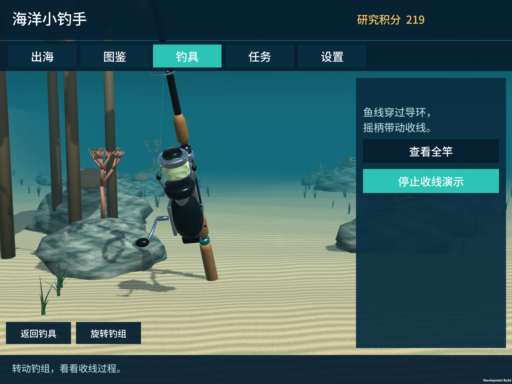
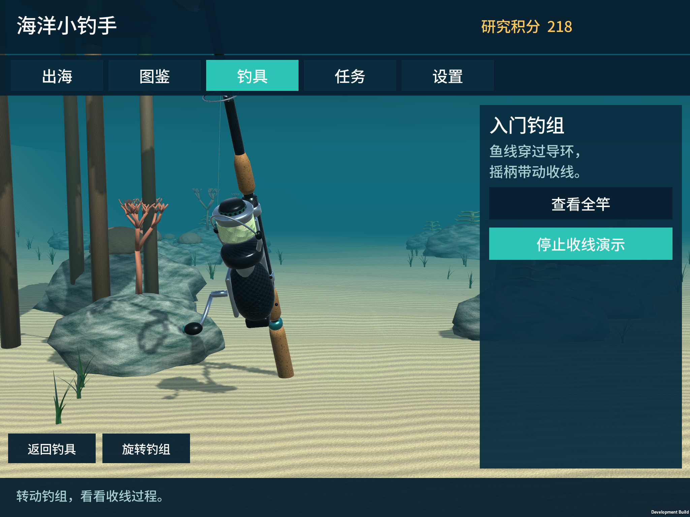

# 鱼体表面与鉴赏标题修复

2026-11-24。本轮针对实际游戏画面中的鳃盖硬边、过强高光和平板鉴赏标题缺失，继续改进首条蓝鳍鲹候选。成品美术仍为PARTIAL，科学人工复核和用户审阅尚未通过；不批量制作其余物种。

## 鱼体表面

原鳃盖是覆盖在鱼身上的独立薄片，绑定为刚性头骨权重，与下面鱼身的混合权重不同。现将轮廓隆起融入鱼身曲面，移除叠层薄片；细鳃缝沿鱼身使用相同的纵向权重，并采用独立、较柔和的非金属材质。提高皮肤粗糙度，降低法线强度和鳍的平滑度；Blender皮肤清漆也减弱。这是候选材质迭代，不以参数变化证明拟真。

保存源文件的独立检查在七组动作、每组五个姿态中，读取实际变形网格，对鳃缘逐点查找到身体表面的最近距离；最大约0.00240米，小于0.006米的贴合门槛。这些是源模型单位，运行时会随鱼体尺寸一起缩放。三LOD为20720/8288/3108三角面，UV、权重、尾摆和下颌检查通过。Unity重新生成材质映射及prefab，保留实际生成的.meta。

初次场景测试后，Unity补写了新鳃缝材质的兼容颜色字段，源码身份检查发现摘要发生变化。已在材质生成入口同时写入主颜色和兼容字段，重新导入、执行Editor/PlayMode、编译并复查三档原生流程。原始源码摘要、材质差异和第一轮运行记录留存；最终报告使用固定后的源码身份，未将早期截图直接当作最终包的证据。

修改前的原生钓鱼画面：

修改后，相同游戏镜头：

实际审图确认硬边减轻、高光更柔和；局部硬鳞亮点、口部/鳍条形态与水下照明仍需改进和审阅，不能将清单或检查通过当作A1–A3通过。

## 鉴赏标题

原生平板逻辑尺寸复现了问题：两处标题需要40.5点高，实际容器只有40点，生成顶点为零，整行消失。原检查的1点容差漏过0.5点溢出。标题容器现为44点，文字溢出检查收紧至0.01点，并独立记录鉴赏标题的可见字符和实际缓存文字顶点；结合实际截图确认显示，不仅检查Text字段存在。[Unity TextGenerator说明](https://docs.unity.com/en-us/engine/6000.0/script-reference/unityengine/textgenerator)用于核对API含义，具体数据来自本机实际运行。

三档新Mac原生隔离流程均PASS：1440×900桌面、1024×768逻辑点平板、758×372.33逻辑点手机（含注入安全边距），每档12截图。四个鉴赏状态均实际生成4个标题字符、16顶点；捕获放流、机构、导航、取消清档与触控尺寸检查也通过。28项Editor、7项PlayMode及Mac编译通过。每档只进行一次捕获，不证明20次真机循环或儿童首鱼时间。回执、首轮失败和范围见[bluefin-surface-and-ui.json](bluefin-surface-and-ui.json)；原始日志、隔离存档与完整截图仅存本机。

所有上述图片均为本项目Unity直接捕获、未经修图的画面，按MIT登记，无OS界面或私人媒体。工作室四角、咬钩姿态和转台从新保存源文件重新渲染，与游戏截图、真机及人工审阅分别记录。

TestFlight 0.1.0 (2)仍冻结于2971b11，不含本轮修复。真实iPhone/iPad触控、标题可读性、听感/触觉、20分钟运行、儿童/家长试玩和完整产品仍未验；水面、其他物种/钓具/海域及观察生物还需继续制作。
