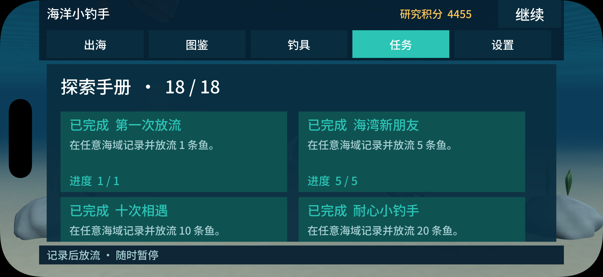
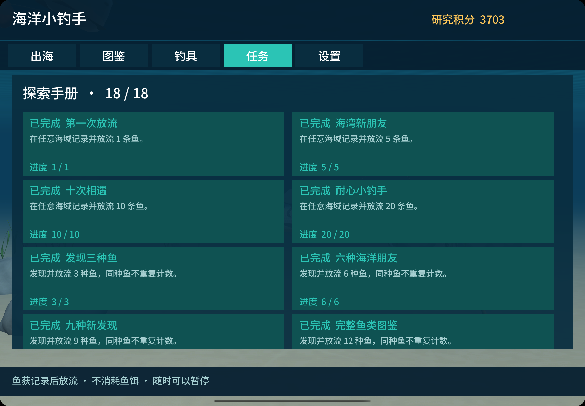
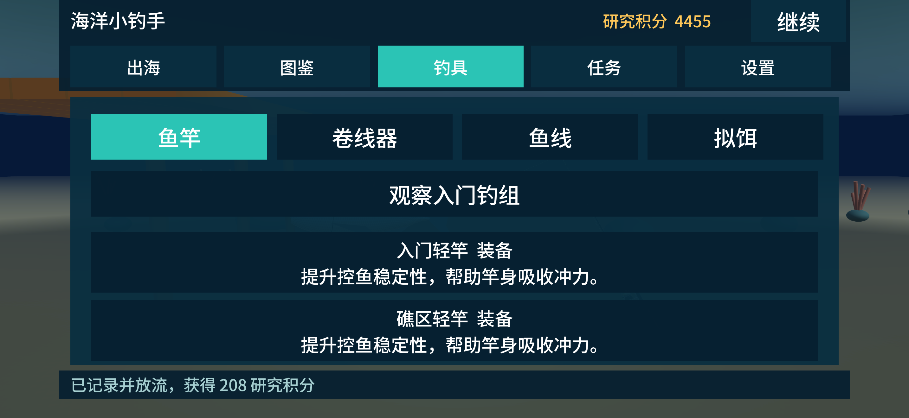
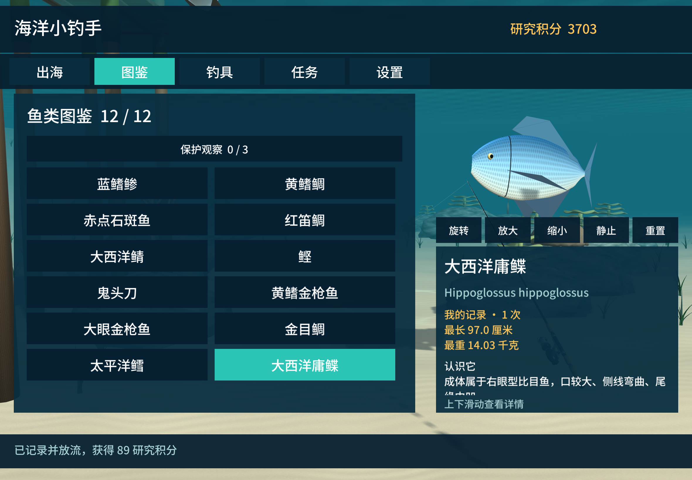

# 完整成长与双端模拟器验证

本轮补齐了“固定20轮”未证明的完整成长路径：从全新隔离存档，通过正常界面和正式随机遭遇，分别在iPhone/iPad原生模拟器中收齐12种鱼、完成18任务、自然解锁并逐件装备20件钓具。**功能流程PASS，完整产品仍PARTIAL；12条目收集不代表12个拟真模型已经完成。**

## 冻结和输入

源码`0bea41d0df348c0256a33dfbd8701119ff2b1e63`，摘要`7531f0dff16f3a8cb7f4a2ae0530670684559d7e2989a2495f2ef70f240fd2e3`；同一App摘要`a671481c855c163b0a508b275fdcb6d164b03a55ab7ae903df18154618f5e829`。Unity Simulator导出、Xcode ARM64编译、双设备族和SDK设置恢复前后SHA通过。配置号0.1.0 (5)是本地unsigned Development模拟器包，不能与TestFlight冻结`a6bcf8e`的build 5混同。本轮未操作个人手机或TestFlight。

新增`--ocean-content-journey`共用既有EventSystem驱动，固定20轮入口保留。只抛竿、提竿、按住/松手收线、记录放流和正常页面操作，不注入积分/鱼获，不指定目标鱼或替换随机种子。自动策略优先探索已解锁、未发现鱼种较多的海域，选择可用较强钓具，张力0.65时松手；前10轮辅助，随后标准。每轮同帧重复放流点击，再核对真实文件总账、唯一记录、任务进度。上限96轮/45分钟，缺内容时FAIL，不把20轮当作全部内容通过。方法与复现入口见[说明](../docs/22-complete-content-journey.md)。

## 实际结果

| 范围 | 轮数 / 积分 | 收集 / 任务 / 装备 | 恢复及边界 |
|---|---|---|---|
| 52项Editor | 52/52通过 | 规则/资产/场景等基线 | 最终源码编译通过 |
| 两项定向无画面PlayMode | 完整模式20轮/3820分；固定模式20轮/3622分 | 完整模式12种/18任务/20装备 | 两个实际场景/控制器重建通过；0截图；不是新全量13项PlayMode |
| iPhone 17 Pro Max / iOS27.2 | 25轮 / 4455分 | 12种 / 18任务 / 20件逐一装备 | 36张渲染；新进程及OS鼠标18/18页通过 |
| iPad Air 11 M3 / iPadOS27.2 | 20轮 / 3703分 | 12种 / 18任务 / 20件逐一装备 | 36张渲染；新进程及OS鼠标18/18页通过 |

手机辅助/标准为10/15轮，三海域鱼获9/11/5；平板10/10轮，三海域10/4/6。45次额外同帧放流点击没有重复奖励，装备选择没有扣分；每轮读回文件与内存总账一致。结束后两端各记入三项独立保护观察，不增加鱼获和积分。独立Python依据真实存档和内容目录重新计算18项条件、唯一记录、积分合计、checksum及装备/观察集合，结果一致。完整结构化值见[JSON](complete-content-journey.json)。

两端自动首轮分别约22.8/22.0秒，完整流程约491.4/390.2秒；这些是程序正常控线的功能用时，不能证明儿童首鱼3分钟、好玩或真机性能。Metal、Medium、原生/期望4×MSAA及HDR保持；没有改低抗锯齿换取通过，也没有新的物理双设备20分钟资格。

最后仅测试清理字典增加`originals.Clear()`；最终Editor52编译通过，以上两项PlayMode执行所用Player Runtime文件SHA与最终Runtime完全相同。未冒称清理行重跑了整套PlayMode，原XML/日志和本次前后存档留本地。

## 新进程与原记录

完整运行结束后重新启动同一App，使用各自原隔离存档根；实际PID不同，文件SHA不变。OS鼠标打开任务页，两端分别仍显示18/18及4455/3703。平板Device Hub先显示竖向设备框中的横向游戏，执行一次Rotate Left后横向展示正确，再打开任务页；这只证明该次模拟器旋转，其他方向/真机适配未验。

更新前后的原三份QA文件逐字节一致：旧手机20条/3观察/3333分、旧平板20条/3观察/3444分，以及原手动一条/205分。取证使用本轮成功安装/启动映射并核实MCM归属，未重建、重放或清档；原记录完整保留。新45条记录另存于独立QA根，不冒充个人游玩进度。

## 图像审阅与明确未通过项

72张原生生成帧经4张接触表检查，另查看15张原尺寸：手机8张、平板7张，覆盖任务首/中/末段、钓具、庸鲽、收鱼和新进程任务页。18卡的目标/进度及入视口检查均通过，9组滚动截图全部留档；并未宣称72张都逐一原尺寸审阅。仅公开6张已实际查看的自有游戏图，原始日志、设备标识、容器路径及其他项目侧栏不公开。

- 钓具选择成功落盘，但重建列表会跳回顶部；手机底部所选钓具离开视口，页脚仍显示上次放流提示。功能通过，选中反馈与滚动体验仍需修复。
- 大西洋庸鲽仍是对称高体A0功能形体，与右眼型比目鱼文字不一致；平板构图还裁到尾部/右缘。该模型科学/美术验收明确未通过，应完成独立源资产和对应原型标识。
- 其余鱼/保护对象仍有明显几何样板。20件装备是配置/装备操作通过，完整源美术样板仍只有首套纺车钓组，不能称20套完成模型。
- 英雄鱼鼻端、下颌明暗、完整其他物种/海域/钓具、拟真A1–A3、科学/用户/儿童、最低OS和真实双端20分钟仍未完成。样板视觉方向已请求用户审阅，未推定同意，也未批量生产其他物种。

[手机中段12/12任务原图](../art/previews/complete-content-journey/phone-tasks-species12.png) · [平板末段积分任务原图](../art/previews/complete-content-journey/tablet-tasks-points.png)

本轮20条完成测量（含本次审计）均通过，起止记录绑定当前apply尝试；741条已提交历史完成记录逐项未变，无新孤立完成。历史独立receipt审计缺口仍为INCOMPLETE，不编造修复。GitHub提交/CI另按实际读回记录；2.4、3.4、4.1–4.3和完整apply/产品出口继续未完成。
