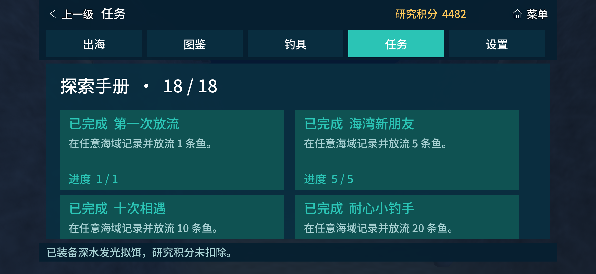
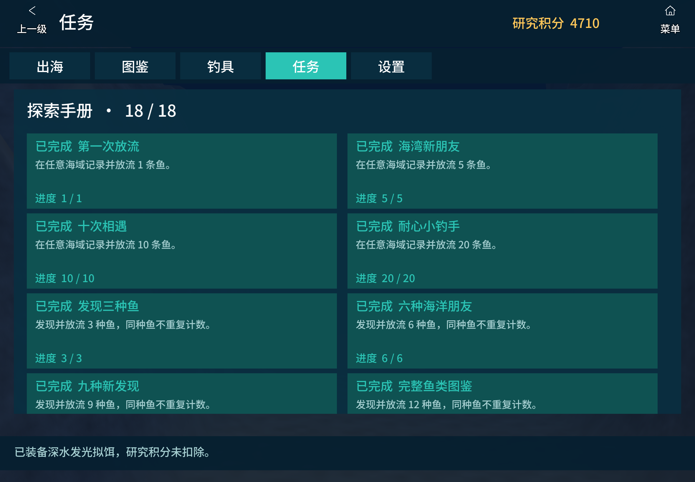

# 当前原生包的完整成长验证

2026-11-25，**完整内容功能 PASS，完整产品 PARTIAL**。同一现有原生模拟器包在手机、平板各自全新隔离存档中，正常随机收齐12鱼种、完成18任务、自然解锁并逐件装备20件钓具、记录3种保护观察。未修改游戏源码、模型、积分、随机种子或存档格式；不会以目录数量或功能收集代替拟真模型。机器可读结果见[本轮回执](content-current.json)。

| 实际结果 | 手机 | 平板 |
|---|---:|---:|
| 正常钓鱼并放流 | 26轮 | 27轮 |
| 已发现可钓鱼种 | 12 | 12 |
| 完成任务 | 18/18 | 18/18 |
| 逐件装备并确认的钓具 | 20 | 20 |
| 同帧再点放流未重复奖励 | 26次 | 27次 |
| 最终研究积分 | 4482 | 4710 |
| 保护观察 | 3 | 3 |
| 正常流程截图 | 38 | 38 |
| 程序游玩流程用时 | 498.34秒 | 523.44秒 |
| 新进程页面积分及存档一致 | PASS | PASS |

两端均经三海域自然解锁，前10轮辅助、第11轮在设置切换标准。所有抛竿、提竿、收线、放流及菜单操作使用正常GameUI/EventSystem和实际射线命中检查，滚动位置由测试驱动，不是OS手势。没有直接推进FishingSession或注入分数/鱼获，选择已解锁海域和钓具的自动策略见[复现入口](../docs/22-complete-content-journey.md)。自动控线用时不能作为儿童首鱼用时或“好玩”验收。

独立读取实际持久化文件，检查校验和、唯一已放流ID、积分求和、鱼种/海域目录身份、每轮总账及18任务的逐轮条件，并解码全部76张PNG。两端12个图鉴焦点/学名、20件装备选择不扣分、18张任务卡及9组滚动截图通过本包入口检查。保护观察不增加钓获或积分。原生渲染探针为Metal、Medium、HDR和4×MSAA。

新进程使用各自同一个真实UI产出的隔离存档，实际菜单分别显示4482/4710分；主文件SHA、26/27鱼获、12鱼种、3观察及18任务重算条件全部不变。重启后的任务结果来自文件重算，本轮未另做OS点击任务页。测试前已有105份进度相关文件（55主文件，含备份/临时/损坏样本）最终逐字节保持；未卸载、清档或恢复覆盖。

平板第一份独立核对与首次重启捕获有2.270秒测量区间重叠，两条原始回执均保留并排除最终资格。等它们结束后，以`content-current-tablet-proof-b`及`content-current-tablet-restart-b`串行重做，再核对新截图和文件；最终采用第二次重启画面。不得将全部测量描述为互不重叠，也不因重跑成功删除第一次记录。旧历史缺启动/磁盘事件缺完成仍为整体审计INCOMPLETE。

四张接触表覆盖两端76帧，另查看八张选定原尺寸图，包含任务首尾、重启、首次收鱼和庸鲽。不是所有原尺寸图或自然动作审阅。庸鲽仍呈普通鱼形，其余非英雄鱼和观察生物也有明显样板形体；黄色“模型还在制作”提示保留。科学形态、完整拟真/自然观感仍 **未通过**，首套英雄鱼/钓组用户方向与A1–A3未由此补齐，也未批量制作其余11种成品鱼。

冻结源码 `45b04aa7081f12c8dd4e4a3aeb32e1b7754aa51c`，源码摘要 `545ceab933ee4a3504f4147933f81d594af01e9ebe7a5fc9e90b939de625b03a`，App摘要 `8f8d883bc70bdd8299893c521a0438d4a7e10a80bfe9799d1a77e9b0355f169f`。这是[前轮原生倒影/沉浸验证](reflection-native.md)的同一包，本轮没有新编译或重跑Editor/PlayMode，不套用旧全量结果。本地版本字段0.1.0(8)与现有TestFlight8冻结1bdfa78不同，未上传发行或操作实体iPhone。

儿童实际首鱼/张力理解、图标理解与真实触控、双真机20分钟/后台恢复、TestFlight来源实际安装，以及全部成品美术继续待验；任务4.1–4.4、4.7、apply和完整目标均未完成。

[手机图鉴/装备](../art/previews/content-current/phone-contact-1.png) · [手机任务/海域](../art/previews/content-current/phone-contact-2.png) · [平板图鉴/装备](../art/previews/content-current/tablet-contact-1.png) · [平板任务/海域](../art/previews/content-current/tablet-contact-2.png) · [手机重启](../art/previews/content-current/phone-restart-main.png) · [平板重启](../art/previews/content-current/tablet-restart-main.png) · [未通过形态验收的庸鲽](../art/previews/content-current/phone-prototype-halibut.png)
