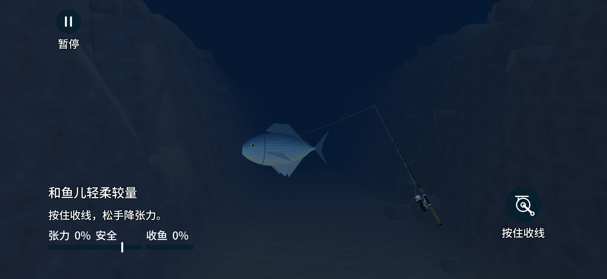
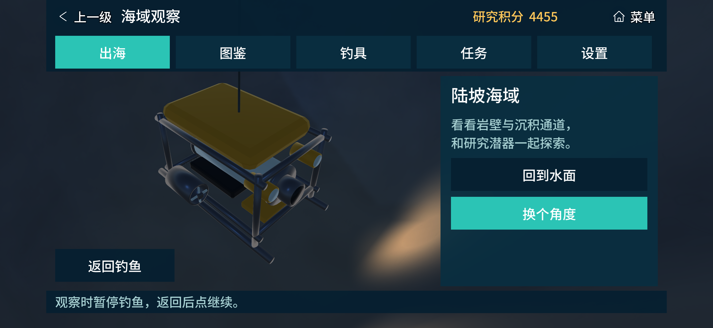
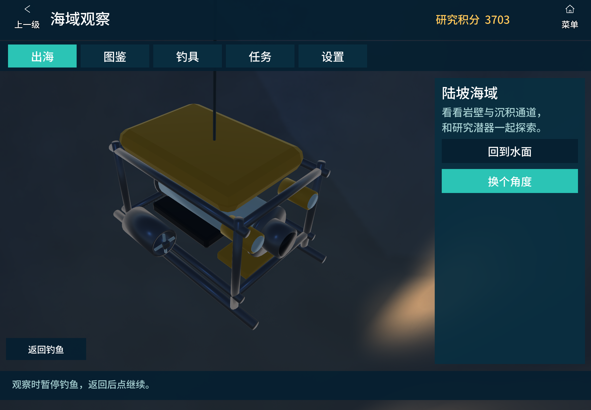
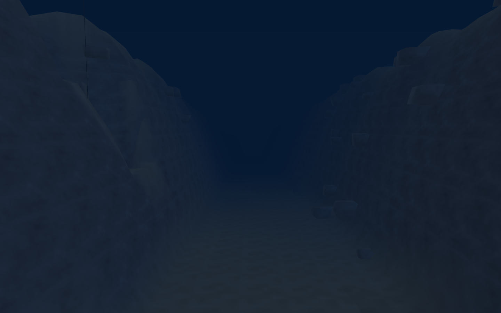
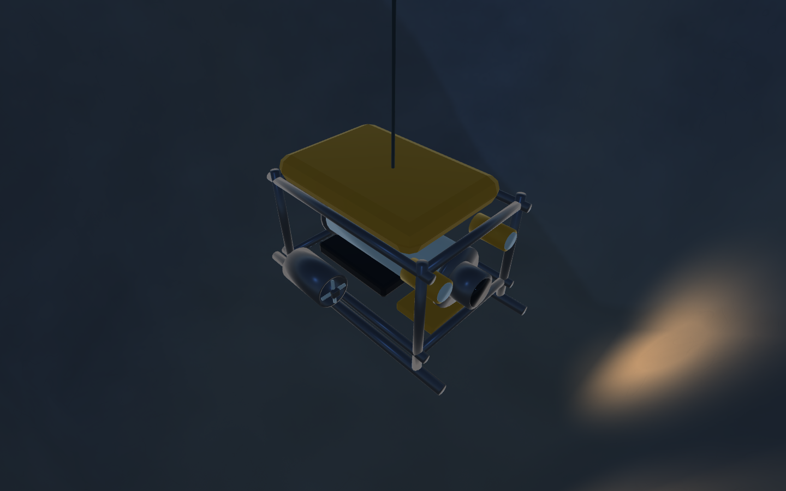

# 陆坡海域候选与验收边界

第三海域已接入独立源资产，替换原运行时基础几何。源文件、FBX、原创岩层/沉积 PBR、五组各三 LOD、研究潜器及自有小艇改装均已实际生成和导入；继续使用共享准备、鉴赏、暂停、设置与最小化游玩界面。当前仍为美术样板，完整产品和 REQ-05/06/08 保持 PARTIAL。

修正版冻结源码 `2bed34702dcd9a81dcc09c13d86225e31c514389`，摘要 `de605000ed2a2d017b2ffd0724e7785a91d85a6113910d99f22716d7561a2df0`。同一个 ARM64 原生包 `f37cbd4a…` 在 iPhone/iPad 模拟器各完成 21 帧定向流程。结构化结果、范围与原始测量引用见 [JSON](continental-slope.json)；模拟器结果不作为真机资格。

地形是两侧岩壁、坡脚碎石与开放沉积通道，潜器悬停在侵蚀岩阶上。海平面 200 米为本地坐标，不表示完整水压、光学、地质或生态模拟；没有复用浅海海草，也不声称四种目录鱼真实共栖。环境参考及复现入口见[约束](../docs/24-continental-slope.md)和[源资产说明](../art/source/continental-slope/README.md)。本轮未制作其他物种，英雄鱼/钓组样板的用户审阅仍为批量生产门槛。

工程检查与实际画面分别记录：

- 保存源文件独立检查通过：UV/依赖、封闭与正体积、严格 LOD 递减、连续沉积权重，以及真实网格的通道、悬停和鉴赏视线。潜器底部与岩阶实测约 0.304–0.380 米；不能据此认定全部碰撞或地质形态合格。
- 导入网格检查覆盖全部 LOD 的 297 个保守钓鱼身体采样和 192 个鲸鲨观察身体采样。四项陆坡 Editor 检查通过；这不是全空间形式证明。
- 首轮完整 56 项 Editor 与三项定向 PlayMode 通过；照明微调后四项陆坡 Editor 与一项切换回归通过。后续构图修正又完整运行 57 项 Editor 和三项定向 PlayMode，全部通过。随后仅把通用鉴赏标题改为“海域观察”并加入原生标题检查，最终源码通过 GPU 编译/检查；不冒称本轮跑过全量 PlayMode、45 轮完整成长或真机。
- 最终 iOS 配置 Editor Metal 离屏检查通过，保留 4×MSAA：三次静止绘制的初次/重复 RGB 改变像素均为 0，倒影有内容且水波随时间改变。原图与环境记录留档；这不是 Player UI 或物理设备验收。

保留问题与修正过程：首轮碎石简化出现零体积面、潜器连接边不封闭，改为逐独立实体简化并修正交叉护杆。工作室 B 水下过暗；C 改灯光后仍被岩壁挡住潜器。新增真实地形视线检查复现失败，D 移动鉴赏相机后通过。`slope-source-20261124d` 曾在作者作业退出前误启动，存在约 3.7 秒重叠，该次结果排除；等待退出后串行运行的 `d2` 才作为最终源检查。一次 Editor 测试依赖了未触发的非运行模式 OnDisable；现由海域切换显式执行幂等恢复，OnDisable 仍作后备，颜色、强度与环境模式按原值检验。

初轮冻结 `040a64c` 的同一 ARM64 原生包在手机/平板各完成 21 帧、一次实际钓鱼放流及三海域查看；独立总账与设置核对通过。手机副本 25→26 条、4455→4710 分，平板副本 20→21 条、3703→3910 分。手机实图仍显示说明板挡住潜器，因此这次逻辑 PASS 不作画面通过。修正版按安全区和说明板实际宽度调整鉴赏投影，返回游玩复位；原生检查增加潜器全包围盒与说明板/安全边缘的间隙和复位检查。鲸鲨观察按原目录前往近海航道，未改成陆坡生态。

修正版两端的潜器边界、通用标题及游玩投影复位均通过，42 帧以两张私有接触表检查，另查看两端游玩/潜器四张原尺寸图。每端从原全成长记录的独立字节副本开始，真实新增一次放流：手机 25→26 条、4455→4622 分；平板 20→21 条、3703→3817 分。原记录前缀、其他进度与设置不变；更新前九份 QA 存档主文件在当前容器中逐字节相同，未通过恢复或重放制造一致。新进程仅带存档隔离/渲染诊断参数，未带自动游玩参数；实际菜单显示 4622 分，与 26 条存档及启动前字节一致。手机模拟器留在该暂停菜单，可主动继续。

实际钓鱼仍只有暂停与当前动作两个按钮，收线仪表只在较量阶段出现。Ready/Bite/Fighting 的普通 HUD 最高占安全区 12.034%／4.455%，中央检查区域保持无遮挡。这里是 EventSystem 可见命中与截图验证，没有执行本轮 OS 鼠标/实体触摸、儿童测试、完整成长重跑或 20 分钟性能验证。保留 HDR 与 4×MSAA；未用 LDR 或降采样替代。

工作室源预览与运行时灯光不同。岩壁轮廓/纹理仍有重复和棱面感，水面波纹重复，潜器与船体细节仍偏简单；源预览水面还存在明显明暗边界。游玩截图中的非英雄鱼仍是 A0，庸鲽形体仍与科普身份不符，不能当成新完成的鱼模。零像素差、PBR 和三 LOD 齐全均不能覆盖这些美术问题。A1–A3、科学/用户/儿童、真实触控、最低 OS 和双真机 20 分钟均未通过。

本轮发布范围为经许可审查的原创项目候选；未使用外部照片/模型或私人媒体，支持邮箱保持 `arthur.wang.wsx@gmail.com`。没有个人手机安装或 TestFlight 操作。master 不因工程检查通过而自动合并；完整需求、apply 和历史独立 receipt 审计仍未完成。

本轮新增 45 条实际测量，813 条已提交旧完成对象及 809 条旧启动对象逐项保持不变。新条目均绑定当前 apply attempt，45 份实际 receipt 与记录、哈希一致；总计 858 条完成、854 条启动。唯一 3.684 秒作者/验证重叠已明确排除对应验证结果，并使用退出后的 D2 证据。这里仅证明本轮记录完整性，正式 CLI 审计仍 INCOMPLETE，818 项历史/策略问题没有伪造补齐或改成通过。
