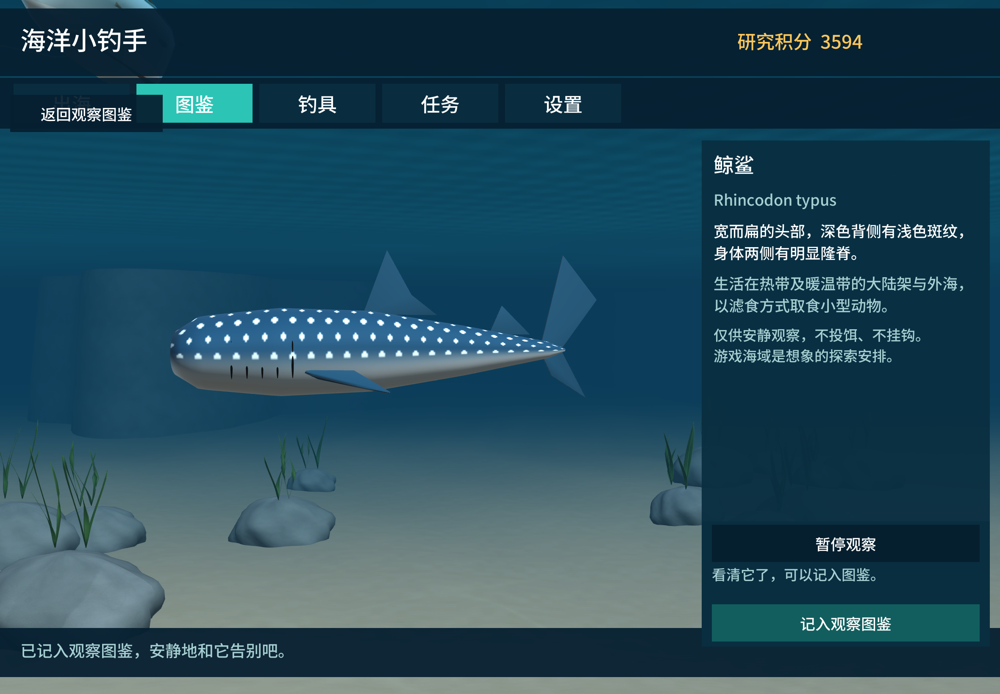
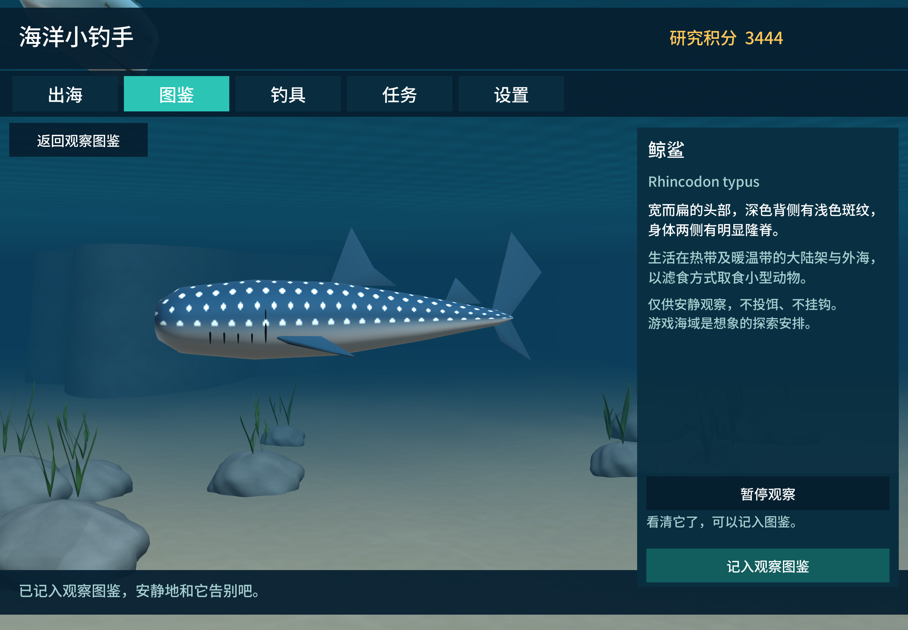
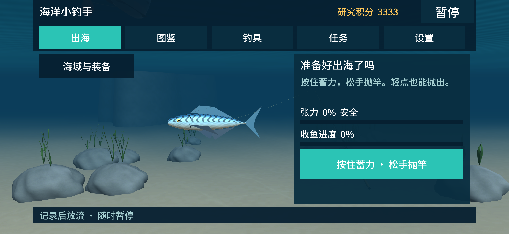
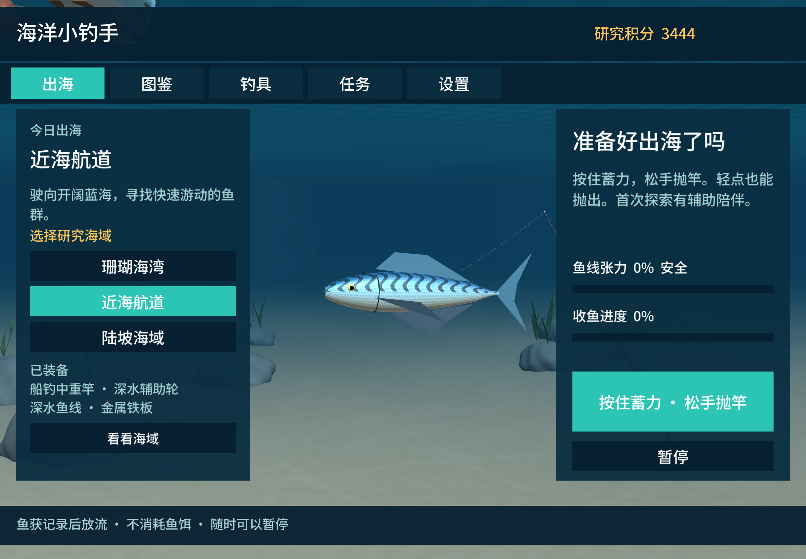

# 连续流程与双端原生模拟器验证

**52项Editor、12项完整PlayMode、iPhone/iPad各20轮原生EventSystem流程及进程重启恢复PASS；完整产品仍PARTIAL。** 本轮发现并修复两处实际按钮遮挡。程序通过正常GameController.Update推进，不注入积分/鱼获，不直接调用Session.Tick；这些结果不能代替系统触摸、儿童试玩或真机20分钟。

## 实际问题与修复

紧凑准备页：从钓具返回后保持暂停，底部“结束本次 · 返回准备”盖住准备列表末尾“看看海湾”。640×480实际命中点(162.6,74)在视口内、未被裁切，但最上层目标错误。等待两帧仍失败，定位后才把暂停时面板底边从36pt提高到102pt。独立左右手回归均实际命中并进入海域观察；原失败和中断保留。

宽布局观察页：15c5b2b的iPad原生实测完成20轮、3594分和三观察，但最后“出海”被“返回观察图鉴”盖住，整段FAIL。原图与射线记录一致。宽布局导航占82–142pt，返回按钮现移至150pt，紧凑布局仍102pt。修复后新包重跑两端20轮，并实际走返回观察图鉴→重新进入鲸鲨观察→顶部出海；两种退出均命中。PlayMode另检查观察页五个导航及返回按钮的最上层命中，避免仅调onClick掩盖遮挡。

| 修复前iPad观察退出 | 修复后iPad观察退出 |
|---|---|
|  |  |

这组图片用于布局对照，不是同时间像素一致性或美术合格证明。

## 当前冻结源码的结果

源码冻结`dbaccb4c4882971b321529ff7850df9360d8562f`，源摘要`182d5b572e697d823fb1ebba1d8d896b56b1f742a99d8c2729e60f48a5fe35bd`；两端安装同一App，摘要`4b0ceb8ef1f82333a77f2a479722cdc50069544f8fb40e6a2a950d97f726eb16`。Unity journey2导出和Xcode ARM64编译通过，安装后逐文件核对构建产物，未卸载或清档。ProjectSettings在Simulator SDK/架构临时切换前后SHA256完全一致。

| 检查 | iPhone 17 Pro Max / iOS 27.2 | iPad Air 11 M3 / iPadOS 27.2 |
|---|---|---|
| 20轮完整钓鱼、记录放流、回Ready | PASS | PASS |
| 逐轮磁盘重新读取、唯一ID、released、积分合计 | 20条、3333分 | 20条、3444分 |
| 三海域自然解锁、钓具选择、两档辅助 | PASS | PASS |
| 控线中进图鉴、取消按住、暂停冻结、主动继续 | PASS | PASS |
| 三项保护观察、鱼获/积分不增加、两种退出 | PASS | PASS |
| 进程重启，同一显式隔离QA存档恢复 | 20条、3观察、3333分，实际主界面一致 | 20条、3观察、3444分，实际主界面一致 |
| 新长流程实际原图 | 10/10逐张审阅 | 10/10逐张审阅 |
| 逻辑点安全区及密度 | 832×420pt，3像素/点 | 1180×790pt，2像素/点 |
| 渲染探针 | Metal / Medium / 原生4及URP4 / HDR开 / LDR对照关闭 | 同左 |

20轮及观察自身分别耗时380.683/384.969秒；这是程序操作耗时。第1、10、20轮鱼获图在记录放流前捕获，图中顶部积分尚未包含本条；最终落盘积分及重启主界面见JSON和下图。两个重启主界面也分别审阅，校验SaveStore大写十六进制SHA256、唯一20条和3观察，以及不同进程身份。

| iPhone重启后 | iPad重启后 |
|---|---|
|  |  |

同源码完整PlayMode 12/12无跳过：20轮、4008分、三观察和Bay/GameController重建恢复通过，长流程377.222秒；此项是场景重建，与上表真正新模拟器进程分开。Editor 52/52和既有11项发布保护检查通过；游戏/工具源码未在冻结后改动。

普通启动另验：新包不带QA参数启动，初次5秒截图仅是Unity启动图，不据此记PASS；后续系统截图才确认游戏主界面。默认存档根为0分，20轮使用的显式QA存档仍独立保留；不能把两个根的积分不同记作丢档。这里只确认等待后可启动，未测冷启动资格。

## 留存与边界

15c5b2b的旧包仅iPhone整段通过、iPad整段失败，不能与修复后的dbaccb4混用。两批40张长流程原图均已审阅，SHA见[结构化记录](continuous-journey.json)；当前20张另加两张重启图作为最新原生证据，公开11张代表性原图（含一张修复前对照），许可与逐文件摘要登记在asset-manifest。系统主页、Apple/Unity启动图、Device Hub侧栏、设备标识及原始日志只保留本地。

解锁后CLI仍曾会话绑定失败，后来通过Device Hub只启动项目专属模拟器，并以系统实际画面及Booted读回确认。旧QA标签冲突由保护检查在启动前拒绝，旧数据未覆盖。两台测试完成后保留数据关闭；其他项目模拟器未操作。所有早期非零测量、真实命中失败及环境失败保留，不能被后续PASS覆盖。

实际画面仍见海湾岸线/倒影阶梯感、重复岩体/植被及简化近海地形；非英雄鱼和三种保护生物仍有明显A0形体和扁平鳍片。可滚动的观察文字也需真实儿童可读性评估。完整源资产、拟真造型/PBR/动画/LOD、美术A1–A3和科学/用户审阅未通过。自动长流程不证明完整18任务实玩、真实系统手势、最低系统、儿童首鱼时间或双真机20分钟性能/恢复。

包沿用配置0.1.0 (5)，是本地unsigned Development模拟器产物，不是a6bcf8e冻结的TestFlight/Ad Hoc build 5；本轮无新TestFlight上传或个人手机安装。独立receipt审计仍INCOMPLETE，2.4、3.4、4.1–4.3及apply保持未完成。复现入口见[流程说明](../docs/20-continuous-journey.md)，历史sim4单轮检查见[旧模拟器记录](ios-simulator.md)。
