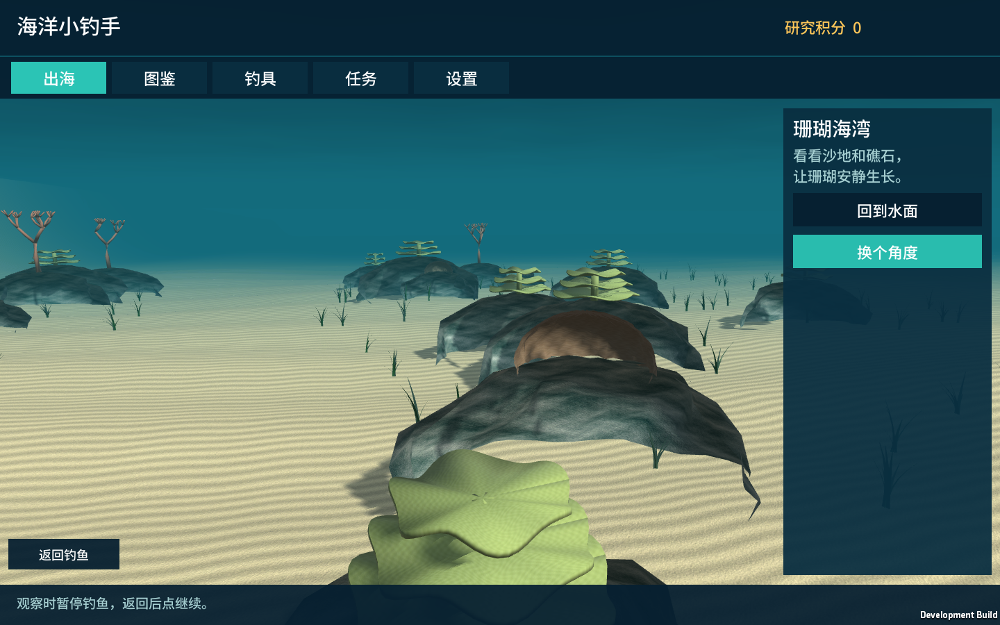
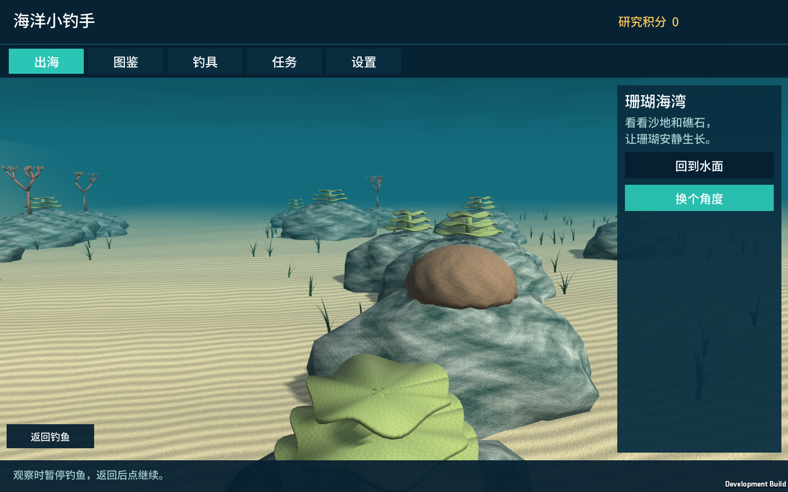
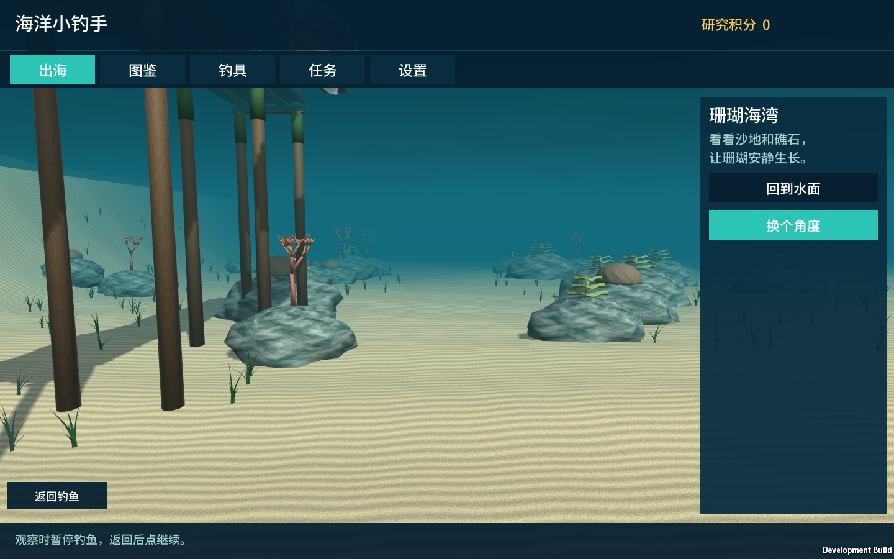

# 海湾礁石与丘状珊瑚实体修复

实际游戏近景暴露出礁石像薄壳、丘状珊瑚能看到内部的问题。对保存源文件独立检查确认：24块礁石全部朝内，减面后还有开放边；丘状珊瑚朝向与顶部接缝、底部封闭也有缺陷。

源制作脚本现已修正面顺序，焊接几何接缝和极点后再生成LOD，丘状珊瑚保留封闭的埋入式底部。UV仍按面角保留，材质继续单面剔除；修复的是实际几何。保存的Blender、FBX及Unity prefab均重新生成/导入。

独立检查只在临时分析副本焊接，不会修补被验文件；按连通实体逐个计算有向体积并检查流形边。修复后三档均有24块朝外封闭礁石和8个朝外封闭丘状珊瑚，开放/非流形边与朝内实体数量均为零。旧源文件的失败检查和本轮通过结果保留在[脱敏回执](coral-bay-solid-geometry.json)。

| 距离档位 | 静态三角面 | 水面三角面 | 合计 |
|---|---:|---:|---:|
| LOD0 | 81296 | 32768 | 114064 |
| LOD1 | 40647 | 32768 | 73415 |
| LOD2 | 16249 | 32768 | 49017 |

Unity导入、28项Editor检查及Mac编译通过。相同镜头的新Mac原生隔离流程通过，保留12张实际截图；复查水面、水下和礁区近景，先前的内表面/薄壳缺陷已消除。这是1440×900的Mac检查，不代表手机/平板或完整美术验收；本轮没有把上一版本的尺寸模拟结果记作新模型的设备通过。

修复前，同一游戏镜头：

修复后，同一游戏镜头：

图片为本项目Unity直接捕获的原始画面，未绘制或修图。源模型工作室四视角另行重渲染，不能作为游戏渲染或真机证据。

当前美术结论仍PARTIAL。水面波纹/反射层次、鱼身接缝/高光、珊瑚与植被形态重复、平板鉴赏标题问题仍待解决；科学人工复核、用户美术审阅、其余鱼种/钓具/两海域、儿童试玩和真机20分钟均未通过。TestFlight 0.1.0 (2)仍冻结于2971b11，不含本修复。
