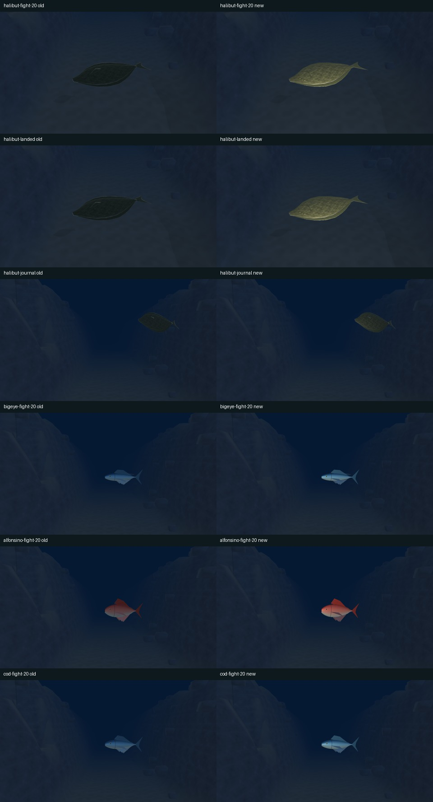
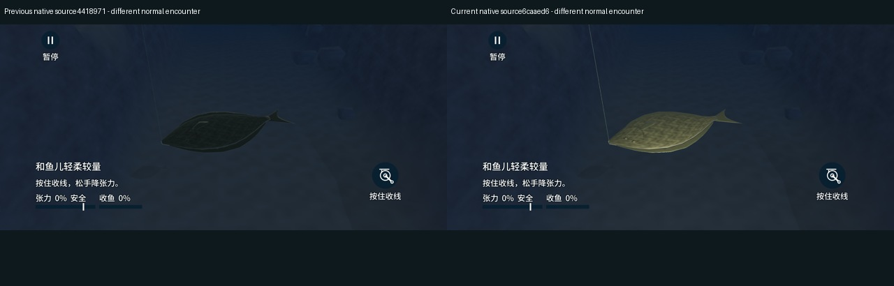

# 深水近景照明改进

旧版扁鱼镜头已经能展示完整体形，但原生画面中的眼侧和花纹仍接近黑色。现复用原 ResearchCameraFill，让它从最终镜头的右上方照亮近景；色调为中性偏暖、强度36、角度80、距离20。水面关闭、离开海域恢复，暂停不增加自动运动；扁鱼、图鉴和观察的最终镜头调整完成后再定位灯光。三盏已有聚光灯、无附加阴影、每对象4灯预算保持；没有新增 HUD，也没有提高全局曝光或修改雾、环境光、太阳衰减、模型及贴图。

## 对照与源检查

首版18强度的28张同姿态图虽工程检查通过，人工查看仍偏暗，保留为视觉 PARTIAL；调整后最终28张 Metal HDR4×MSAA 覆盖四物种/七视图，旧灯和新灯均保留首绘/重绘，全部零像素差。6项定向Editor、8项PlayMode通过，覆盖研究灯与最终斜俯视的关系、光束内主体、水面关闭/场景恢复、原有目标网格/鱼线/暂停/放流/图鉴和沉浸导航。430份既有模型/贴图、其他Runtime及数据文件保持字节相同；UI、随机选择、积分和存档格式未改。初版亮度调整不冒充非零测试失败。

## 原生来源与真实随机流程

冻结源码 `6caaed6450815a5ec7a1efe919fdea75e2cb1548`，游戏/工具摘要 `556d58ad72594bc745937b44c1cc1291ed6ba1cc26a8bcd45ae62ef8e660c000`；同一 ARM64 模拟器 App 摘要 `b0e38658f2679c2d7f1ffc11f1e05e4e1cc61eb4b881ee639e1ff57061a1d800`。Unity 导出、Xcode 编译通过，两个项目拥有的模拟器安装后均核对实际文件。Player 内的目录文本与源码14,424字节完全相同，陆坡包含 bigeye/alfonsino/cod/halibut。

使用以前真实 UI 成长获得的隔离副本，每次通过普通抛竿、生产随机选鱼、提竿/控线/收鱼/放流新增一条记录，未指定鱼种、随机种子或生成奖励。手机首批12次没有遇到庸鲽，首批结果 PARTIAL_HALIBUT_NOT_ENCOUNTERED 保留；平板第7次遇到后，继续新的手机隔离流程，第14次才遇到。全部21次结果均保留：

| 设备 / 次序 | 随机鱼种 | 新增分数 |
| --- | --- | --- |
| phone / 01 | cod | 171 |
| phone / 02 | bigeye | 150 |
| phone / 03 | alfonsino | 110 |
| phone / 04 | bigeye | 221 |
| phone / 05 | cod | 248 |
| phone / 06 | alfonsino | 106 |
| phone / 07 | cod | 190 |
| phone / 08 | cod | 108 |
| phone / 09 | cod | 170 |
| phone / 10 | bigeye | 128 |
| phone / 11 | bigeye | 165 |
| phone / 12 | cod | 158 |
| tablet / 01 | alfonsino | 100 |
| tablet / 02 | bigeye | 178 |
| tablet / 03 | cod | 176 |
| tablet / 04 | alfonsino | 208 |
| tablet / 05 | bigeye | 271 |
| tablet / 06 | cod | 116 |
| tablet / 07 | halibut | 165 |
| phone / 13 | alfonsino | 108 |
| phone / 14 | halibut | 115 |

这21次各自从同一个设备原进度的独立副本开始，不是21次连续成长，也不是鱼种概率研究。每次旧记录前缀、总积分独立重算、设置/装备/观察及原海域恢复通过。Ready/Bite/Fighting 保持两个交互按钮与中央空白，HUD最高手机约12.034%、平板约4.455%；未新增收鱼遮挡或改变布局。

手机庸鲽6.79千克/115分、平板11.93千克/165分，控线、收鱼、放流原图均查看，鱼体与眼侧比旧源清楚；镜头保持，鱼游离视野。新进程读取新鱼获的字节相同副本，手机26条/4570分、平板21条/3868分，图鉴/20装备/12模型提示通过；图鉴在原存档海域展示，不当作陆坡新照明的同姿态对照。该过程没有覆盖原件。

[手机实际四图](../art/previews/deep-water-lighting-native/phone-contact.jpg)、[平板实际四图](../art/previews/deep-water-lighting-native/tablet-contact.jpg)、[手机控线至放流](../art/previews/deep-water-lighting-native/phone-fight-release.mp4)、[平板控线至放流](../art/previews/deep-water-lighting-native/tablet-fight-release.mp4)。前后原生图来自不同随机遭遇，不作为严格同姿态比较；严格对照见上面的 Editor 图。两段约13.3秒录屏均查看12个合计抽帧，仅截取已核对的游戏窗口，没有主页、音频、调亮或改色，只缩放和30fps采样，不是实际运行帧率证据。

21×21帧加两次重启各6帧，共453张原生PNG解码核对；更新前133份旧进度相关文件（69主文件）全部逐字节保持。

## 失败、交付与剩余项

源码6caaed6首次CI因资产清单仍记录旧场景prefab摘要而失败。仅修正对应摘要和说明后，69fe46c CI通过；游戏/工具摘要与已编译App保持不变，旧失败没有抹除。后续证据提交应另按准确HEAD查CI。历史独立审计仍INCOMPLETE，不以本轮回执替代完整历史证明。

本地字段仍为0.1.0(8)，与Apple TestFlight旧冻结1bdfa78的构建8不同；本轮只做模拟器，没有更新个人手机或上传TestFlight。构图与补光实现已落地，但高光偏硬、眼部造型、自然鳍波和完整美术仍PARTIAL。首套用户方向、科学/A1–A3、其余成品物种与钓具、儿童图标理解/3分钟首鱼、OS实体触控、双真机20分钟及当前来源TestFlight实际安装均未验收。任务4.10、完整产品与apply不勾选。约束见[照明设计](../docs/38-deep-water-lighting.md)，结构证据见[JSON](deep-water-lighting.json)。

本轮27项已完成测量与开始、当前apply attempt、回执SHA及串行区间核对，既有状态对象保持；检查自身随后另留完成回执。当前本地非零测量为0项，远端首次CI失败单独保留。此核对不改变历史独立审计INCOMPLETE。
