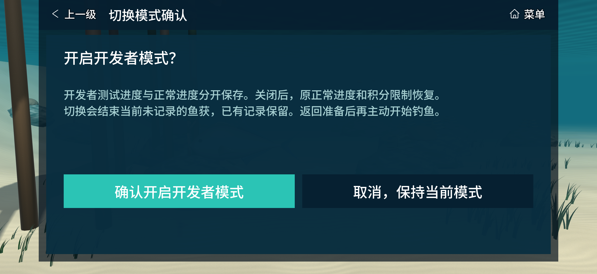
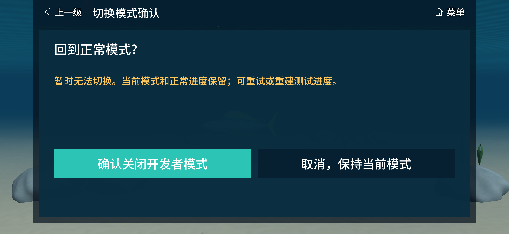
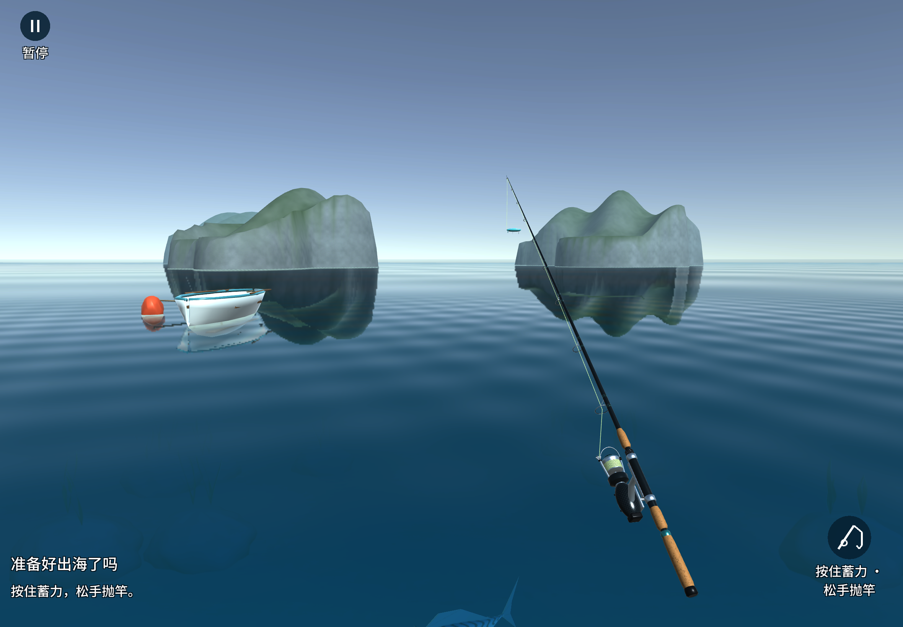

# 本人开发者模式：实现与验收

开发者模式已实现，当前build 9的手机／iPad模拟器功能和页面验收PASS，完整产品仍PARTIAL。入口：首页或暂停 → 设置 → 家长区与隐私 → 家长验证 → 开发者模式 → 开启并确认。普通发布构建同样可用，不依赖Unity开发构建。TestFlight 0.1.0 (9)已VALID／INTERNAL_ONLY／IN_BETA_TESTING，已分配本人授权两账号内部组；指定邮箱仍INVITED，实际安装NOT_RUN。

零积分即可选择三海域、全部二十钓具和三个保护观察，并查看十二鱼种图鉴模型；钓鱼、发现计数、任务及积分结算保持真实，不注入完成记录。正常／测试进度独立保存，关闭恢复原正常进度和门槛，再开启恢复测试历史，重启保持上次选择。切换成功后回准备并保持暂停；取消或写入失败保持当前模式。没有新增游玩常驻HUD。

| 当前冻结范围 | 实际结果 |
| --- | --- |
| Editor规则、资产与存档 | 84通过 |
| 本轮DeveloperMode PlayMode | 1通过，包含三阶段页面及场景重载 |
| 发布保护工具 | 12通过，合成数据／mock，无真实邀请 |
| 同一个ARM64 Simulator App | 两端各3个外部启动进程、376检查、40帧，全部PASS |
| 零积分实际入口 | 3海域／20钓具／12鱼种模型／3保护观察逐项访问 |
| 独立真实玩法 | 手机黄鳍金枪鱼210分、iPad鬼头刀200分，各1条真实放流和3观察 |
| 正常进度保护 | 222份已有进度文件逐字节一致，含112份正常主存档；新隔离根正常主文件／备份也保持 |
| 页面实际图审 | 80张原生截图由8张总览覆盖，另审阅6张原尺寸图；确认操作及失败提示无需滚动 |
| TestFlight／个人手机 | build 9已处理并加入本人两账号组，指定邮箱INVITED；未操作实体iPhone，实际安装NOT_RUN |

冻结源码`5e4f9700468e045bac40e631f5ab018a5f8e6ad7`，来源摘要`17a84537c126d9a4f3d46edf34d87b13abf87bb6beb39ae2d1219c4db5844434`，App摘要`6b6bf393383b96cc2b605c724287446f61c9d7d8c57281f35d975cb8b77363d6`。本地Simulator使用0.1.0(9)，不是Apple发行包或真机安装证明。正式签名包来源、归档和IPA另行冻结。

模拟器B轮834dffc已通过双端三进程，各40帧、374检查，测试积分241／254，214份已有文件保持；C轮在此基础上整理手机确认页并新增失败提示可见检查，以上表格是当前C轮结果，不能把两轮截图或检查数混合相加。B轮实图显示失败提示落在手机视口下方；640×480的headless探针实际通过，不能声称它复现了手机裁切。当前确认页缩至304点，说明／错误共享可见区域、两个54点操作并列；实际两端画面与安全区检查均通过。

初始639144a的原生编译因120 GiB硬底线被拒绝，拒绝及历史导出仍保留；该阻塞已被后续B/C原生成功取代。新C流水线首次原生编译退出65：Unity追加导出在GameAssembly中重复登记同一脚本引用。保留失败后，仅删除生成工程中一个完全相同的重复引用，再用同一缓存成功编译。没有删除不同脚本或修改游戏逻辑；原生g0／两worker配置沿用。共享适配器首次以12.0传入只接受整数的CLI时被参数解析拒绝，改为整数后准入，没有降低12 GiB预算或120 GiB底线。

完整测试／留存／导出／失败编译受`run-e6d631f851cd49e792e2592296b8dfc8`保护；恢复编译／双端安装／进度核对／截图和收据受`run-306d2c972d5c4d399b321c7df00a7acb`保护，均申报12 GiB。第二份私有流水线回执中的scope沿用了整条逻辑流水线描述；它并没有在第二租约内重跑第一段测试。复用同SDK／配置的导出和DerivedData，覆盖旧路径前已完整核验保存上一生成工程与App。详见[本机构建与缓存](../docs/46-local-build-storage.md)。

本轮也修复蓝鳍鲹FBX更新后prefab子材质错序导致的全黑虹膜／蓝色嘴缘，源几何／贴图／动作保持；相关84 Editor及早一冻结4项世界／动画／图鉴Play回归、126离散GPU视角和252张首／重图分别保留。[实际材质修复范围](bluefin-gill-import.md)不是自然连续游动、科学审阅或最终美术通过。

[模式设计](../docs/45-developer-mode.md) · [完整当前小型回执](developer-mode.json) · [本人build 9说明](../docs/47-beta9-review.md) · [初始33条测量完整性](developer-mode-records.json)。最后一项只覆盖初始增量，独立历史审计仍INCOMPLETE。失败、旧阻塞和每轮来源均保留；完整产品、原美术／儿童／真机任务及apply不标记完成。所有模型仍prototype，其他成品物种／钓具、最终拟真、美术／科学／用户、儿童、OS触控和双真机20分钟继续开放。

2026-11-25发行完成：同一5e4f970来源已冻结正式iOS工程、验证签名归档与内部专用IPA，单次上传后Apple返回VALID／INTERNAL_ONLY／IN_BETA_TESTING；仅本人授权两账号组，指定邮箱仍INVITED，测试说明已核对。实际TestFlight安装、真实触控和双真机仍NOT_RUN；[独立发行回执](testflight-0.1.0-9.json)。

本后续增量52条测量已结束，5条失败保留；[局部完整性检查](developer-mode-native-records.json)在自身开始时截取了前51条，末条自身回执现已确认exit 0。旧1685对象／回执摘要保持，新回执、绑定及新结束区间的串行顺序通过；不修补旧缺失证据，正式历史审计继续INCOMPLETE。收尾读数190.81 GB，200 GB日常工作目标尚未达到；共享120 GiB硬底线与全部活跃预算保持，未扩大清理范围。
