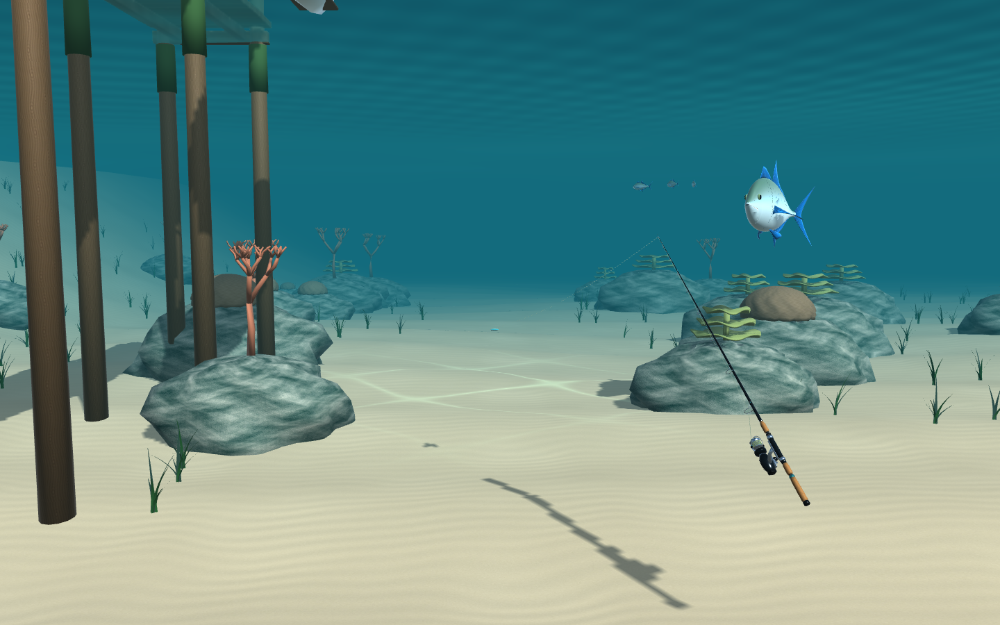
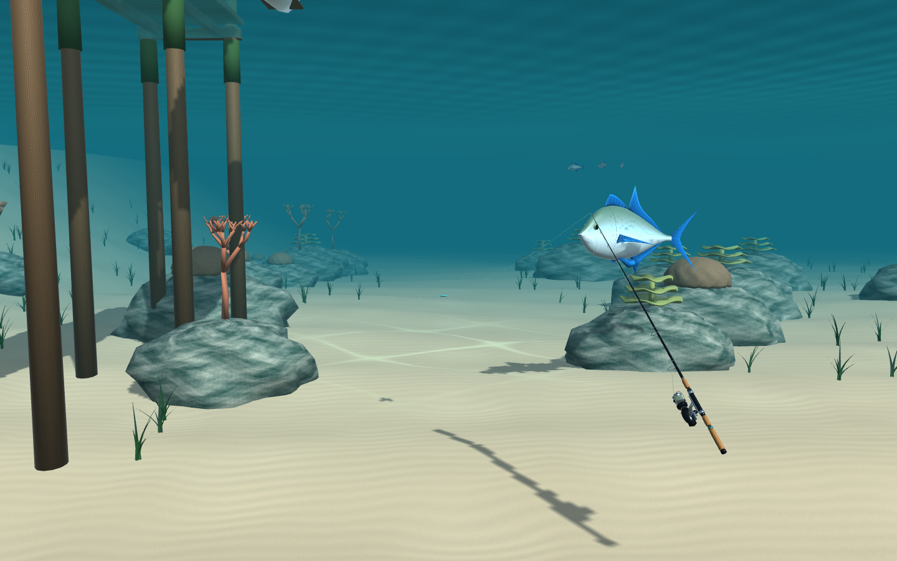
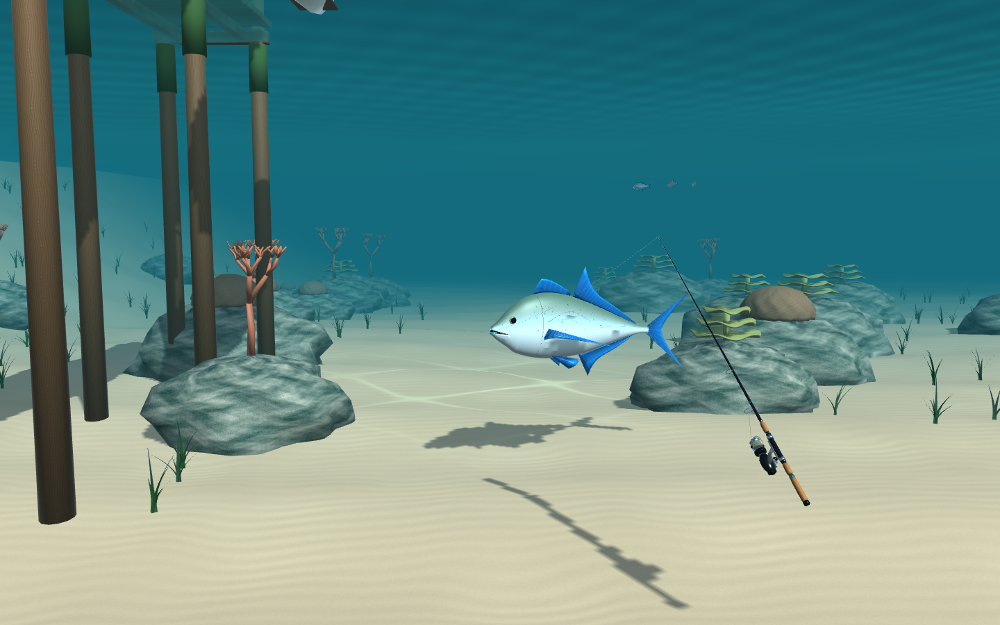
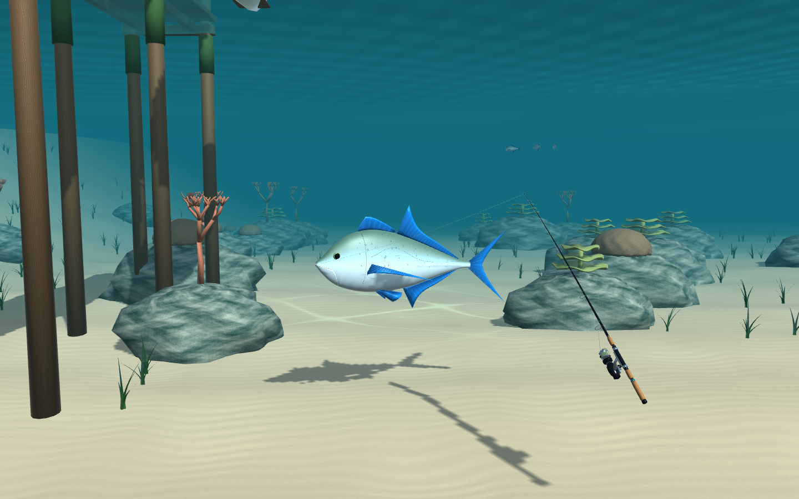

# 拟饵接近与收鱼表现

2026-11-24。实现 IMPLEMENTED；整体、美术与设备验收仍 PARTIAL/NOT_RUN。本轮复用现有英雄鱼与纺车钓组，不制作其他物种，不改变捕获池、等待时间、张力、奖励或存档格式。机器回执见 [JSON](fishing-encounter.json)。

此前目标鱼始终在前景游动，拟饵固定不动；进入收鱼阶段后，鱼线立即离开嘴部回到固定位置。现在 Casting 使用从真实竿尖出发的抛投弧线；Waiting 沿预定路线接近拟饵；Bite 显示嘴部拟饵；Fighting 随收线进度靠近前景；Landed 保持嘴部鱼线，直到记录成功、开始放流才解除。拟饵鼻端对齐目标，鱼线在 Animator 更新后的 LateUpdate 读取嘴部锚点。

这是固定钓鱼镜头中的表现路径，尚未实现拟饵感知/觅食AI、完整物理抛投或水上船钓视角。Ready 仍展示预览鱼。减弱动态维持同一静态鱼姿，关闭抛投/接近的连续运动；暂停使用状态机同一时钟。动画不决定咬钩、积分或任务。

## 画面

以下为当前源资产的 Editor Metal 离屏原图，1440×900、LOD0，手动采样动画；没有玩家UI，不是原生窗口或iPhone/iPad截图。全部八张已逐张审阅，鱼体高光、形态及海湾整体自然感仍须美术/科学/用户复核。

| 等待开始 | 接近途中 |
|---|---|
|  |  |
| 咬钩 | 收鱼 |
|  |  |

另有[抛投](../art/previews/fishing-encounter/01-cast.png)、[嘴部近景](../art/previews/fishing-encounter/04-bite-close.png)、[控线开始](../art/previews/fishing-encounter/05-fight-start.png)、[控线途中](../art/previews/fishing-encounter/06-fight-middle.png)。

## 验证与保留失败

- 39项Editor、8项无画面PlayMode、Mac编译通过。新增验证包括时钟暂停、阶段位置/朝向衔接、左右布局通道、投掷力度端点、减弱动态、实际动画嘴部/拟饵/鱼线连接和Landed连接；既有记录失败重试、四次放流、图鉴36布局、鱼群及音频检查保留。
- 蓝鳍鲹三LOD在固定swim 0.2秒姿态的合并包围盒，经过132个等待/控线位置，对比海湾三LOD共137054三角面的包围盒，均不相交，并位于环境鱼群完整安全体积前方。这是有限位置与固定动画采样的保守检查，不代表连续碰撞或全部物种验证。
- 三个咬钩/控线/收鱼姿态的实际LOD0蒙皮网格，鱼线分段逐三角面检测通过；嘴部0.12米连接区域除外。该检查不覆盖所有动画时刻。
- Editor GPU八图通过，接近距离4.148494米；最大鱼线/嘴部连接误差约0.00000064米，拟饵鼻端约0.00000066米。数值只是源场景锚点检查，不等同于视觉成品通过。
- 初始测试直接发送Editor MonoBehaviour生命周期消息被Unity断言中断；改为幂等初始化和显式表现步进入同一生产代码。断言失败回执保留，没有忽略日志。
- 初始较长低位路线与后部片状珊瑚包围盒相交，随后路线仍过于接近环境鱼群体积。保留两次失败后，缩短并抬高起点/控制点，未放宽几何间隔检查。最初离屏图保留在本机，不作为最终候选。

当前CUA确认Mac仍锁定，未重复启动已知无法检查的原生窗口。iPhone/iPad安全区、触控、连续20次实际UI循环、儿童首鱼3分钟、20分钟性能、听感以及A1–A3均未通过。其他十一鱼种和两海域仍为样板；保护观察生物/完整生态尚缺。本轮新增内容不在冻结05c8cc7的TestFlight 0.1.0 (3)中，安装也未验证。

复现：串行运行 `python3 tools/game.py tests`、`python3 tools/game.py tests --test-platform PlayMode --label <新字母数字标签>`、`python3 tools/game.py encounter-review --label <新字母数字标签>`、`python3 tools/game.py mac`；阶段验证须经项目iSpec measure入口记录。原始日志和失败XML仅保留本机，公开内容只有本项目原始渲染与脱敏摘要。
