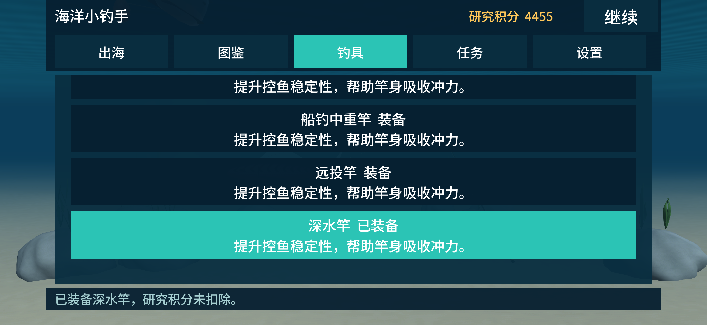
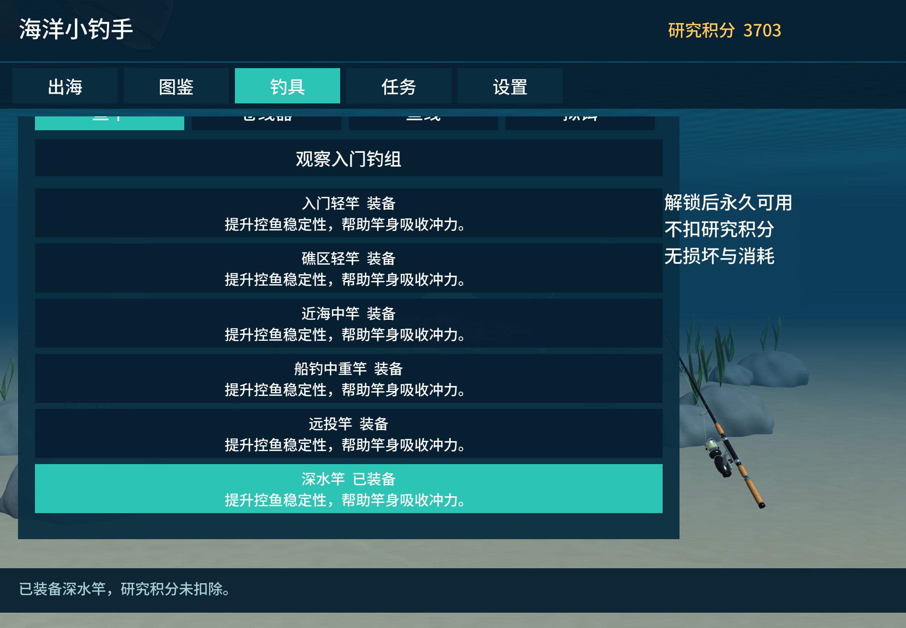
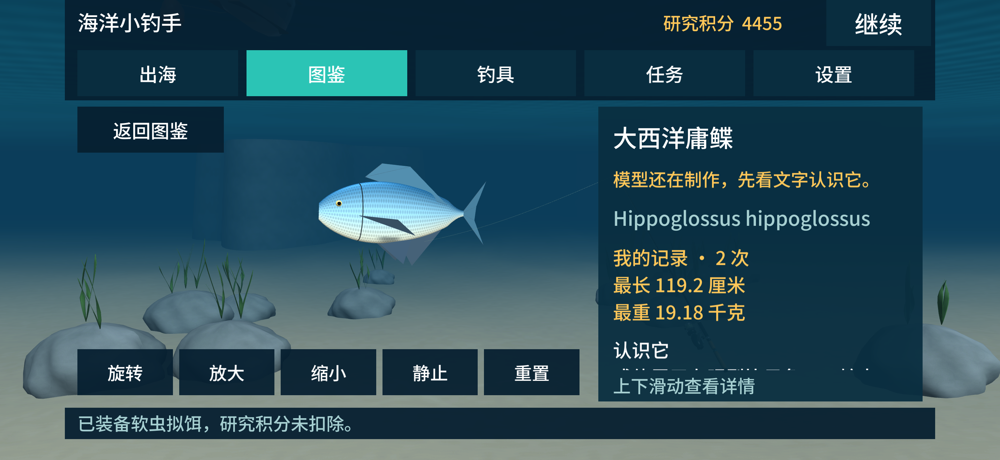
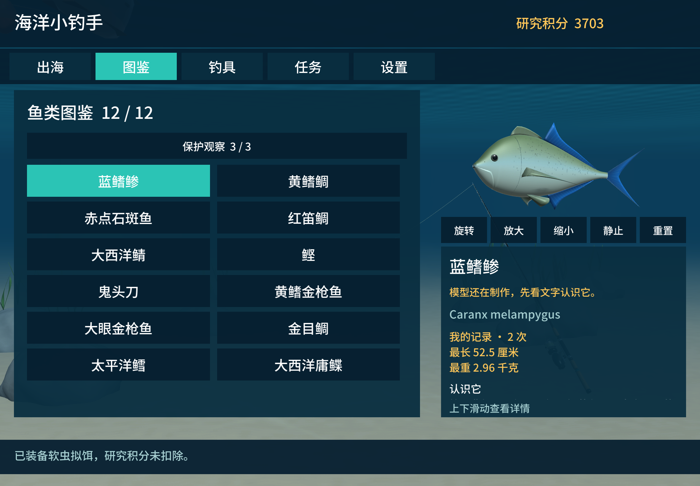
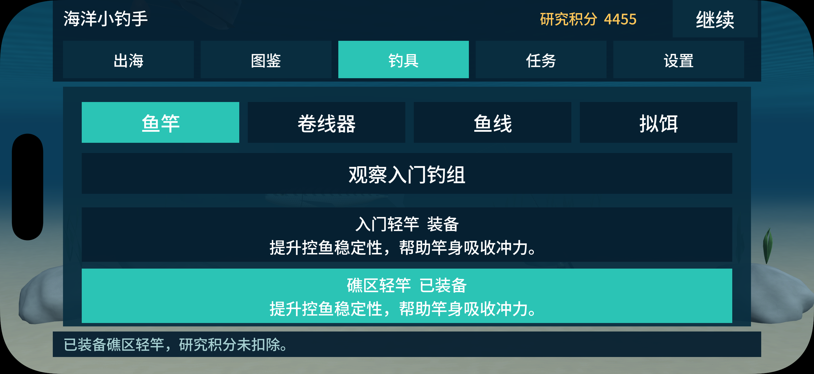
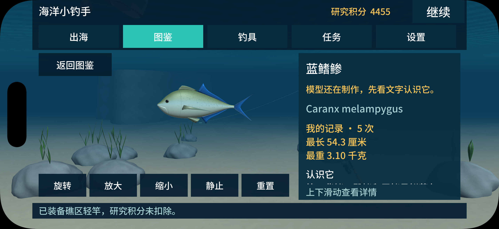

# 钓具反馈与模型制作状态

冻结8583697 / 源摘要e7c71cec，ARM64 Simulator包3643828a。此记录覆盖沉浸式改版之前的定向修复，完整产品仍PARTIAL。

旧版选择底部深水竿后，滚动位置从0跳到1，已选条目离开视口，射线也无法再命中；实际红测退出2保留。修复按钓具类别保留滚动位置，装备成功信息在写盘成功后显示，进入钓具页使用对应提示。阻断临时文件写入时不显示成功、不改变原装备/主文件，解除阻断后可重试。1项定向PlayMode、52项Editor通过，原字体722字符核验通过。

同一新包在手机和平板各检查20装备：每次选中仍完整可见且最上层命中、提示已实际生成、落盘一致，最大归一化滚动差0。12条未完成鱼模型均显示“模型还在制作，先看文字认识它。”，两端均在视口内；这不修正庸鲽形体或宽屏裁尾，也不代表成品/科学验收。

输入分别复制自0bea41d真实原生UI成长的25条/4455分及20条/3703分存档，复制前SHA一致。只改变副本的4个装备字段，鱼获、积分、观察、设置及其余字段不变；本次0条新钓鱼。五份原始QA存档逐字节保留。12帧经两张接触表查看，另看6张原生原尺寸和2张鼠标操作原尺寸；以下6张原图均实际审阅后登记许可。

系统鼠标点击可见的“礁区轻竿”并显示正确反馈、打开英雄鱼详情看到制作提示已确认。两次拖动被表现为切换类别/选择装备，一次滚动没有移动，系统拖动滚动NOT_CONFIRMED；没有事件轨迹可区分输入提供方与应用原因。程序设定ScrollRect位置后的射线点击不能替代系统触控滚动。

没有本次全量14项PlayMode或新45轮成长。无个人手机/TestFlight操作；本地配置号5不是冻结a6bcf8e的TestFlight包。儿童、真实触控、最低OS、用户/科学、美术A1–A3、完整模型和双真机20分钟仍未验。历史独立测量审计仍INCOMPLETE。结构化结果见[回执](gear-feedback-and-model-status.json)。
