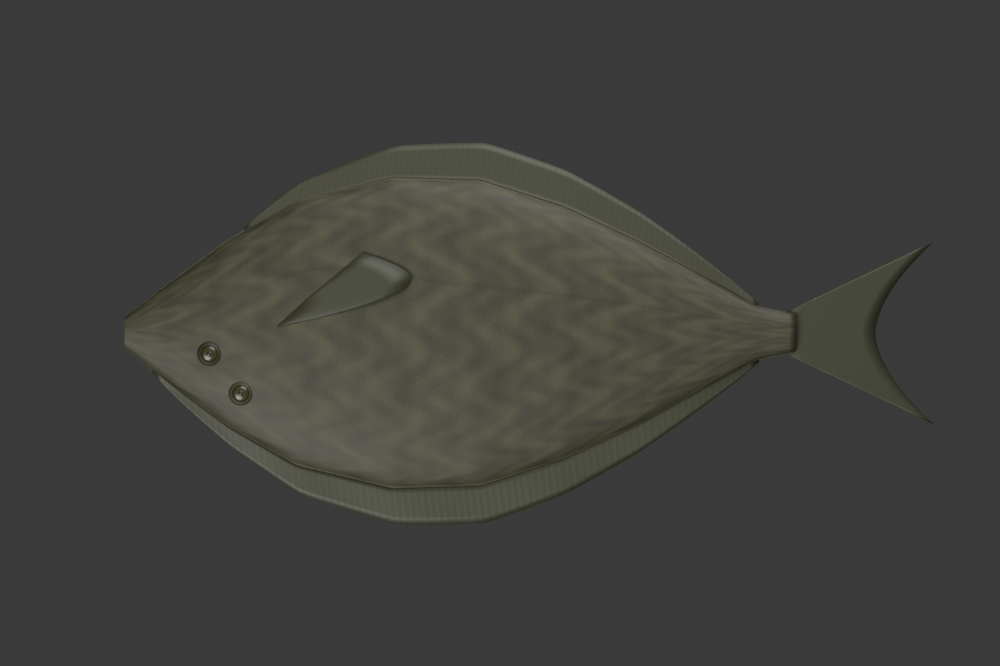
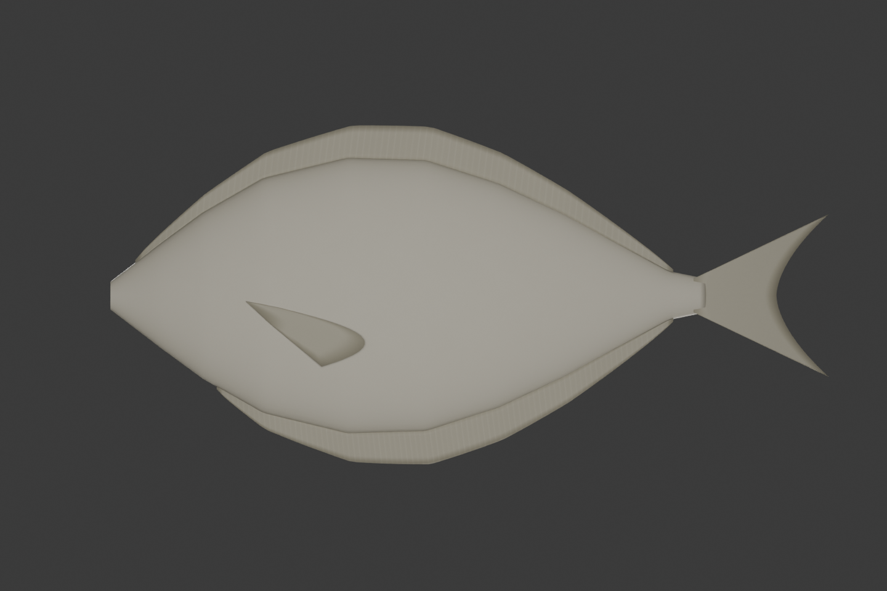
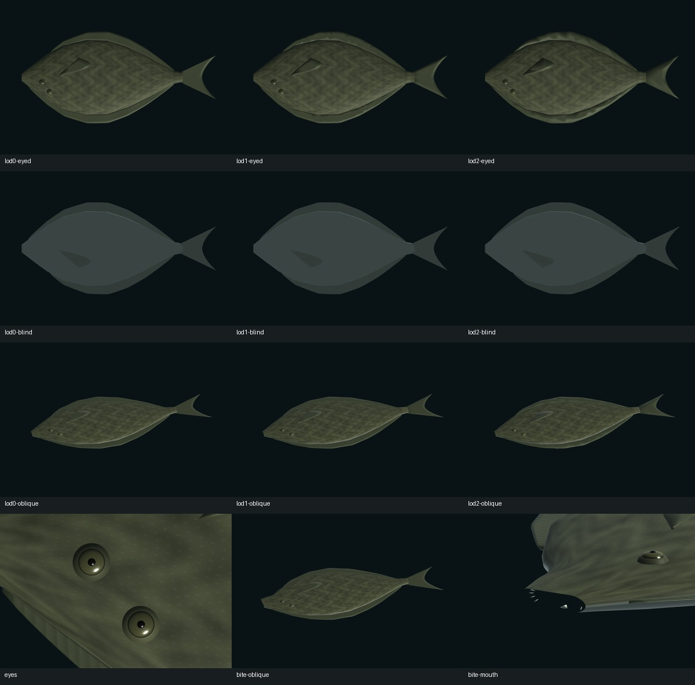

# 庸鲽候选：工程通过，美术未通过

2026-11-25，基线 ca44a18，integration/art-candidates 分支。针对旧样板“普通鱼形”制作一个独立大西洋庸鲽候选；**尚未替换实际遭遇或图鉴里的旧模型**，没有新 Player、安装或 TestFlight 包。

| 范围 | 结果 | 证据 |
| --- | --- | --- |
| 可编辑源与三 LOD | PASS | 20336 / 8134 / 3049 三角面；122 个源条件通过，七动作 35 姿态实际变形读取 |
| 解剖方向 | PARTIAL | 扁体、朝上眼侧双眼、浅盲侧、凹尾已呈现；科学、细节及最终自然感未验 |
| Unity 导入 | PASS | 三网格、五材质槽、七语义动画、Box trigger、随颌钩点，实际导入检查 |
| 定向 Editor | PASS | HalibutAssetTests 四项与原 BluefinMotionTests 一项，共 5 项；首次 3 失败、第二次 1 失败保留 |
| 隔离 Metal 图 | PASS（绘制） | HDR / 4×MSAA，12 机位姿态共 24 PNG，首绘与重绘逐字节一致；开口钩点位移约 0.09488 世界单位 |
| 口部美术 | **FAIL** | 近景口缘/牙根连接缺失，牙齿呈脱离感，禁止据此判为成品或接入生产表现 |
| 源展示 | PASS（生成） | 7 张源静态图、36 帧转台；共 67 张最终源/Metal PNG 解码检查，转台视频 960×640、36 帧/12fps，仅展示帧率 |
| 既有内容保持 | PASS | 核对 968 份既有 game/art 文件，966 份字节相同；预期变化仅资产登记与 Editor 动画 helper 的可选目录参数；既有 Runtime、模型及当前原生 App 摘要不变 |
| 本候选游戏流程 / 双端 Player | NOT_RUN | 未接入选鱼工厂，不能借用旧双端完整成长结果 |
| 用户 / 科学 / A1–A3 / 儿童 / 真实设备 | NOT_ACCEPTED | 完整产品和 apply 继续未完成 |

实际形态依据与可重建命令见[制作记录](../docs/38-halibut-anatomy.md)。完整数字、文件摘要及本轮测量回执摘要见[JSON](halibut-anatomy.json)。

## 画面

[源转台视频](../art/previews/halibut-anatomy/source-turntable.mp4)与[36 帧接触表](../art/previews/halibut-anatomy/source-turntable-contact.jpg)用于检查立体轮廓。眼部已单独查看原尺寸；[口部原图](../art/previews/halibut-anatomy/unity-bite-mouth.png)明确保留未完成表现。

## 失败与限制

源 A 的距离 UV 越界；源 B 渲染三 LOD 重叠并裁尾；Unity 首轮测试三失败；第二轮仍有重复应用 FBX 缩放的坐标失败；Metal A 眼部特写错侧。源 C、第三轮 Editor 与 Metal B 是当前对应产物，旧证据留在独立本地目录和测量中，不覆盖重跑结果。

图像成功生成和重复一致仅证明该隔离条件下绘制稳定。口缘、牙根、鳃盖、眼眶、边鳍波动与胸鳍动作仍待制作，画面仍有塑料感。源工艺已从普通鱼形迈向物种独立候选，距离“好看、拟真、完整”的验收仍有明确缺口。首套风格未获用户确认，不批量生产其他物种。

基础规则、12 项发布工具回归及待公开文件审查通过。本轮记录检查核对新增 21 项完成与其启动、attempt 绑定、回执 SHA、串行区间和旧对象保持；检查自身当时为唯一运行项，其随后完成回执另保留。三次非零命令和视觉否决均保留。历史独立记录审计仍 INCOMPLETE，不据此抹去旧缺口。master、个人手机和 TestFlight 未变，4.9/apply/完整产品不勾选。
