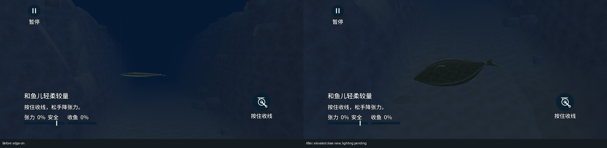

# 扁鱼游玩构图修正

本页保留4418971/3849caec的构图阶段与当时偏暗结论；后续6caaed6/b0e38658同姿态与双端近景补光证据见[深水照明](deep-water-lighting.md)。

## 实际遭遇发现的问题

2026-11-25，基线 bdb9dc9。首先复用已安装的 88c6879 / App 7dc15a24 模拟器包和既有正常 UI 进度的隔离副本。未指定目标、修改随机种子或生成鱼获。手机前三次正常陆坡遭遇依次为大眼金枪鱼、大眼金枪鱼、庸鲽，各新增一条放流记录，分别 238 / 115 / 255 分；三次总账及已有记录前缀独立核对通过。

庸鲽第三次的控线、收鱼、放流截图暴露：默认远处平视镜头几乎只看到薄边，难以识别体形。因此流程 PASS，**原游玩构图 FAIL**，不能用上一轮图鉴画面覆盖它。

## 调整

新增扁鱼专用水下近景：镜头从鱼体上方斜看，鱼保持水平游姿；眼位限制在水面下。平滑跟随正在控线的目标，暂停固定当前视角，放流保持最后视角，让鱼游离镜头；观察页与图鉴继续使用各自原有镜头。其他鱼型、随机选择、积分和 UI 布局不变。

8 项定向 PlayMode 通过，包括实际扁鱼目标、原默认水下镜头作为负对照、新视角在水面下且能从上方看鱼、暂停固定、放流不追随、既有动画与沉浸菜单/仪表/失焦回调。第一轮红测和初次修正版均保留；夹具手动推进跳过了真实等咬钩时间，镜头仍在水面过渡，新增等待实际过渡完成的前置状态后才核对水下构图。

仪表夹具同时暴露广播刷新问题：`Component.SendMessage` 会向同一对象上的多个行为派发，禁用的兄弟行为也会收到。本轮独立 probe 已复现这种派发；UI 边界测试改为定向调用 GameUI.Update，保留真实失焦注入、继续按钮、字号/区域、808 次标签和存档字节检查。[Unity 官方语义](https://docs.unity.com/en-us/engine/6000.3/script-reference/unityengine/component/sendmessage)支持该修正。初轮 value100 进入 Landed 的失败保留，不能据此唯一归因更早历史的首次空引用。

## 新原生包与随机遭遇

源码 `441897100c195df7d43270d328fbcaf7e49fca86`，源码摘要 `0a05e8fcae18d0139dde04dadb50e622f8a6ce431cc2e2174858dc5aaa05ed25`；同一 ARM64 模拟器 App 摘要 `3849caec442cef6e578e631130d98e8a26e085d084d9249595226f07f097257a`。本地字段仍为 0.1.0(8)，不是 Apple TestFlight 的同名旧构建，没有上传。

| 来源 | 设备 / 次序 | 正常随机结果 | 新增分数 |
| --- | --- | --- | --- |
| 旧镜头 88c6879 | 手机 1 / 2 / 3 | 大眼金枪鱼 / 大眼金枪鱼 / 庸鲽 | 238 / 115 / 255 |
| 新镜头 4418971 | 手机 1 / 2 | 金目鲷 / 庸鲽 | 130 / 257 |
| 新镜头 4418971 | 平板 1 | 庸鲽 | 191 |

全部为既有正常 UI 成长存档的独立副本，使用当前控制器的普通抛竿与均匀随机选鱼，未指定目标或注入记录/积分。每次一条新增放流记录，原前缀、积分独立重算、其他设置/装备和海域恢复通过。六次独立单鱼流程不等于新 20 轮连续验收，也不代表儿童或 OS 实体触控。

手机/平板庸鲽均已实际查看控线、收鱼、放流原图。能看到扁体与眼侧，放流离开保持的视角，没有新增常驻 HUD；Ready/Bite/Fighting 均为两个交互按钮，中心保持空出，记录的 HUD 最高约 12.034% / 4.455%。新进程再打开新鱼获的字节相同副本，图鉴/20 装备/12 模型提示核对通过，分别保持 26 条/4712 分与 21 条/3894 分。源数据与旧记录不覆盖。

[手机实际四图](../art/previews/halibut-framing-native/phone-contact.jpg)、[平板实际四图](../art/previews/halibut-framing-native/tablet-contact.jpg)、[手机控线至放流录屏](../art/previews/halibut-framing-native/phone-fight-release.mp4)与[平板录屏](../art/previews/halibut-framing-native/tablet-fight-release.mp4)。录屏仅截取核实后的游戏窗口，未收入主页/私人内容，无音频、无调亮或改色，只缩放并采样为 30fps，不作为运行帧率证据。已抽帧查看，不能据此宣布自然鳍波或最终动作通过。

六次流程各 21 图、两次重启各 6 图，共 138 原生 PNG 解码核对。第一阶段 117 份已有进度原件字节保持；新包替换前再保留 123 份（64 主文件），更新后全部逐字节一致。原件没有还原覆盖。

模型/贴图及其他 Runtime 的 383 份既有文件字节一致，UI 源码未改；游戏变化只在扁鱼镜头。29 项已完成命令与对应启动、当前 apply attempt、回执 SHA、串行区间和旧状态对象保持核对；检查自身随后完成另留回执。两条非零记录保留，历史独立审计仍 INCOMPLETE。

**照明与整体观感仍 PARTIAL**：深水主体过暗，细节与眼部对比不足；下一步需要完善探索照明和自然鳍波。源模型与贴图本轮未改，用户/科学/A1–A3、儿童和真机验收仍未完成。结构证据见[JSON](halibut-framing.json)，完整产品和 apply 不勾选，个人手机及 TestFlight 未操作。
