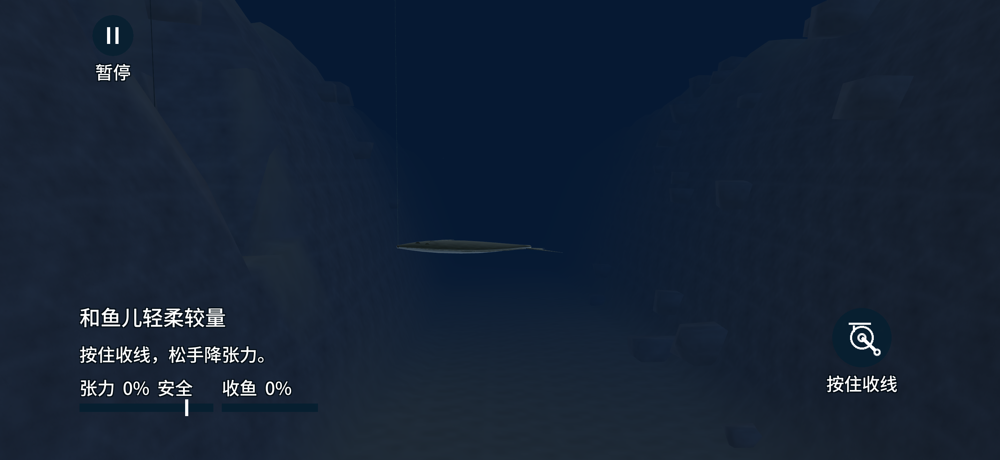

# 扁鱼游玩构图修正

## 实际遭遇发现的问题

2026-11-25，基线 bdb9dc9。首先复用已安装的 88c6879 / App 7dc15a24 模拟器包和既有正常 UI 进度的隔离副本。未指定目标、修改随机种子或生成鱼获。手机前三次正常陆坡遭遇依次为大眼金枪鱼、大眼金枪鱼、庸鲽，各新增一条放流记录，分别 238 / 115 / 255 分；三次总账及已有记录前缀独立核对通过。

庸鲽第三次的控线、收鱼、放流截图暴露：默认远处平视镜头几乎只看到薄边，难以识别体形。因此流程 PASS，**原游玩构图 FAIL**，不能用上一轮图鉴画面覆盖它。

## 调整

新增扁鱼专用水下近景：镜头从鱼体上方斜看，鱼保持水平游姿；眼位限制在水面下。平滑跟随正在控线的目标，暂停固定当前视角，放流保持最后视角，让鱼游离镜头；观察页与图鉴继续使用各自原有镜头。其他鱼型、随机选择、积分和 UI 布局不变。

8 项定向 PlayMode 通过，包括实际扁鱼目标、原默认水下镜头作为负对照、新视角在水面下且能从上方看鱼、暂停固定、放流不追随、既有动画与沉浸菜单/仪表/失焦回调。第一轮红测和初次修正版均保留；夹具手动推进跳过了真实等咬钩时间，镜头仍在水面过渡，新增等待实际过渡完成的前置状态后才核对水下构图。

仪表夹具同时暴露广播刷新问题：`Component.SendMessage` 会向同一对象上的多个行为派发，禁用的兄弟行为也会收到。本轮独立 probe 已复现这种派发；UI 边界测试改为定向调用 GameUI.Update，保留真实失焦注入、继续按钮、字号/区域、808 次标签和存档字节检查。[Unity 官方语义](https://docs.unity.com/en-us/engine/6000.3/script-reference/unityengine/component/sendmessage)支持该修正。初轮 value100 进入 Landed 的失败保留，不能据此唯一归因更早历史的首次空引用。

本次修正仍需新的原生包与真实随机庸鲽遭遇画面核对。第一阶段 117 份已有进度原件字节保持。源模型、贴图、自然鳍波、用户/科学/A1–A3、儿童与真机验收继续分开，完整产品和 apply 未完成。
