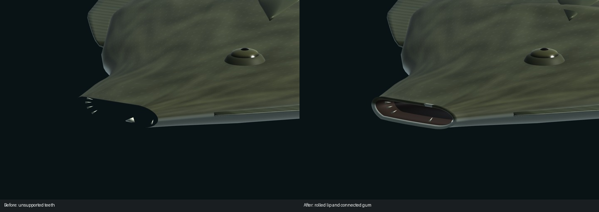
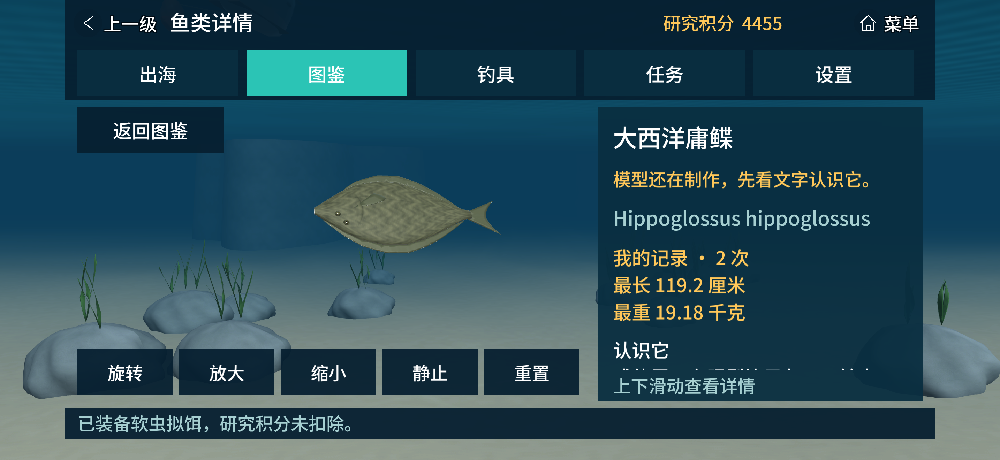
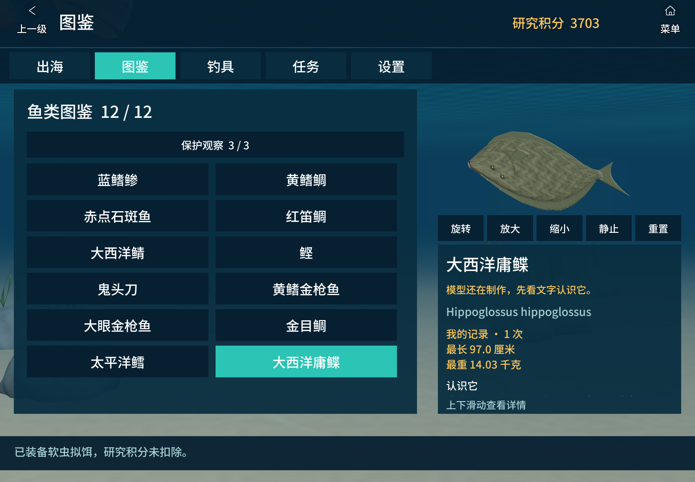

# 庸鲽口部与游戏内接入

2026-11-25，基线 eed9320。庸鲽候选新增连续外唇、牙龈、口内壁和咽底；口部与鱼体真实焊接，牙齿按牙根共同权重移动。鳃盖起伏与弯曲边界直接制作在鱼体表面。三 LOD 为 20784 / 8312 / 3117 三角面；新增牙龈材质后共六槽，最终性能预算仍待设备验收。

保存源 160 条检查通过，旧源使用同一检查确认缺牙龈且有 112 条口部开放边；新源为 0。七动作 35 姿态中，12 牙根到真实变形牙龈面的最大距离约 0.0000415 世界单位，属于归一模型尺度，不是所有鱼获的实际生理尺寸。Unity 六项定向 Editor 通过，包含在实际导入七动作/35 姿态上检查牙根贴合。隔离 Metal HDR/4×MSAA 的 12 组/24 图首绘与重绘一致，口部原尺寸已审阅。

口缘和牙龈连接已有改善，唇部仍有突兀高光、眼眶偏简化，鳃盖/凹尾比例与自然鳍波需进一步审阅；不是 A1–A3 或科学、用户审阅通过。

## 游戏路径

OceanWorld 现在按 halibut 加载独立 prefab，实际游动保持水平扁体。图鉴用倾斜展示角度配合原有旋转按钮查看两面，没有新增游玩 HUD 或修改 UI 布局；未完成模型提示保留。

新增 PlayMode 夹具在隔离存档中，用规则有效的基础鱼获解锁陆坡，并显式选择庸鲽验证生产模拟/表现接线。不是自然随机成长或儿童操作证据。三项定向 PlayMode 最终通过：实际网格选择、控线嘴部鱼线端点、结算及重复放流、放流实例连续性、图鉴重新选中同物种资源、旋转/缩放/暂停/重置及存档字节保持；原两项动画检查也在该组内。

第一次失败来自断言实例根名为 HalibutCandidate，但 Unity 保存后的实际根名是 Halibut；改为验证真实网格。第二次失败来自错误要求跨图鉴默认物种切换后仍为同一实例；改查同一物种资产，放流期间的同实例检查仍保留。首轮尚未执行的 EndOfFrame 等待同步改为普通帧推进，适配无画面夹具。失败回执保留，不改生产流程以迁就测试。

## 同包原生模拟器结果

源码冻结 `88c68797301075501a16ea53af4b77258bca9790`，摘要 `7658788767b0aa25998a7fc61f0b4cbe4b08a11725f3c3a0b815d0edc52b8627`。Unity 导出和 ARM64 Xcode 编译通过，App 摘要 `7dc15a24ed91fdb438c556fb65c8393dd012eaa97ca4302a7f3aa4c093b3de3b`，支持 iPhone/iPad。同一个新包分别安装在项目拥有的两个模拟器中，未卸载或清除数据。

手机/平板各 6 张实际画面，均完成 20 件装备选择与 12 个模型状态检查，庸鲽原尺寸画面已查看，鱼体未裁切。采用此前真实 UI 成长得到的隔离进度副本，分别保留 25 条/4455 分和 20 条/3703 分；鱼获、积分、观察与原有设置保持。新写回的副本仅补入旧存档缺少的默认 `underwaterOnly=false`，第一次独立比较因该已知新增字段不相等而失败；随后仅归一该缺失默认值，其他设置和总账仍严格比较。113 份更新前原件（59 主文件，含备份/临时/损坏样本）逐字节保持；没有还原覆盖它们。

[手机六帧](../art/previews/halibut-mouth-native/phone-contact.jpg)与[平板六帧](../art/previews/halibut-mouth-native/tablet-contact.jpg)是此次新包。控线/放流/嘴部鱼线的本轮证据来自定向 PlayMode；原生本轮只复核图鉴/装备，没有重新跑庸鲽自然遭遇、全成长或新 20 轮。外部安装流程约 73.5/68.3 秒，自动 UI 本体约 6.16/6.60 秒，均不作为儿童或物理性能指标。

本地 App 字段仍为 0.1.0(8)，与现有 Apple TestFlight 8 的旧冻结源码不同；本轮没有上传。个人手机未操作。模型仍为候选，完整产品、儿童/科学/用户/真实触控/双真机和 apply 继续未完成。结构证据见[JSON](halibut-mouth.json)。

本轮新增完成命令及启动、当前 apply attempt、原始回执 SHA、串行区间和旧状态对象保持另行核对；检查自身在执行时是唯一未完成项，随后完成回执保留。控制红测、两次夹具断言失败和默认设置兼容比较失败共四次非零记录保留。旧历史独立审计仍为 INCOMPLETE。
