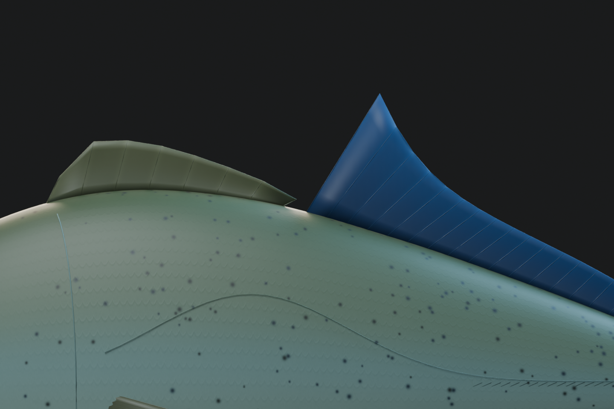
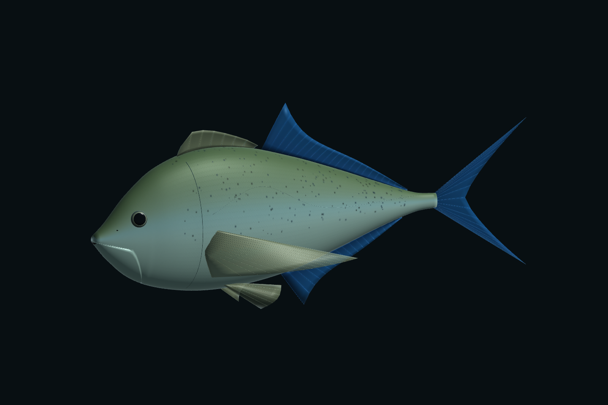
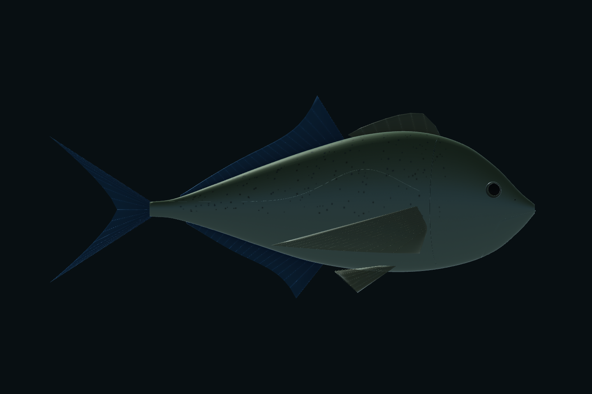

# 首条英雄鱼的薄鳍候选

蓝鳍鲹的膜和实体鳍条现已分开：膜为三个LOD各自重建的闭合渐薄壳，鳍条仍是不透明几何；原创RGBA颜色、法线、粗糙度和打包图已导入。身体、眼睛和口部仍不透明，12骨骼与七动作保留。当前是PARTIAL候选，不能视为拟真美术或完整产品验收。

三LOD实际24664/9864/3699三角面，LOD0保留25000预算；材质槽从六增至七，明确增加了绘制成本，尚无真机帧耗资格。源72处双壁测量全部通过：各LOD最小约0.000495/0.000511/0.000551、最大约0.001368/0.001376/0.001498模型单位。它们是作者网格测量，不是鱼类真实组织厚度。RGBA实际Alpha约0.631–0.969，参数也不是科学测量。

原始检查先复现缺失RGBA/膜材质/真实壁厚的问题。A版源检查发现未保存的技术图、胸鳍边界折返与LOD2薄壁失真；B版保留技术图并在简化后重建膜，仍因跳过边界控制点而有七处LOD2测量失败。C版保留全部边界射线，修正胸鳍边界次序后通过原有口/眼/UV/骨骼与七动作各五姿态检查，以及新薄壁检查。失败源和报告留在本机，不覆盖历史候选。

Unity使用库存URP Lit透明Alpha与Preserve Specular；调用安装版本材质状态API。膜不写深度或投影，实体鳍条保留深度和阴影；不宣称折射、彩色阴影或完整组织散射。前两次GPU对照因把ShaderLab Name当LightMode而未真正禁用膜，掩膜为空，均失败；更正为UniversalForward后C/D通过。最终D的1440×960、Metal、RGBA Half HDR、4×MSAA对照分别有50625/50827/52618个膜内部像素响应背景变化，不透明控制与静止重绘变化均为0。归一化背景RGB变化仅为诊断，不是生物透射率。工具曾留下Medium临时配置，现有finally还原；D前后QualitySettings/GraphicsSettings的SHA完全一致。

八张工作室源图经接触表检查；另查看原尺寸鳍近景、正反及斜/极斜GPU候选。薄鳍冻结4223d8d前，完整59项Editor与3项定向PlayMode（动画、整合世界、沉浸导航）检查通过；后续收鱼修正又串行运行上述3项定向检查并通过，没有把前一版59项冒称为修正版新全量检查。原生运行结果将在冻结新包后单独记录，不能由这组离屏检查替代。初包没有改变HUD、积分或存档。原生结果卡遮挡问题另行修正，积分和存档格式保持不变。

当前仍有偏简化的鱼体/嘴部轮廓、绿色及塑料感，薄膜工程通过不代表生物结构、色彩或好看已通过。科学/用户/儿童、A1–A3、实体触摸、最低系统和双真机20分钟仍未验收。英雄鱼/钓组用户方向审阅未获得，不批量生产其余物种。来源及完整限制见[制作约束](../docs/25-hero-fin-tissue.md)，结构数据见[JSON](hero-fin-tissue.json)。本轮没有个人手机或TestFlight更新；master与apply保持未完成。

首轮冻结4223d8d、包e34380d4，两端各15帧流程和新鲜教学首鱼落盘通过，228/183分；新鱼鳍实际可见。但手机原尺寸收鱼图中旧结果卡遮到背鳍，故该阶段画面判PARTIAL。新增检查计入所有可见Image背景并覆盖Landed，旧布局实际复现FAIL（2e1b05ac）。修正把鱼名、尺寸/重量与轻柔控线结果共三行放进底部既有提示区，移除中央结果卡；保持两个按钮与放流操作，收鱼也纳入15%和中央净空约束。修正版须经新包双端实际画面复核，不能沿用首轮通过结论。

