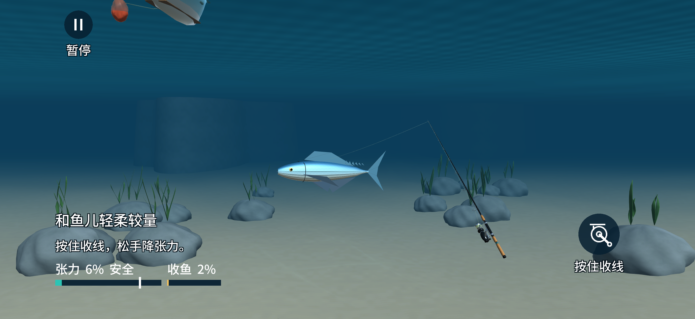
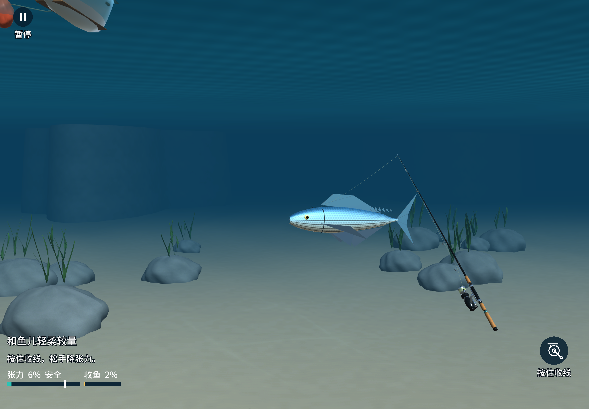
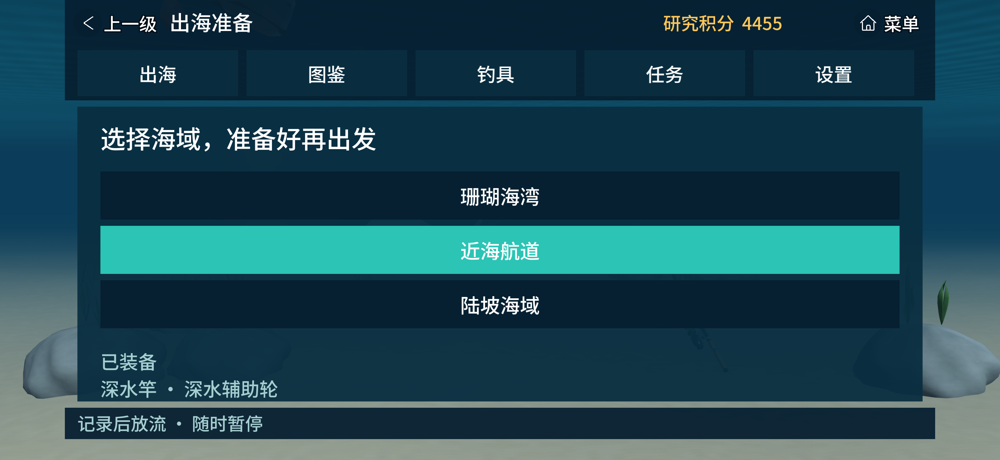
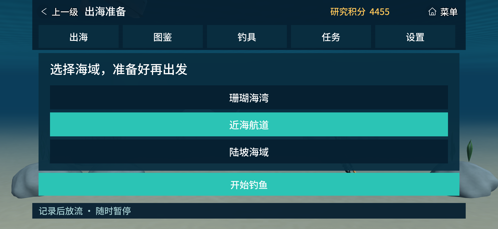
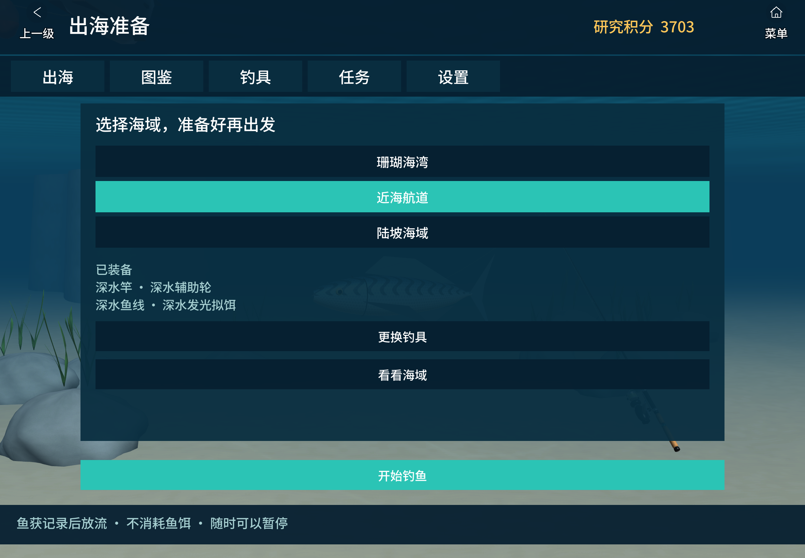
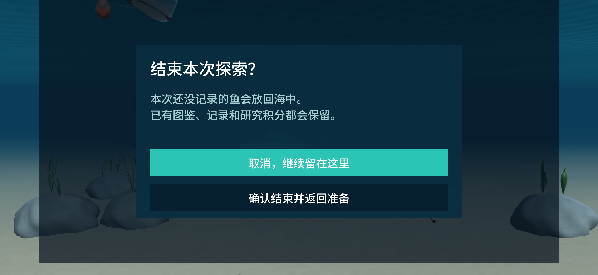
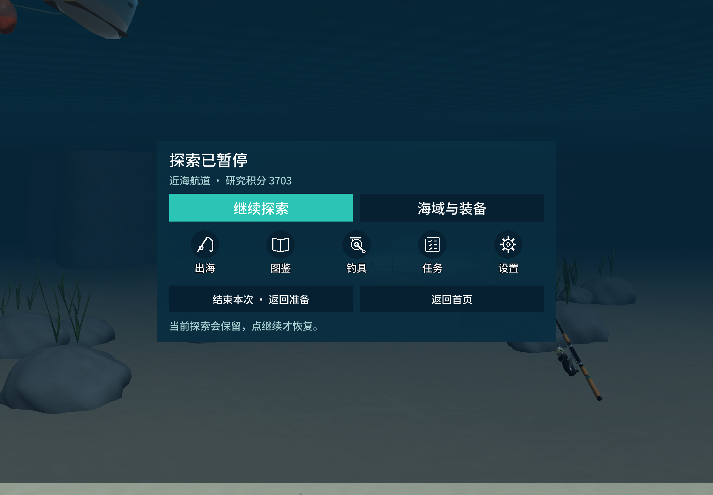
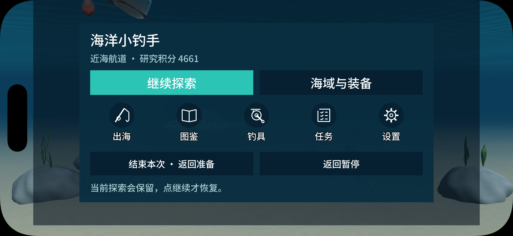

# 沉浸式界面与分层入口

后续已修复手机收鱼结果卡遮鳍：收鱼也计入HUD覆盖，结果收进底部三行。d99cd12修正版双端各15帧通过，含Landed最高12.228%/4.526%，原13份QA文件保留。下文保留此前冻结结果；最新原图与分层验收见[薄鳍与收鱼证据](hero-fin-tissue.md)。

首版已实现，最终df6b580 / 源摘要ad843090，ARM64 Simulator包ed43d567。手机和平板定向流程PASS；儿童/用户理解与真实触控未验，完整产品仍PARTIAL。产品层级与复核入口见[界面说明](../docs/23-immersive-interface.md)，数值/来源见[结构化回执](immersive-interface.json)。

实际钓鱼移除了顶部积分/全局导航、底部通用通知与两侧大面板，保留边缘暂停和阶段主动作；仅收线时显示小型张力/进度，警戒同时有刻线、“！”与松手文字。已完成教学后的准备/等待提示六秒后收起，放流反馈复用提示位置。原创形状图标配中文标签，左右手镜像，控件至少44点。

首页/暂停菜单承接独立海域/装备准备、图鉴、钓具、任务与设置；详情有上一级返回。导航、按住中暂停与模拟失焦均取消持续输入、冻结当前鱼获，必须主动继续。统一结束确认页：取消保留当前未记录鱼获并保持暂停，确认仅放回本次未记录鱼获，转入准备页；已有积分、记录不变。未记录的单次钓鱼没有跨进程继续承诺，不强制关闭iOS应用。

两端各9个Ready/Waiting/Bite/Fighting与左右手样本，活跃按钮均为2个，普通HUD矩形并集占安全区最高分别12.034%/4.455%，均不与中央观察区相交；仪表只在Fighting出现。指标不包含暂停、退出与收鱼结果临时界面，中央区定义见说明，不能由比例代替实际构图审阅。

首轮5184472的52项Editor、6项定向PlayMode和双端各15帧通过；图形过早点击的初次射线失败及真实文字裁切失败均保留。实际手机图又发现出发入口藏在滚动区：新增检查在旧布局真实失败（退出2），固定出发按钮、缩短内容并为视口预留空间后，最终4项定向导航PlayMode、字体722字符、Unity导出/Xcode ARM64编译及双端各15帧通过。本次没有把52项Editor重算为最终修复后新跑，也没有重新运行全量PlayMode或45轮成长。

最终原生流程从0bea41d真实成长存档的字节副本开始，没有生成积分/记录。手机25条/4455分→26条/4661分，平板20条/3703分→21条/3798分，各新增一次实际抛竿/提竿/控线/放流，另一次在控线中取消退出再确认结束。原有鱼获前缀逐条不变，其他字段和设置恢复一致，取消和未记录退出不改已有文件总账；五份原始QA文件前后字节/SHA完全一致。两端原生自动输入是EventSystem射线，不能作为系统触摸或儿童实际操作。

手机另用新进程打开最终QA副本，5秒截图尚为Unity启动页，保留且未冒称主界面；稍后同进程再截图已见首页4661分，与26条落盘记录一致，文件字节未变。首轮手机启动命令也曾等待较长；本次不评定冷启动性能。最终手机留在暂停的首页，平板保留数据、流程退出；没有清档或操作其他项目模拟器。

初轮30帧及最终30帧经4张接触表检查，另看初轮4张手机原尺寸、最终5张手机/4张平板原尺寸，重新打开的启动/首页2张原图；8张公开原图均实际查看后登记许可。画面中的非英雄鱼/海域仍有明显样板形体与材质，界面留白不代表拟真美术合格；没有批量制作尚待审阅的其他模型。

本地包沿用0.1.0 (5)配置，和冻结a6bcf8e的TestFlight包不同。本轮无个人手机或ASC/TestFlight更新；系统拖动、无障碍/儿童图标理解、最低OS、科学/用户、美术A1–A3、完整模型、真实双设备20分钟及TestFlight实际安装仍未关闭。历史独立测量审计仍INCOMPLETE，apply与完整产品任务保持未完成。

冻结范围补充：首轮52/6在冻结前执行，最后仅将旧Smoke入口两处导航改为使用已经验证的等待菜单帧路径，没有重跑旧完整Smoke；当前沉浸流程随后在5184472原生包实际运行。最终df6b580的4项定向与原生包单独记录。状态审计保留761条已提交记录，新52条均有当前apply/attempt的匹配启动和完成，实际时间区间不重叠，4个非零红测保留；审计本身已终态，历史缺启动/仅输出的缺口继续INCOMPLETE，不由本轮通过覆盖。

上面的PASS仅指state journal的启动/完成/绑定核对。CLI独立的expectation/receipt审计仍INCOMPLETE，包含本轮未声明的正式receipt，不能把journal核对当作该项通过；它记录809个注册、813个完成、0个未终态，尚有818条审计问题，未伪造或回填独立receipt。metrics运行后再次核对，761条旧完成对象仍逐项一致。
