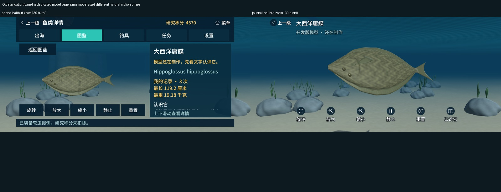
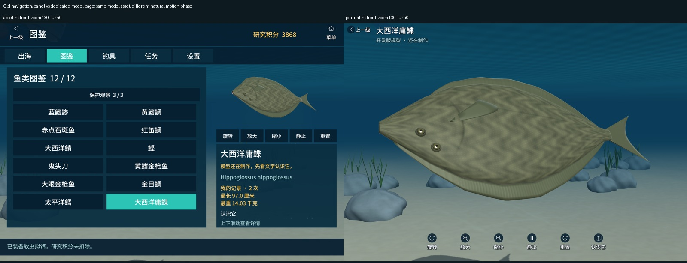

# 沉浸式页面整体优化：本轮结果

页面实施与本地模拟器功能/画面复核通过，完整产品继续 **PARTIAL**。游玩仍只有暂停与当前动作两个边缘按钮；准备、装备、图鉴列表、3D鉴赏、科普资料、分组设置和退出确认由各自页面承载。模型页移除重复全局导航、底部通知和常驻阅读侧栏；旋转、缩放、静止、重置使用图形触控。返回跟随实际来源，进入页面取消长按，必须主动继续才恢复游玩。

冻结源码 `79692d81d4abc9bae2c41f604cbd847cb3e4fafa`，游戏摘要 `2b4c36be6fc955cdb749bf9a0444b0c52a6f467c93a2beee7bd4d8277d673455`，同一个ARM64模拟器App摘要 `96568e87cd7e6519828166ceff3b082b31c4d378e64611775f2fe61955e06856`。本地0.1.0(8)与历史Apple build8的来源不同，没有更新个人手机或TestFlight。

| 范围 | 本轮结果 |
| --- | --- |
| 修复后完整Editor / 定向Play | 77 / 14通过，含3456个真实模型中间姿态样本 |
| 每端页面、装备 / 游玩原图 | 各40 / 19，共118张 |
| 每端图鉴模型 | 12种、104个自然动画帧末样本；无越界或相机后方顶点 |
| HUD最高占安全区 | 手机12.228%，平板4.526%；两个动作按钮，中央净空 |
| 本轮正常新增放流 | 手机鲭148分，平板鬼头刀221分；旧记录前缀及其他设置一致 |
| 原有存档保护 | 202份相关文件、104份主文件逐字节保持 |
| 源美术/模型保护 | 319份保持；积分、随机、经济和存档规则未改 |

首轮498315f平板有37处标题裁切，没有算通过。保留原26/28字号，增大容器并调整鉴赏标题位置后，同包双端最后零失败。鉴赏鱼、钓组和保护生物时清除高于海面的背景舟艇/码头等景物，回到海域观察或游玩恢复；实际游玩仍能看到场景舟艇。完整钓竿天然细长，卷线器提供独立近看入口。长资料、装备与家长页面可滚动，出发操作固定可达。

下图左旧右新，均为实际模拟器画面、同一庸鲽模型与1.3倍操作；自然游动姿态不同，不是模型美术升级对比。

[手机准备原图](../art/previews/immersive-pages/phone-pages-preparation.png) · [手机设置原图](../art/previews/immersive-pages/phone-pages-settings.png) · [手机资料原图](../art/previews/immersive-pages/phone-pages-fish-reading.png) · [平板鉴赏原图](../art/previews/immersive-pages/tablet-pages-fish.png) · [手机收线原图](../art/previews/immersive-pages/phone-fighting.png)

[手机全部页面1](../art/previews/immersive-pages/phone-all-pages-1.jpg) · [全部页面2](../art/previews/immersive-pages/phone-all-pages-2.jpg) · [游玩19帧](../art/previews/immersive-pages/phone-fishing-contact.jpg) · [平板全部页面1](../art/previews/immersive-pages/tablet-all-pages-1.jpg) · [全部页面2](../art/previews/immersive-pages/tablet-all-pages-2.jpg) · [游玩19帧](../art/previews/immersive-pages/tablet-fishing-contact.jpg)

[手机实际缩放/转动录屏](../art/previews/immersive-pages/phone-model-controls.mp4) · [平板录屏](../art/previews/immersive-pages/tablet-model-controls.mp4)；分别约4.36/4.43秒，全片各六个均匀样本已经查看：[手机](../art/previews/immersive-pages/phone-recording-contact.jpg)、[平板](../art/previews/immersive-pages/tablet-recording-contact.jpg)。六张总览覆盖118张原图，另查看七张本轮原尺寸截图和两张前后对照。只做区间裁剪、缩放及30fps输出采样；无音频或调色，不能据此声明运行帧率或OS触摸能力。30份自有游戏媒体已登记MIT许可，私人录屏原件和设备日志不公开。

原生构建保留Unity开发入口，采用ReleaseForRunning和受支持的IL2CPP `--compiler-flags=-g0 --bee-jobs=2`。共享120GiB准入保护线没有修改；本次1GiB增量估算偏低，机器空闲量实际减少约1.33GiB（含并行机器活动），后续至少预留2GiB。仅回收本项目可重建的编译缓存，保留现有运行包、原Unity缓存ZIP、源代码、发行包、存档与验证记录；没有清理其他项目。

本轮没有重新完成全部成长/双真机20分钟，也没有儿童图标理解、科学或用户A1–A3、最低系统及性能验收。鱼/钓具/海域仍为原型美术，连续眼表的局部改善不等于完整拟真。全产品、4.4及apply不勾选；历史独立记录审计继续INCOMPLETE，当前测量另作完整性核对。详见[结构记录](immersive-pages.json)、[页面设计](../docs/43-immersive-pages.md)与[完整总账](acceptance-ledger.md)。

连续眼表/页面这一增量的82条测量均已结束；17条失败或取消完整保留。自有记录的历史对象、回执SHA绑定及串行时间区间检查通过（检查执行时排除自身，随后自身回执也已完成）；历史正式独立审计仍INCOMPLETE。
