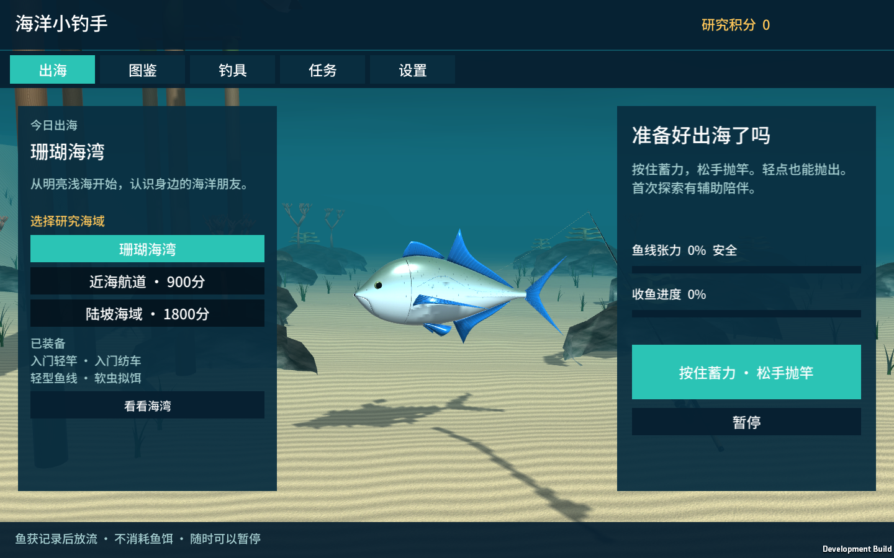
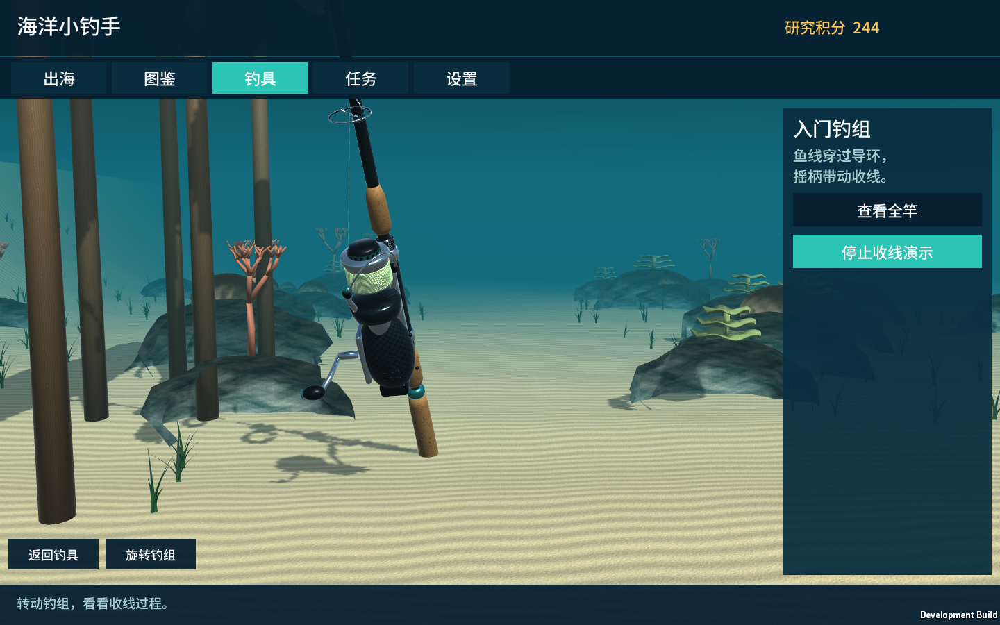
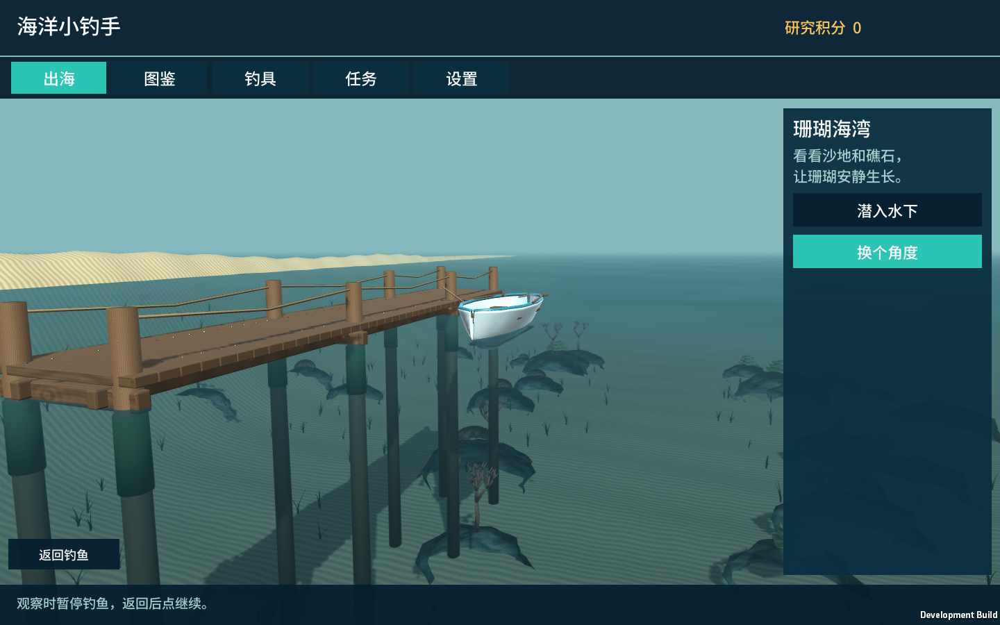
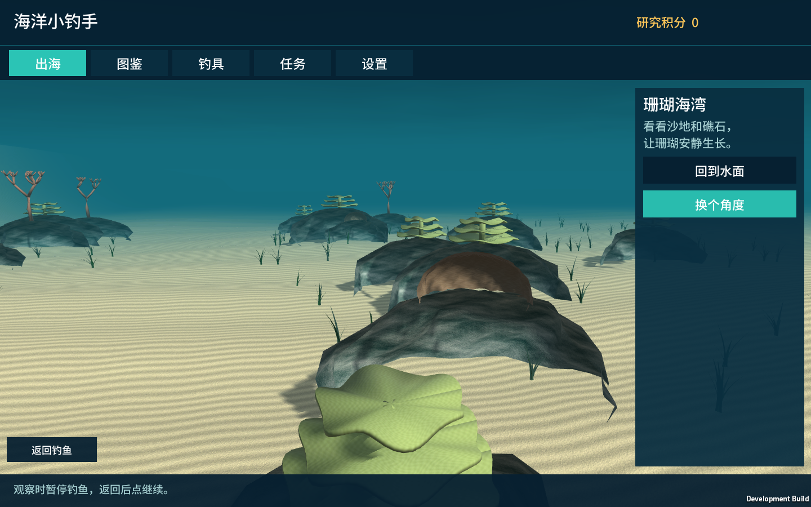
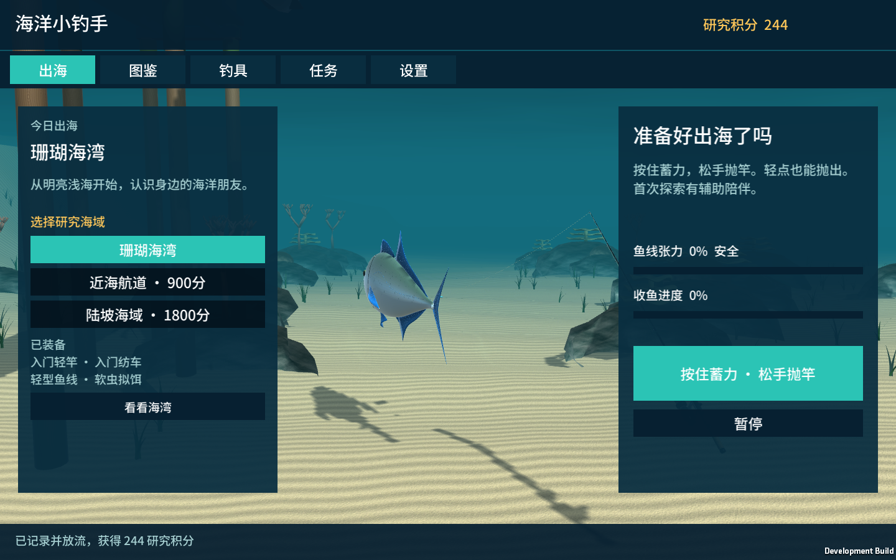
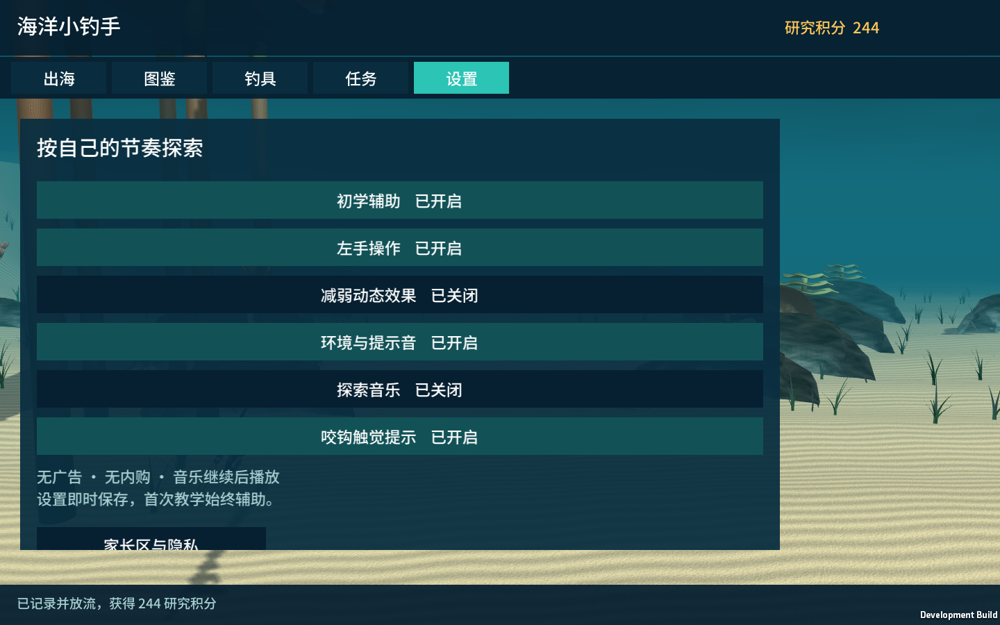

# 集成候选的实际原生画面检查

2026-11-24。桌面已可使用；同一份Mac开发包用隔离存档完成三档原生检查，各有12张Unity实际截图。1440×900桌面、758×372.33逻辑点手机（2556×1180像素，含左右47/底部21点注入安全边距）、1024×768逻辑点平板（2048×1536像素）均通过控件命中、捕获放流、积分存档、观察切换、试摇、任务/设置导航和取消清档检查。它们是Mac尺寸模拟，不是iOS模拟器或真机；每档只跑了一次捕获循环，不能证明20次真机无卡死或儿童首鱼时间。

首次桌面实测发现装备摘要、海湾说明与钓组说明裁切，保留失败记录，调整实际容器高度及按钮位置后使用新标签重新检查通过。没有放宽字体、裁切或44点触控标准。原始日志、隔离存档和完整截图留在本机，脱敏回执见[integrated-native-render.json](integrated-native-render.json)。

## 实际画面审阅：PARTIAL

三套源模型确实同时加载，尾骨、绕线机构与放流过程可见；当前成品美术仍未通过。鱼身高光过强且头身接缝明显，水面缺少可信的波纹、反射与岸边深浅层次，礁石近景出现薄壳感，珊瑚与海草稀疏重复。平板卷线器截图的标题未显示，需进一步核查。下一步先修这些样板问题，再请求用户审阅和批量制作其他物种。

以下都是未修改的游戏原生截图，资产按MIT登记，无OS界面、私人媒体或设备标识。

新音频及混音逻辑的独立范围见[音频检查](audio-feedback.json)和[实现说明](../docs/11-feedback-audio.md)。本轮不证明实际扬声器/耳机听感、触觉、真实后台/锁屏或20分钟性能。TestFlight 0.1.0 (2)仍是2971b11冻结产物，不含后续放流、任务、物种目录、音频和本次布局修复；真实安装与儿童/家长试玩仍待完成。
