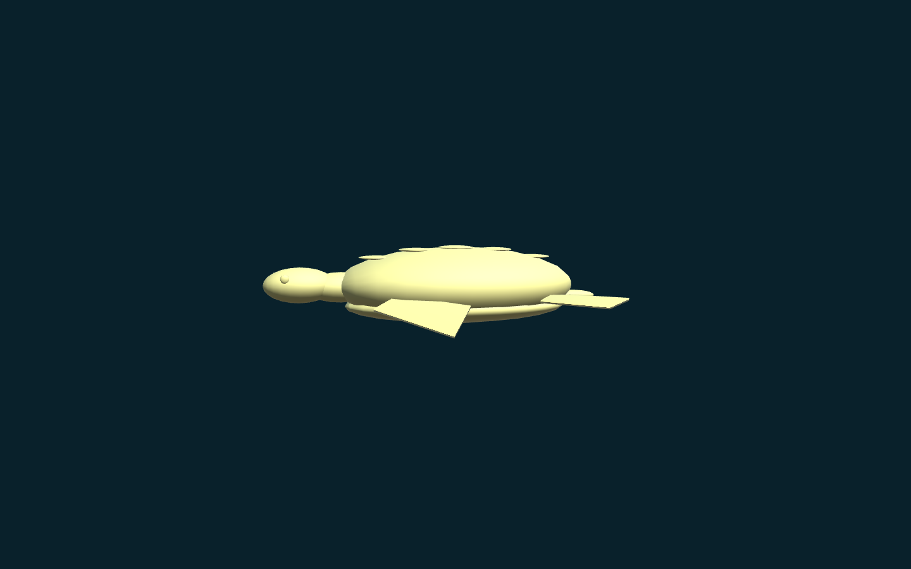
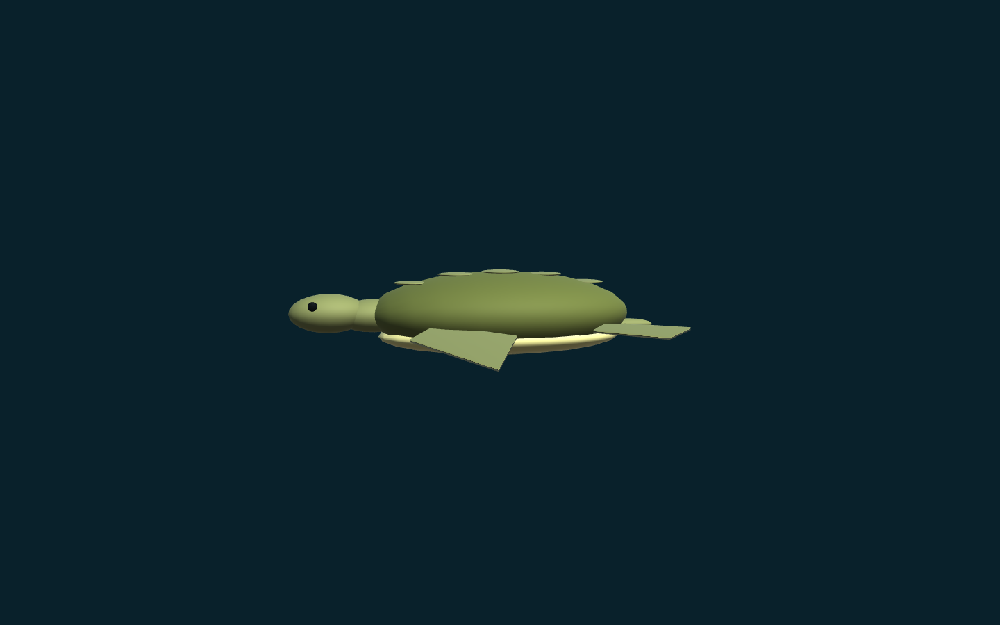
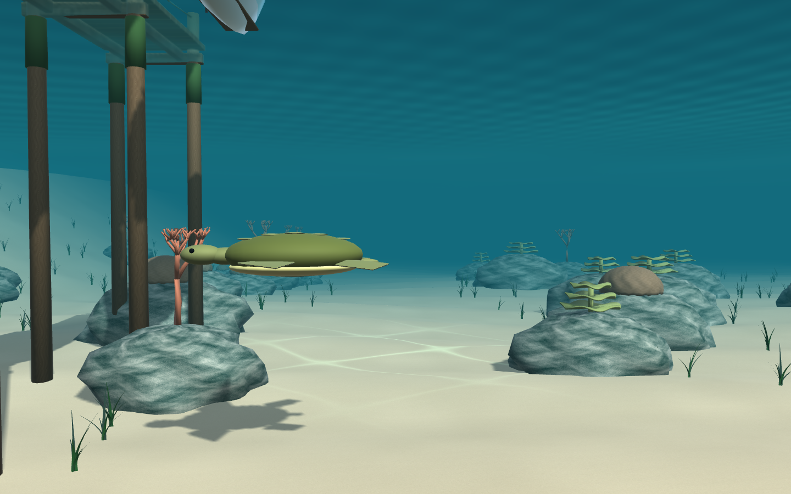

# 保护观察闭环

2026-11-24。交互候选IMPLEMENTED，REQ-04/07/08总体验收PARTIAL，三种形体均为A0；不计为完整拟真模型。功能与存档说明见[设计](../docs/14-protected-observation.md)，机器回执见[JSON](protected-observation.json)。当前TestFlight 0.1.0 (4)/ee7ba50不含这轮源码。

图鉴新增独立保护观察入口：绿海龟、宽吻海豚和鲸鲨。阅读目录不算发现；进入已解锁海域后暂停钓鱼、隐藏目标鱼和钓组，主动开始观察，在相机视口内保持至少两秒才可记录。观察记录不加积分、不增加鱼获、不推进18项任务；重复记录不写盘。跨海域必须先回到准备；同海域观察可保留暂停中的钓鱼状态，返回不会自动继续。

三种科普分别据[NOAA绿海龟](https://www.fisheries.noaa.gov/species/green-turtle)、[NOAA宽吻海豚](https://www.fisheries.noaa.gov/species/common-bottlenose-dolphin)及[澳大利亚博物馆鲸鲨](https://australian.museum/learn/animals/fishes/whale-shark-rhincodon-typus-smith-1828/)核对。这里只作游戏内仅观察安排，不推定全球法律/保育等级；机构照片、插画和交互模型未进入资产。

## 工程证据

46项Editor、9项无画面PlayMode、Mac编译和718字形覆盖核验通过。场景检查通过实际UI按钮事件进入三种观察对象、失败保存/重试、逐次重读、重复记录、不改积分/任务、跨海域入口限制、保留正在控线的鱼获/张力、返回保持暂停、后台/失焦后主动开始，以及减弱动态下静止观察。三物种各240/310/500点宽度共9个详情布局检查，核对实际字体生成字符、布局高度及滚动到底；这是无画面场景测试，不是实际触控或设备画面。

绿海龟在两种布局共512个姿态样本的整个可见形体包围盒，与海湾三LOD共137054个静态三角面包围盒无交叉。它是有限采样下的保守几何检查；不代表连续碰撞、真实设备、另外两种生物在成品场景中的路径或所有角度均已验收。相机视口检查只看中心位置，不证明实际UI/场景不会遮挡。

旧schemaVersion 1缺少观察字段可读取为空；普通设置仍写1，首次观察成功才写2。保存失败保留内存和原鱼获，重复记录幂等；非法/重复/未解锁观察ID和未来版本3受到保护。旧build 4拒绝大于1的payload，故回退旧包不会静默覆盖观察记录，而是提示需要更新。真实设备升级/回退尚未测试，不以清档解决。

## 初始绘制问题

第一轮命令完成了模型分离/非鱼获类型检查，但初次海龟画面颜色错误；该候选否决并保留，不能把命令PASS当成画面PASS。为每个MeshRenderer的材质槽固定BaseColor/Smoothness后，三个首次/重复侧面样本的RGB最大差均为0。这里只证明当前离屏样本的稳定性，没有据此断言Unity内部根因。相关renderer不使用SRP Batcher，性能成本待验。

| 被否决的首次颜色 | 修正后的首次颜色 |
|---|---|
|  |  |

## A0形体边界

| 交互对象 | 当前三角面／Mesh部件 | 仍缺成品交付 |
|---|---|---|
| 绿海龟 | 5824／16 | 完整甲片、口眼/鳍肢细节、PBR、蒙皮/动作、LOD与科学比例 |
| 宽吻海豚 | 4124／9 | 头吻/口部/呼吸孔、流线体型、真实尾柄与游动、PBR/LOD |
| 鲸鲨 | 8928／19 | 头口/鳃裂/隆脊、斑纹尺度、真实鳍尾与游动、PBR/LOD |

模型没有Collider或FishVisual组件，独立于可钓池。以上只是运行时程序形体，未交付Blender/FBX及完整资产清单，也不解除首英雄鱼/钓组用户审阅后再批量制作成品的门槛。

[海龟俯视](../art/previews/protected-observation/green-turtle-top.png)、[海豚斜角](../art/previews/protected-observation/bottlenose-dolphin-three-quarter.png)、[鲸鲨斜角](../art/previews/protected-observation/whale-shark-three-quarter.png)保留粗糙形体、接缝和花纹等限制。13张最终Editor Metal原图包括9个独立角度、3张像素一致的重复侧面及1张海湾图；10张独立画面逐张检查，原图未涂改。另保留1张被否决的首次颜色图。

本轮CUA确认Mac锁定，未运行新的原生玩家窗口；离屏图不含UI，未完成真实设备触控、声音/触觉、20分钟性能、儿童/家长或A1–A3。完整12鱼/3观察成品、两处成品海域、钓具库与整体产品仍未完成，master和iSpec完成出口保持。
