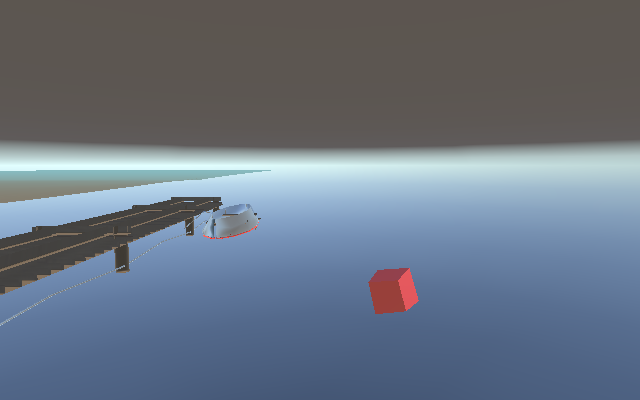
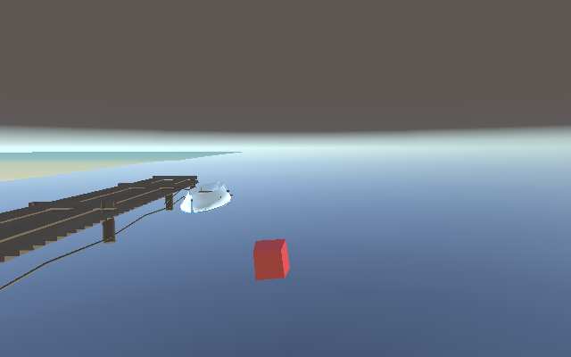
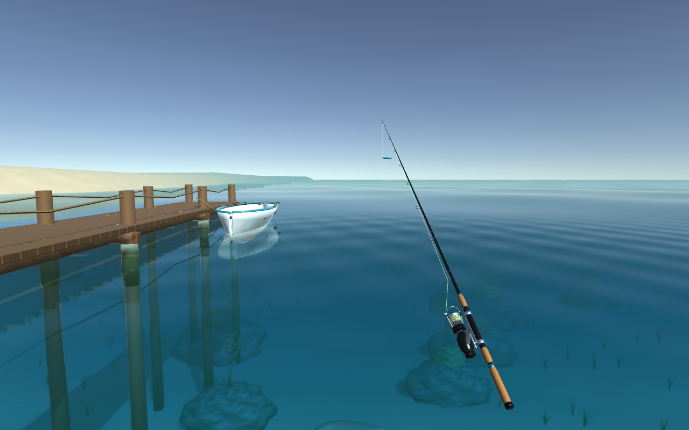
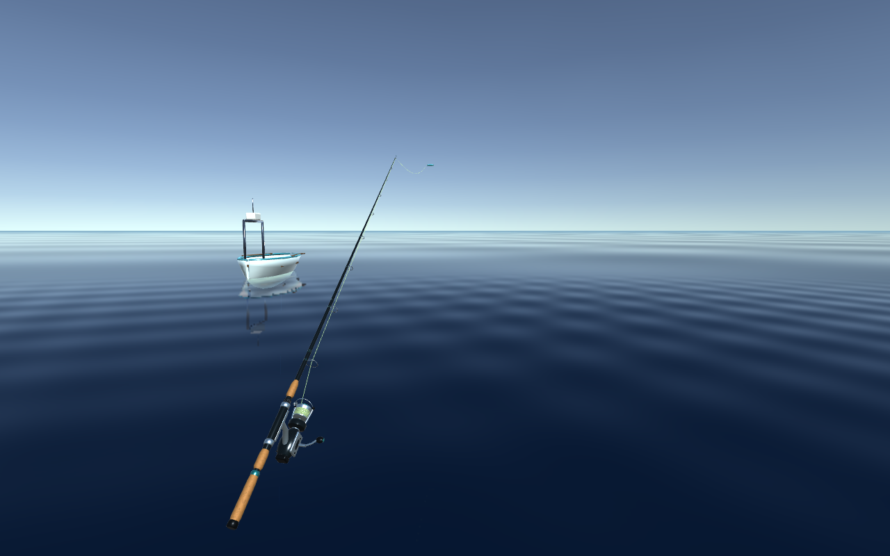

# 移动倒影的范围与证据

固定镜头移动物体后仍显示旧倒影的缺陷已修正，实施IMPLEMENTED，整体验收PARTIAL。没有增加常驻HUD，也没有更改鱼体/钓组模型、贴图、积分或随机概率。源码文件摘要、实际结果及图片哈希在[JSON回执](reflection-motion.json)，约束与重现方式见[设计说明](../docs/36-reflection-motion.md)。

同一初始夹具的旧实现和修正版分别为1→1次/0像素变化与1→2次/3445像素变化：

扩展夹具实际LateUpdate移动3351像素、仅修改线顶点308像素、隐藏标记物1720像素、回到水面1664像素；每项各增加一次捕捉，静止重复及水下均没有额外捕捉。骨骼用例增加一次捕捉但0像素变化，明确只验缓存失效，不将镜头外关节算作视觉通过。诊断方块和粗线不随Player构建。

20项定向Editor及5项无画面PlayMode通过，含实际世界初始/三海域重复切换绑定与沉浸导航保护。新的三海域24姿态/48张Metal静态原图中，23对RGB差0，首对仍17像素/最大4，严格状态PARTIAL；关键机构构图最小边缘余量约19.9%。已查看选定原图，没有逐张人工审阅全部48图。

首个新增诊断命令因错误带提前退出参数没有运行到取图，不作为红测；修正入口后才真实复现旧倒影。该入口失败、实际红测和严格首绘非零回执均保留。历史测量记录缺口继续INCOMPLETE，本轮不补造旧记录。

本轮仅Editor，未重建新iOS模拟器/真机/TestFlight包，旧1317bc4双端模拟器证据不能用来证明本源码。动态倒影的移动设备成本、用户/科学/儿童和最终美术仍待验；其他11鱼种、完整钓具库及双真机20分钟等全产品要求保持。
