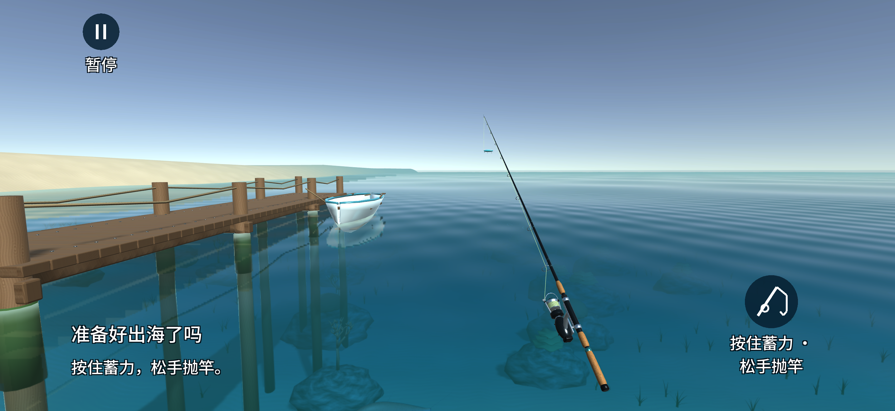
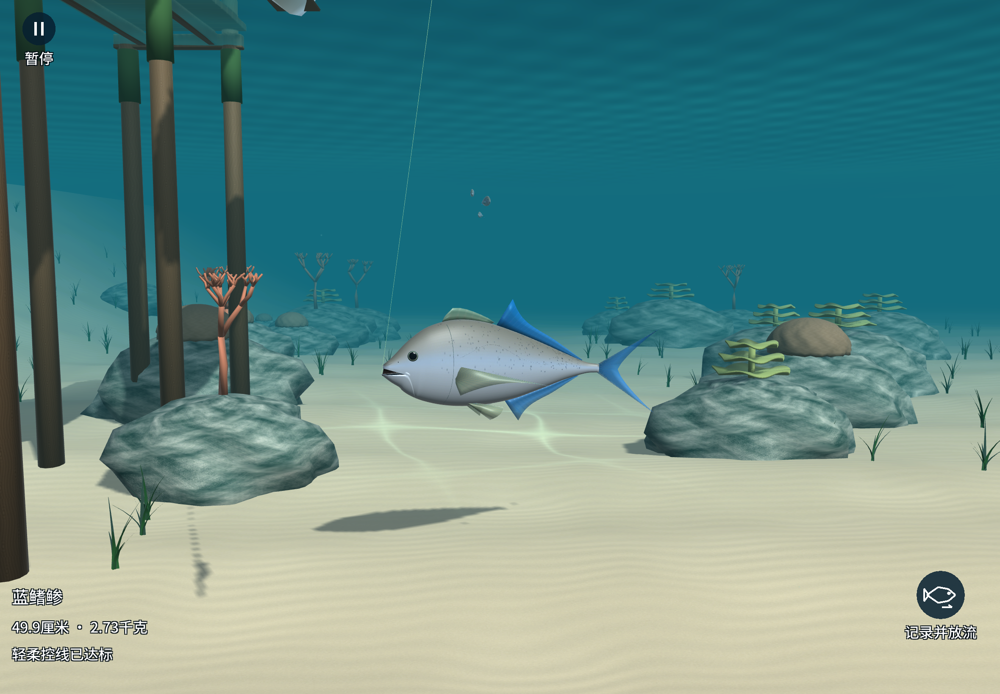

# 原生倒影、沉浸页面与进度复核

2026-11-25，整体 **PARTIAL**。修复固定镜头下钓组变化不刷新倒影后，原生首包又发现静止钓组反复触发捕捉。最终源码 `45b04aa7081f12c8dd4e4a3aeb32e1b7754aa51c` 将拟饵定位和线杯轴改为固定局部基准，消除逐帧浮点反馈。未放宽静止比较、修改模型/PBR或增加HUD。机器可读结果见[回执](reflection-native.json)，实现依据见[倒影说明](../docs/36-reflection-motion.md)。

源码摘要 `545ceab933ee4a3504f4147933f81d594af01e9ebe7a5fc9e90b939de625b03a`；同一ARM64原生模拟器App摘要 `8f8d883bc70bdd8299893c521a0438d4a7e10a80bfe9799d1a77e9b0355f169f`。版本字段虽然仍为0.1.0(8)，这是本地Simulator包，与此前TestFlight8的冻结源码不同。本轮未上传TestFlight，也未操作个人手机。

| 检查 | 实际结果及范围 |
|---|---|
| 严格静止与流程回归 | 8项定向Editor、10项定向PlayMode通过；静止用例覆盖两海域、左右手、拖曳前后及60次重复，逐分量与Renderer矩阵相等。部分Play夹具使用合成解锁/加速，不计自然成长 |
| 三海域GPU首绘 | 本轮24姿态/48张真实Metal图，首绘/重绘RGB全部零差异。只证明本轮夹具，旧17/232像素差仍保留各自冻结范围；不单凭不同冷启动结果推断修正原因 |
| 手机与平板 | 同一最终App各19帧，实际UI教学分别记录放流180/225分；菜单、准备、设置、左右手、暂停、退出确认、镜头设置与进度保护通过 |
| 实际倒影读回 | 两端右手静止次数1→1、左手32→32，纹理SHA相同；抛竿至落水次数2→22、实际纹理SHA变化；水下关闭捕捉 |
| 沉浸遮挡 | 钓鱼仅暂停、当前动作和必要仪表，中心视野保持空出；普通HUD最高占安全区12.228%/4.526%，含收鱼阶段。不是所有页面遮挡比例或儿童理解验证 |
| 手机连续20轮 | 正常UI与实际会话推进，辅助/标准两模式、三海域自然解锁、20条唯一已放流记录、3431分、3保护观察；实际遇到8鱼种，12张截图。不代表当前全部12种/18任务通过 |
| 新进程恢复 | 终止旧进程后启动同一App、同一隔离存档，实际页面3431分；主文件SHA、20鱼获、3观察及总分完全一致 |
| 旧数据保护 | 测试前已有99份进度相关文件（52主文件，含备份/临时/损坏样本）在更新与最终20轮/重启后逐字节不变；未卸载、清档或恢复覆盖 |

保留四次真实失败：归档后恢复入口不兼容旧Python；c1e首包静止0.12秒捕捉5→12但纹理不变；拟饵严格红测；首修候选线杯矩阵仍漂移。最终采用固定基准及一次有界拟饵精度修正、静态线杯轴，未以容差掩盖漂移。[否决首包原图](../art/previews/reflection-native/rejected-idle-recapture.png)的视觉本身正常，失败属于缓存/重复渲染，不能把它描述成平色水面。

存储方面只将旧生成导出`build/ios-simulator-sim1`完整压缩校验后移除展开目录：3039文件、215目录及归档根共3255成员，原文件950953596字节、归档238592132字节。独立恢复演练核对内容和元数据；系统来源标记原值保存在归档，恢复文件由OS重新分配，未重写。同期主机其他活动释放大量空间，不把全机空间变化归功于这个归档。其余导出、App、签名发行包、源码/模型及存档保留。

新增测量均保留命令、实际结果和当前apply attempt；旧历史缺启动/磁盘中断缺完成记录未补造，历史整体审计继续 **INCOMPLETE**。该状态不妨碍将本轮具备原始回执的局部结果记录为PASS，也不能用于声称完整产品通过。

两端19帧接触表、20轮12帧接触表及六张选定原尺寸图已查看。接触表检查不等于逐张原尺寸审阅，静态图不证明自然运动和性能。蓝鳍鲹及首套钓组仍待用户/科学/儿童审阅；其余鱼、保护生物与部分环境仍有明显样板形体。按首套用户审阅门，尚未批量制作其余11种成品鱼。任务4.7、apply与完整产品保持未完成；真实OS触控、双真机20分钟与TestFlight来源实际安装另验。

[手机19帧](../art/previews/reflection-native/phone-contact.png) · [平板19帧](../art/previews/reflection-native/tablet-contact.png) · [连续20轮接触表](../art/previews/reflection-native/journey20-contact.png) · [新进程3431分](../art/previews/reflection-native/restart20-main.png) · [其他鱼种仍是样板](../art/previews/reflection-native/journey20-landed.png)
