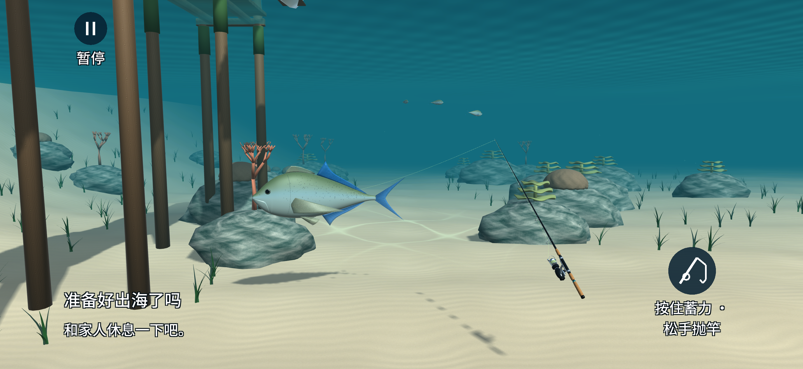

# 休息提醒闭环

旧代码已有900秒未暂停时间阈值，但沉浸暂停菜单未展示提醒，也未调用既有清除入口。现沿用原边缘提示、暂停/首页说明和继续按钮：主动点“休息好了，继续”才开始下一周期。普通菜单往返和再次准备抛竿不清除；待提醒不使已学会玩家的等待提示常驻。没有新增HUD、页面或奖励规则。

最终2项定向PlayMode通过：原沉浸导航/记录与新时钟边界/休息确认。测试内存时钟899.99秒及临时已学会夹具只用于快速边界回归，真实Update、布局和EventSystem指针走生产路径，覆盖左右手、暂停不累计、准备/设置往返不确认、主动确认、HUD两按钮/15%和存档字节不变。未冒称本轮新跑完整60项Editor/20项PlayMode或完整成长。

冻结源码7a96e4783175dcc3fa72a9a3f2c7e9b220c461e1，源摘要ab046d8634c8bf61089c9b89cf379af206d5045057e9ba5776adb958735789df。双端使用同一ARM64 Simulator包df1f79685a182bccc2bb10bfad8cb60234e4603f779999f1b6818fc62d7916ab，前15分钟刻意停留Ready且不注入时钟、鱼种或成长，再由真实指针确认并跑原沉浸流程。

| 范围 | 手机模拟器 | 平板模拟器 |
|---|---|---|
| 实际到时观察 | 900.150秒 | 900.067秒 |
| 原生画面 | 19帧 | 19帧 |
| 正常教学鱼记录放流 | 1条，226分 | 1条，207分 |
| HUD最高安全区占用（含收鱼） | 12.228% | 4.526% |
| 渲染读回 | Metal / Medium / Half HDR / 4×MSAA | 同左 |

独立核对实际测量耗时、容器归属、19帧集合、提醒/确认状态、进度不变、鱼获和积分落盘、校验和及HUD两按钮/中央净空。更新后22份原QA主文件逐字节一致。新进程仅带隔离存档及渲染探针参数，未回放自动钓鱼，原26条/4622分与存档SHA e3913747a21f851fbee465ecb7d406d6bbdb7c78702e1f54f6e7d23dc64d0bec一致；实际暂停首页4622分已查看。

[手机暂停确认](../art/previews/rest-reminder/phone-rest-pause.png) · [平板暂停确认](../art/previews/rest-reminder/tablet-rest-pause.png) · [平板收鱼](../art/previews/rest-reminder/tablet-landed.png) · [原4622分首页](../art/previews/rest-reminder/reopened-home.png)

两套19帧接触表及上述五张原图已查看，视为选定UI画面复核，不代表模型/场景美术合格。没有用约15分钟的刻意等待推断儿童首鱼时间；EventSystem不等于真实系统触摸，模拟器计时不等于目标真机20分钟资格。

旧缺提示红测和首修正版UI重建前的夹具时序失败保留，补布局等待后复验通过。原生首轮链接ENOSPC失败保留；检查无占用后清理四份本项目已结束构建的中间缓存，四份原App哈希前后相同，同一冻结导出继续编译通过。一项其他项目活动构建的保守缓存预检在删除前拒绝，后按目标目录/句柄核对，未操作其他项目。源码、已验证App、导出和失败日志均保留。

[详细回执](rest-reminder.json) · [功能约束](../docs/28-rest-reminder.md)。本轮未更新个人手机或TestFlight，已发布build 6仍冻结648b4ce；本地Simulator版本字段6不代表它来自该发行包。完整产品、A1–A3、首套用户/科学审阅、其他成品模型、儿童/真实双设备资格仍未完成。

本轮22次开始与22次完成逐项核对，回执、attempt绑定及不重叠执行区间一致；4次真实失败均保留，原1002次完成/998次开始历史对象未改。历史独立审计仍INCOMPLETE，本轮记录核对不替代完整产品验收。

后续发行：休息闭环已纳入0.1.0 (7)，Apple处理和本人内部组通过，见[build 7回执](testflight-0.1.0-7.json)。上述模拟器包和本轮未发行的记录保留其原冻结范围，不能据此推断当前签名包的实际设备安装或验收。
