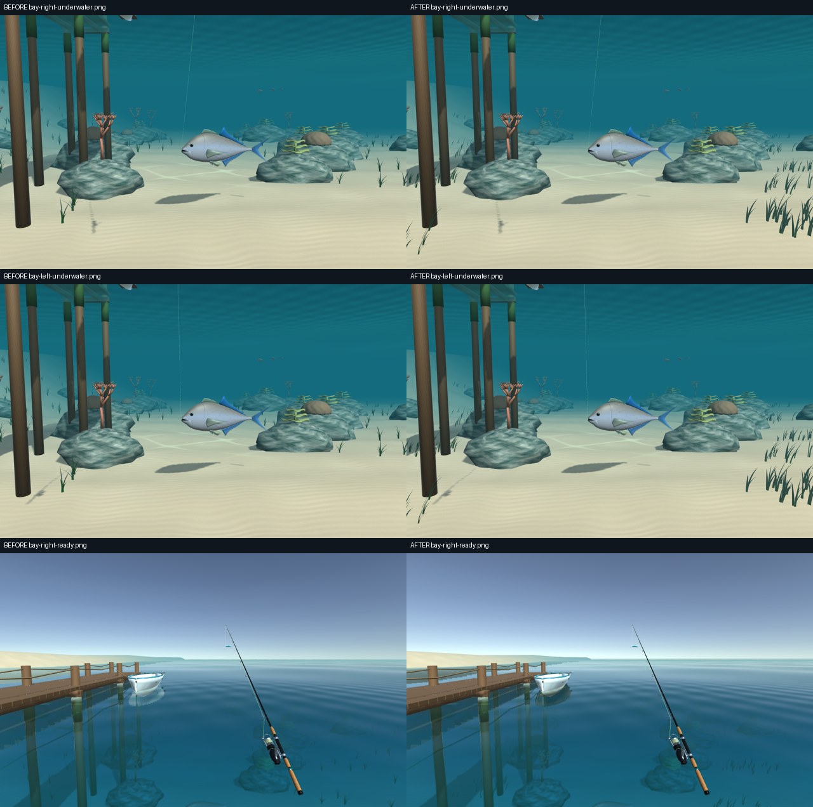
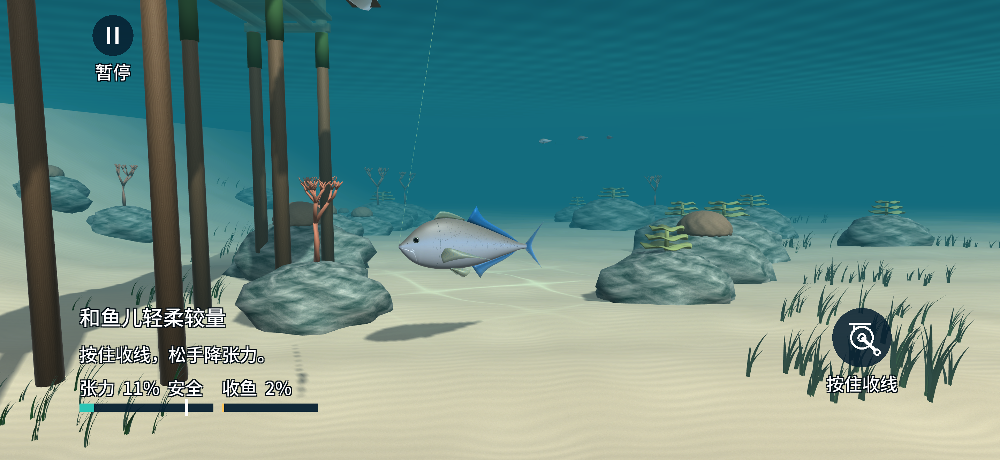

# 海湾海草候选与双端实际画面

2026-11-25，候选已接入，**完整美术及产品仍PARTIAL**。原海草虽随机散布，每丛叶片共用根点，尖刺状扇形重复明显。现从14个候选中心筛选出13个实际斑块、260株、1026片弯叶，分散叶根并改变叶长、宽度、弯曲和轻微扭转；左右成片、中心鱼的展示区域保持空出。没有新增HUD、运行时散布或每帧组件。设计与参考来源见[制作约束](../docs/37-seagrass-meadow.md)，机器可读记录见[回执](seagrass-meadow.json)。

| 检查 | 实际结果与范围 |
|---|---|
| 源几何及地形 | 194项保存源检查通过；29个非海草源网格/UV/材质槽及标尺变换指纹完全相同，265份其他已有素材字节保持 |
| 草根与通道 | 2052个叶根边点按实际三角化海床检查，埋深约5.8–12.1厘米；整片叶的最小中心横向距离2.91米，保持中央四米通道 |
| 三档面数 | 18390/9195/3678降至14364/7182/2872；只证明几何预算下降，不代表真机帧耗已改善 |
| 引擎 | Unity实际导入、11项定向Editor通过；新48张Metal Medium HDR4×MSAA图的24对首绘/重绘RGB全部零差异，只覆盖本轮静态夹具 |
| 流程回归 | 初轮5项Play为4通过/1仪表文字空引用失败；仅增加断言的阶段/暂停/页面上下文后，诊断单项与整组5项复跑通过，首次根因仍未确认 |
| 同一新原生包 | 手机/平板各19帧，正常教学鱼放流180/187分；左右手、菜单/准备/设置、暂停与退出确认、镜头设置和已有进度保护通过 |
| 沉浸与倒影 | 普通HUD最高12.228%/4.526%、中心净空，含收鱼；实际静止倒影复用、抛竿至落水刷新、水下关闭通过。不是完整OS触摸/无障碍或儿童理解验收 |
| 原有数据 | 更新前109份进度相关文件（57主文件，含备份/临时/损坏样本）全部逐字节保持；未卸载、清档或恢复覆盖 |

冻结源码`0d143e006d5b272f89426e508752e7cb0ff26783`，源码摘要`234555190fc7fd8990365d85c275222730b692d79effbde2658419bb2a53d077`，同包App摘要`70218eb51543d4542eeffdf1f4d512e53f0b3cc0cc96ae36e00c92869be0aa43`。Unity/Xcode实际构建完成，项目设置恢复且摘要一致。版本字段虽仍0.1.0(8)，这是本地模拟器包，与既有TestFlight8冻结1bdfa78不同；本轮未上传发行或操作个人iPhone。

保留首次斑块遍历耗尽失败：候选点被排除后重复同一斑块会使后续位置永远没有机会；改为被拒后也轮询其他斑块，未放宽岩石避让、通道或面数门槛。第一次Play失败也保留，后续绿色不能倒推根因已修复；本轮不将其删除或写成已定位的游戏缺陷。旧历史缺启动/磁盘中断缺完成记录继续整体INCOMPLETE。

Unity重存海湾prefab时按新草组计算包围盒，并显式写入MarineHabitat原有默认颜色/密度/null照明；水材质显式写入着色器已有的关闭水花默认值。源文件、导入差异和原值均核对，未将序列化变化描述为“所有文件完全不变”。

三组同机位对照/双端接触表、两张源前后原图及手机控线/平板收鱼原图已查看。选定画面显示同根尖刺减少、弯叶分布在展示区域两侧；细叶边缘锯齿、统一色调/弯向、静止状态及完整自然观感仍待精修。不是全部48张GPU/38张原生原尺寸图逐张人工审阅，也不是自然运动或科学生态验收。礁石/珊瑚布局未在本轮调整，其他鱼种、观察生物及完整钓具库仍有样板内容。

没有重跑完整成长：此前手机26/平板27轮收齐12鱼种、18任务、20装备及3观察的证据仍只绑定45b04aa和旧App，见[历史完整成长](content-current.md)。新包只作以上定向复核。首套用户方向、全部成品美术、科学/儿童、真实触控、双真机20分钟和TestFlight来源安装仍未验；任务4.8、apply和完整产品继续未完成。

[平板收鱼原图](../art/previews/seagrass-meadow-native/tablet-landed.png) · [手机19帧](../art/previews/seagrass-meadow-native/phone-contact.png) · [平板19帧](../art/previews/seagrass-meadow-native/tablet-contact.png)
