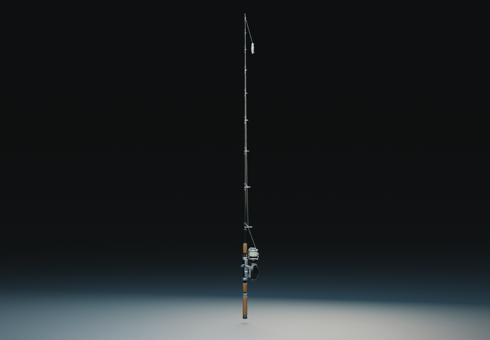
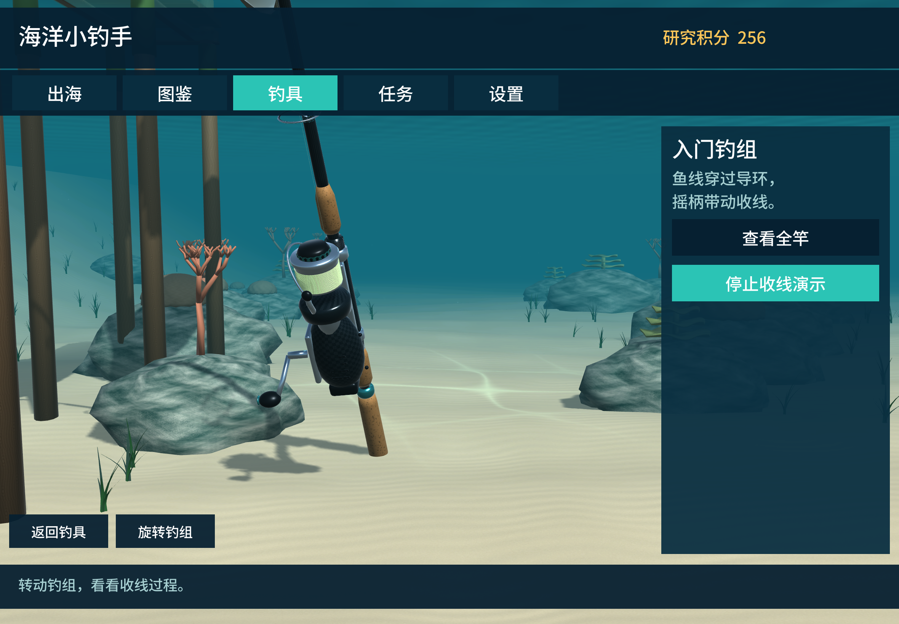

# 第一套纺车轮钓组候选

2026-11-24集成状态补充：该钓组已进入共享游戏，当前分支为integration/art-candidates。源模型与fd23c2b保持一致；较新的iPhone/iPad原生卷线器鉴赏、试摇/停止、鱼线与导环检查见[眼部版本的原生记录](bluefin-iris.md)。下文2026-11-23的分支、锁屏和TestFlight build 1描述为当时历史，较新发行记录另见[TestFlight build 5回执](testflight-0.1.0-5.json)。用户美术审阅及真实双设备20分钟仍未通过。

| 共有源模型的全竿图 | 原生iPad卷线器鉴赏（fd23c2b） |
|---|---|
|  |  |

[查看钓具360度转台](../art/previews/spinning-rig/turntable.mp4)

2026-11-23。独立源模型、Unity导入和无画面运行检查已完成；游戏内新界面、美术成品与真机尚未验收。当前在feature/complete-spinning-rig，master保留此前已验证基线。

## 已制作

原创2.35米竿体、连续握把芯、软木握把、轮座、九组导环/陶瓷圈/支架/绑线；卷线器机壳、支脚、摇柄、转子、可翻线挡、滚线轮、绕线线杯、卸力旋钮；实心米诺及两个无倒刺单钩。11根骨骼，其中10段弯竿骨骼；七个实际网格组件各有三档LOD。源文件、FBX、四张原创颜色/法线图及MIT登记均保留。其他钓具仍共用此模板，不能据此声称20件独立模型完成。

| 档位 | 实际三角面总计 |
|---|---:|
| LOD0 | 43420 |
| LOD1 | 19533 |
| LOD2 | 8678 |

源文件独立重开检查：UV有效、真实骨骼权重和三档递减通过；九个导环在直竿与加载弯竿姿态下与实际蒙皮几何中心一致。首轮线挡枢轴父坐标错误已修正，后续检查通过，失败测量保留。工作室近景又发现握把芯不连续、软木孔纹过方、全竿构图裁切，已在v4修正。机壳及小五金比例、金属反光仍需美术精修。

Unity导入构建了显式URP材质、独占LOD组、实际枢轴和九个导环挂点，新增钓具鉴赏页，支持全竿/卷线器近看、旋转及试摇。摇柄带动转子，线杯往复，竿身随张力弯曲，鱼线穿过移动后的导环并接至拟饵或鱼嘴。

## 检查及证据范围

- 保存的Blender源文件工程检查通过，脱敏回执见spinning-rig-source-validation.json。
- Unity实际导入通过，Mac原生包编译通过。
- 五项PlayMode无画面测试通过，见spinning-rig-playmode.json：唯一LOD归属及实际网格枢轴层级；实际摇柄/转子转角和线杯往复；停止/暂停/减弱动态冻结；线挡实际82度开合；弯竿后九导环鱼线对齐和鱼嘴目标连接，并以CPU烘焙后的实际蒙皮验证五个可明确采样的导环几何。
- 首轮测试的逐帧转角在高频无画面模式下小于浮点角度分辨率，已改为30毫秒区间采样。另一项CPU烘焙检查把FBX比例重复应用，已按[Unity BakeMesh文档](https://docs.unity3d.com/6000.3/Documentation/ScriptReference/SkinnedMeshRenderer.BakeMesh.html)显式补偿Transform比例。初始失败未删除；通过结果只证明机构/绑定，不证明渲染观感。
- 原生游戏窗口两次停在首次Metal呈现，未产生新截图。进程采样显示等待呈现，随后桌面工具明确报告Mac锁屏。原始日志保留于本机；等待用户手动解锁后再验新界面和游戏画面。未通过改渲染器或绕过锁屏伪造结果。
- art/previews/spinning-rig包含全竿、正反卷线器、导环、拟饵、弯竿六张原图和36帧/3秒的近景360度转台。均为自产Blender工作室渲染，不能视作游戏截图。

## 待验收

新钓组在手机/平板逻辑点布局中的实际画面、白天/阴影/水下近景、LOD切换、拟饵动作和抛竿演出；用户美术审阅、真实设备帧耗/内存/温升；其他钓具成品与完整海域。A1–A3及REQ-05保持PARTIAL。

TestFlight 0.1.0 (1)仍是b771909冻结源码，不包含蓝鳍鲹和本钓组。新构建须另行冻结、上传及实机确认。内部邀请已发送到用户指定邮箱，接受邀请与设备安装不是源码测试能够代验的事项。
