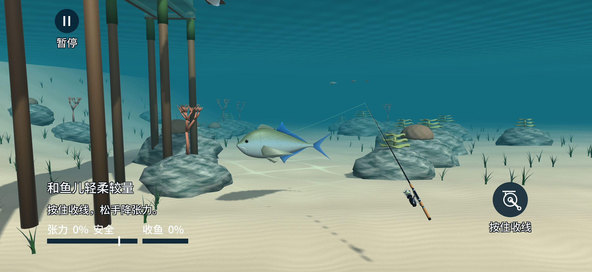
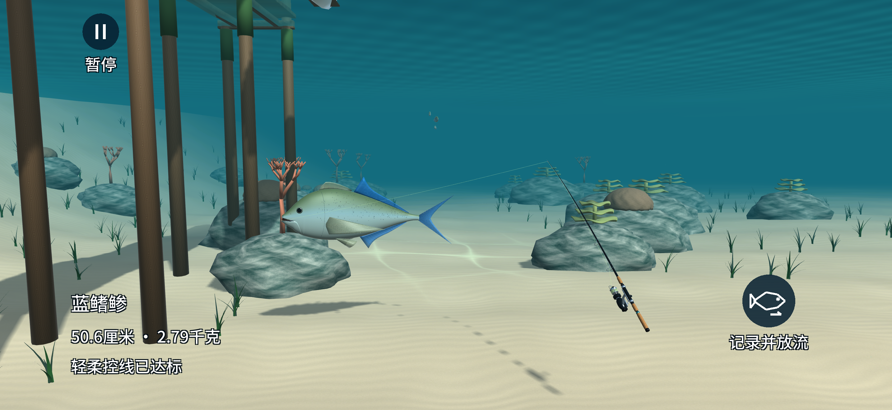
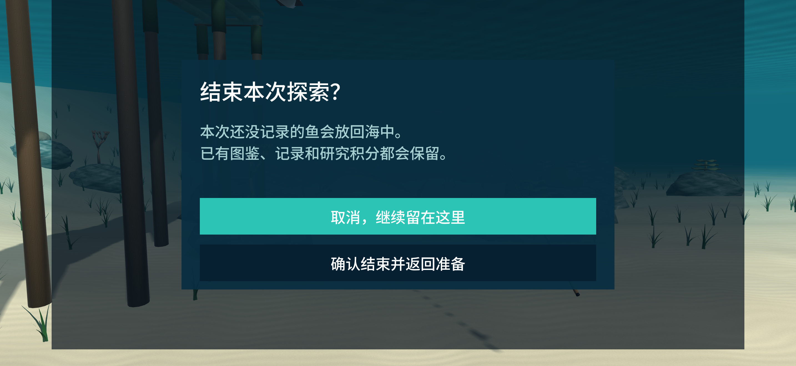
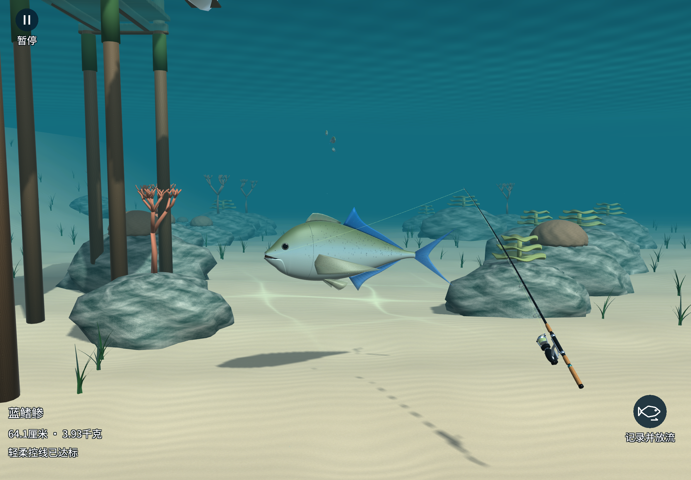

# 首套钓组的滚线轮与出线候选

后续已修正远距绕线、线杯轮廓及可见主轴连接，当前源三LOD43412/19056/8556，并补全竿/卷线器各36帧转台；新证据见[绕线、主轴与转台](spinning-rig-winding.md)。本页9e2b9dd及其原生/照片继续保留历史范围。

当前仍是首套原创候选，实施IN_PROGRESS、美术PARTIAL，完整产品未验收。独立凹槽滚线轮、轴承/支架与线挡一起开合；收线实际驱动滚轮，暂停、停止和减弱动态冻结。开线挡时从往复线杯前缘出线，闭合后接触滚轮凹槽并经过九导环。线杯绕线由25个独立闭环改为一条可见连续螺旋，不模拟逐层线量或真实摩擦。

三个LOD实际43412/19090/8368三角面，LOD0未超过原43420预算。八个功能组件各有三LOD，独立滚轮增加绘制成本。独立重开保存源文件检查24个网格的封闭、面朝向和退化面；三LOD绕线均只有一个连接分量，72条BVH孔/槽采样通过。原四张颜色/法线贴图未变。细节与限制见[制作约束](../docs/26-spinning-roller-and-line.md)。

保留了真实失败：A版超预算24面及小零件简化坍塌；逐原始实体简化并检查体积后修正。源C的出线段在转子34.32度与导入线杯三角面107相交；源D将滚轮和支架移到线杯最前行程之外，并随线挡翻开。最终测试读取真实导入网格、扫描两种线挡状态各330步和完整线杯往复，没有以标记坐标替代网格相交检查。

离屏首图曾把软木/绕线显示成错误材质槽；实际失败75611像素留档。按材质槽显式初始化BaseColor/Smoothness后，最终Metal Medium、Half HDR、4×MSAA的31张图、15组首次/重复RGB对照全部零差异，QualitySettings与GraphicsSettings前后哈希一致；没有丢弃坏首帧或降低画质。PropertyBlock的SRP Batcher/CPU成本仍须真机测量。

最终60项完整Editor和13项定向PlayMode通过。后者覆盖钓组、滚轮、整合世界、沉浸导航以及新鉴赏到正常教学鱼的实际EventSystem流程；新鲜存档实际一鱼246分，不注入积分或鱼种。无画面检查不能证明渲染、系统触摸或儿童体验。此前版本的完整成长证据不冒称本版重新跑过。

八张源棚拍、全部LOD/动作接触表及滚轮和开线挡原图已查看；旧目录的360转台属于历史源，本轮未用它证明新源。LOD2绕线仍有折线感，机壳/五金及材质仍偏简化，不因此把拟真美术或A1–A3改为PASS。用户/科学/儿童、其余独立鱼类和钓具、最低系统及双真机20分钟仍未通过。TestFlight和个人手机未更新，master/apply保持未完成。

结构化结果见[JSON](spinning-rig-detail.json)。

最新原生冻结为`9e2b9dd`，源码摘要`66731f7f5405c7968aec7fff009accdfe009ec016bdbe3632d153c2639e7ff5b`，同一个ARM64双设备族包摘要`fb2f9a66211eb22c1986461aa2cecac7f746affa3906c0748e3a9ef0bc97d32f`。手机/平板各完成14帧钓组鉴赏、正常抛竿到放流并分别落盘194/207分；另外各15帧覆盖左右手、暂停冻结、设置返回、未记录退出的取消/确认，分别226/257分。四个独立新存档均走正常首次教学，没有注入积分或鱼种。58帧经四张接触表检查，另看手机卷线器/搏鱼/收鱼/设置/退出及平板收鱼原尺寸图。HDR与4×MSAA保持，包含Landed的HUD最高占安全区12.228%/4.526%，中央检查区净空。该指标是控件几何及实际图像审阅，不是所有屏幕像素的透明度测量。

更新前15份旧QA主文件在当前自有容器逐字节保留；新进程仅带存档隔离与图形诊断参数，实际首页显示原有4622分，与26条文件及原SHA一致，未恢复或重放。手机模拟器留在这个暂停首页，主动点继续才恢复。测试属于原生Simulator EventSystem输入，不能替代OS触摸、儿童或真机验收，也没有重跑旧45轮完整成长。平板重跑的启动客户端曾长时间等待，同一次请求后来完成；未重复启动/安装，启动性能未据此通过。

一条只读手机核对与平板首轮启动回执区间重叠91ms；原两条记录及15帧首轮平板结果保留并排除串行资格，随后真正串行重跑手机核对与全新平板流程，公开结果使用重跑回执。正式历史独立CLI审计仍INCOMPLETE，不删除失败、重叠或补造旧启动。

本轮实际44条完成与44条启动已核对，包含最后的公开检查；896条旧完成、892条旧启动对象未变。所有新增receipt、SHA及attempt绑定一致，八个真实失败保留；排除上述两条后，资格记录区间无重叠。该完整性结论仅覆盖本轮，不修补历史审计缺口。

