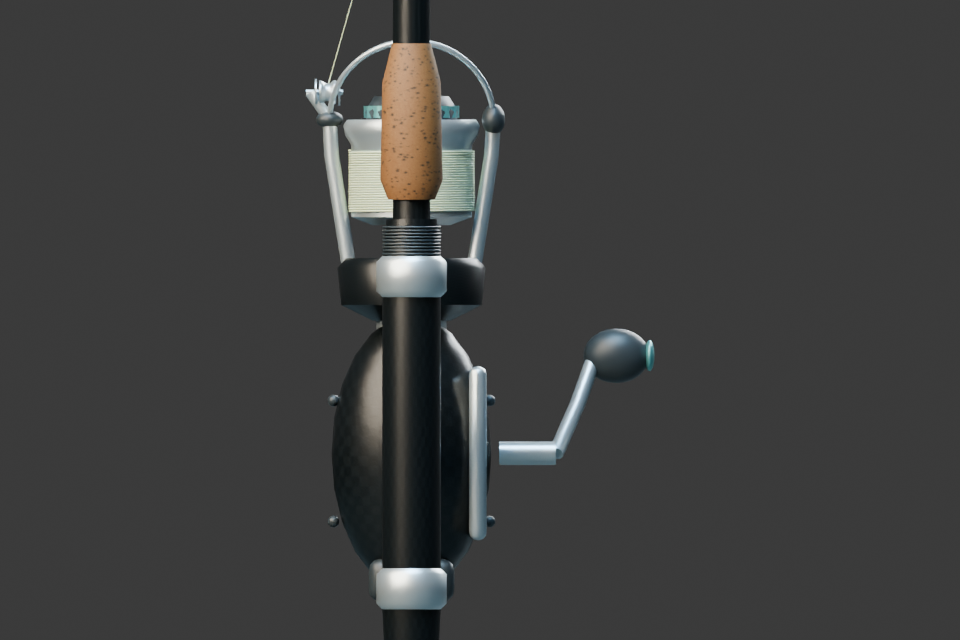
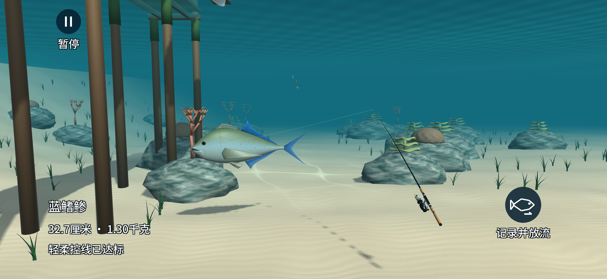

# 钓组远距绕线、主轴与完整转台

本轮继续首套候选，未批量制作其他物种或钓具。修补主轴后的三LOD实际43412/19056/8556，均保持原候选43420/19533/8678上限；组件、材质和贴图数量未增加。LOD1/2改用均匀螺旋并保留线杯轴向轮廓，避免通用减面把线和线杯一起压变形。LOD2中心径向外移0.55mm补偿粗分段弦高，是距离表现近似，不模拟真实线量或制造尺寸。

独立读取保存三角面后，旧LOD1/2保守径向间隙为-0.684/-2.694mm，LOD2一个经线只辨24圈。新三档最小保守间隙约0.0299/0.1843/0.1872mm；每档8008条BVH射线、八经线都辨出25圈，起止经线含26个截面。正包络间隙可保守证明线材与同高度线杯分离；旧负值是风险诊断，不能当作某一点的精确穿透深度。源24实体/72滚轮孔槽、骨骼/导环及UV检查继续通过。

绕线修正版A的LOD0原始缓冲摘要不完全一致，未隐藏两个严格检查失败。规范化索引/面起点后，当时八个部件的实际位置、定向面、权重、世界矩阵、材质与硬边一致；机壳有12个无纹理金属/黑色面的UV尾数差异，最大5.96×10⁻⁸，两者均为常量BSDF材质。该结论只覆盖A，不声称全缓冲或全UV逐字节相同。

侧视转台随后发现线杯与转子之间缺少可见主轴。实读轴向表面后，往复范围内间距约11–23mm，三档72条径向金属射线全部未命中；A包33cf4dd虽已编译，未安装。修补B延伸既有Pinion为细轴，保持Housing合并及8组件；调整隐藏宽段分片，LOD0面数不增。当前72个采样均有约4mm半径的轴体连接。Housing为明确的结构改动，七个其他近景组件的规范化几何/权重/UV/硬边仍完全一致。四张原始贴图SHA不变。不声称内部齿轮、实际轴系受力或制造精度合格；修补后导入/画面/原生和转台重新验证。

当前13项定向无画面PlayMode通过；未冒称本轮重新跑完整60项Editor或完整成长。最新31张Metal Medium、Half HDR、4×MSAA图的15组首次/重复RGB零差异，QualitySettings/GraphicsSettings前后哈希不变。三个LOD/收线/开线挡接触表及LOD2原尺寸图已查看；低档其余五金和轮廓仍简化，不能把强制放大的诊断近景当作正常距离观感或最终美术。

转台现分全竿和卷线器两套，每套36个真实渲染帧、10度步进，编码为960×640、12fps、3秒视频。每套固定镜头尺度；全竿八组件、卷线器六组件的实际包围盒在每帧保持至少4%边距，避免旧近景构图裁掉机械结构。它们是自产Blender源棚拍，不是Player或真机录屏。实现和工程阈值见[制作约束](../docs/26-spinning-roller-and-line.md)，详细测量见[JSON](spinning-rig-winding.json)。

| 旧LOD2诊断 | 新LOD2诊断 |
|---|---|
|  |  |

[修补后全竿360转台](../art/previews/rig-winding-shaft/whole-turntable.mp4) · [修补后卷线器360转台](../art/previews/rig-winding-shaft/reel-turntable.mp4)

冻结源码3fe4504bd928dc227fc70626fc38c30e4832cb25（源摘要ddc45c28942042da7e19257184ed82b91d4e0a6c6996ac2b06c13f9ac0345db8）导出并编译ARM64 iOS Simulator包，手机/平板使用同一实际包，App摘要43ec7760b781aaaf2a055302f9f001efc59900e0ac64e6f3bfc93902a94fd5cd。双端各16帧钓组/正常教学流程和独立落盘核验通过，分别记录放流一条蓝鳍鲹185/258分；Metal、Medium、Half HDR、4×MSAA实读通过。两套接触表及手机卷线器/LOD2/收鱼、平板LOD2原图已查看；源棚拍不能替代这些Player截图。

20份先前QA主存档更新前后逐字节相同。新进程只带隔离存档及渲染探针参数，重开原26条/4622分；文件SHA e3913747a21f851fbee465ecb7d406d6bbdb7c78702e1f54f6e7d23dc64d0bec不变，实际暂停首页4622分已查看。未卸载、清档或回放旧自动钓鱼。

[手机原生卷线器](../art/previews/rig-winding-shaft/native-phone-reel.png) · [手机强制LOD2诊断](../art/previews/rig-winding-shaft/native-phone-lod2.png) · [平板强制LOD2诊断](../art/previews/rig-winding-shaft/native-tablet-lod2.png) · [原4622分暂停首页](../art/previews/rig-winding-shaft/native-preserved-home.png)

运行时只扩展显式开发复核，增加强制LOD1/2两帧、finally恢复自动选择，不新增玩家HUD、入口或积分规则。程序EventSystem输入不等于OS触摸；强制LOD诊断不证明自动距离过渡。此前9e2b9dd的双端15帧沉浸覆盖率结果保留其冻结范围，本轮未重跑该15帧或完整45轮成长/60项Editor。本轮美术/科学/用户/儿童、自动LOD过渡、真实触控/双设备20分钟及其余成品内容未通过；整体和apply保持未完成，个人手机/TestFlight未更新。

本轮34条完成与34条启动的回执SHA、测量/attempt绑定及时间区间已核对，新增区间无重叠；940条旧完成和936条旧启动对象完全未变。四个真实失败（旧绕线、两次严格身份检查、缺轴）保留。724字体/公开许可与登记/需求/分支及差异检查通过。历史正式独立审计仍INCOMPLETE，不能以本轮增量核对修补旧缺口。
