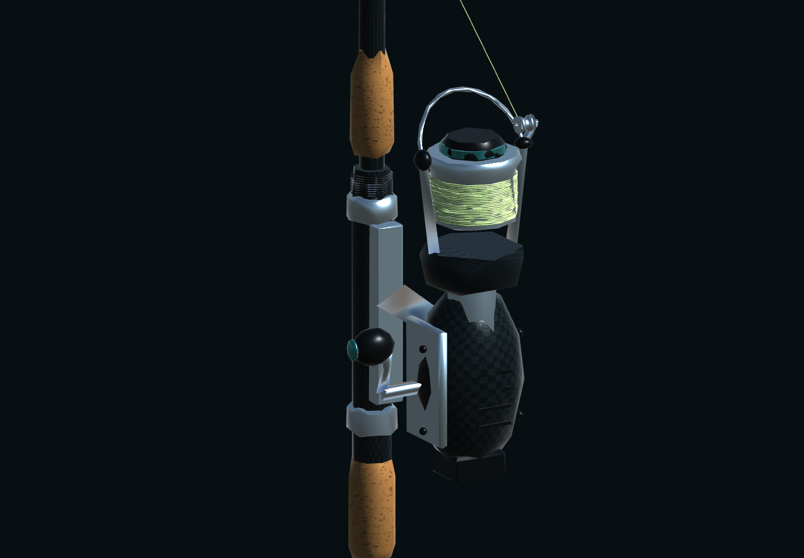
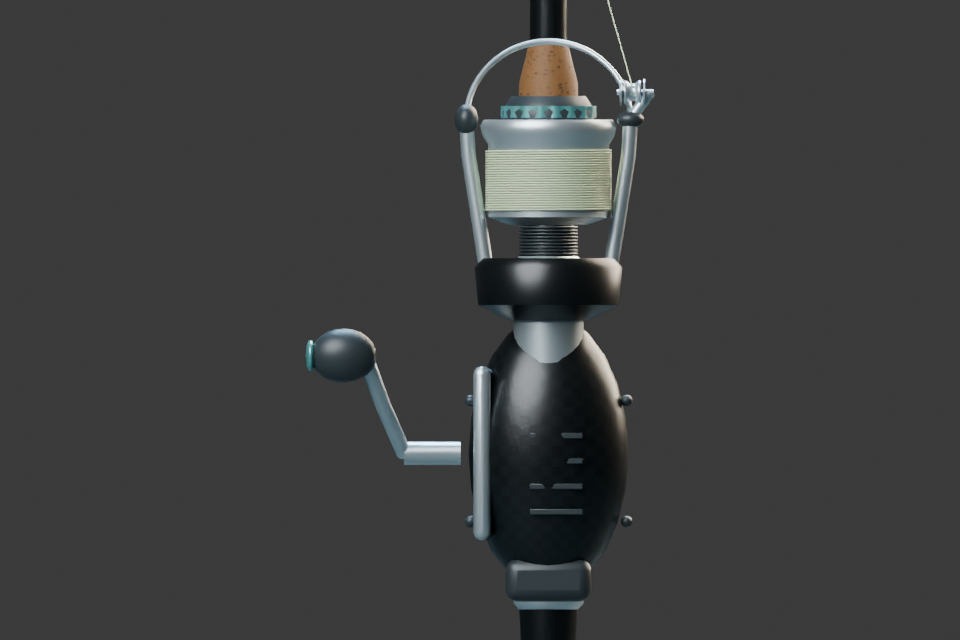

# 钓组远距绕线与完整转台

本轮继续首套候选，未批量制作其他物种或钓具。三LOD实际43412/19034/8526，均保持原候选43420/19533/8678上限；组件、材质和贴图数量未增加。LOD1/2改用均匀螺旋并保留线杯轴向轮廓，避免通用减面把线和线杯一起压变形。LOD2中心径向外移0.55mm补偿粗分段弦高，是距离表现近似，不模拟真实线量或制造尺寸。

独立读取保存三角面后，旧LOD1/2保守径向间隙为-0.684/-2.694mm，LOD2一个经线只辨24圈。新三档最小保守间隙约0.0299/0.1843/0.1872mm；每档8008条BVH射线、八经线都辨出25圈，起止经线含26个截面。正包络间隙可保守证明线材与同高度线杯分离；旧负值是风险诊断，不能当作某一点的精确穿透深度。源24实体/72滚轮孔槽、骨骼/导环及UV检查继续通过。

LOD0原始缓冲摘要不完全一致，未隐藏两个严格检查失败。规范化索引/面起点后，八个部件的实际位置、定向面、权重、世界矩阵、材质与硬边一致；机壳有12个无纹理金属/黑色面的UV尾数差异，最大5.96×10⁻⁸，两者均为常量BSDF材质。四张原始贴图SHA不变。结论是近景几何不变，不声称全缓冲或全UV逐字节相同。

当前13项定向无画面PlayMode通过；未冒称本轮重新跑完整60项Editor或完整成长。最新31张Metal Medium、Half HDR、4×MSAA图的15组首次/重复RGB零差异，QualitySettings/GraphicsSettings前后哈希不变。三个LOD/收线/开线挡接触表及LOD2原尺寸图已查看；低档其余五金和轮廓仍简化，不能把强制放大的诊断近景当作正常距离观感或最终美术。

转台现分全竿和卷线器两套，每套36个真实渲染帧、10度步进，编码为960×640、12fps、3秒视频。每套固定镜头尺度；全竿八组件、卷线器六组件的实际包围盒在每帧保持至少4%边距，避免旧近景构图裁掉机械结构。它们是自产Blender源棚拍，不是Player或真机录屏。实现和工程阈值见[制作约束](../docs/26-spinning-roller-and-line.md)，详细测量见[JSON](spinning-rig-winding.json)。

| 旧LOD2诊断 | 新LOD2诊断 |
|---|---|
|  |  |

[全竿360转台](../art/previews/rig-winding/whole-turntable.mp4) · [卷线器360转台](../art/previews/rig-winding/reel-turntable.mp4)

当前源原生Player另验。运行时只扩展显式开发复核，增加强制LOD1/2两帧、finally恢复自动选择，不新增玩家HUD、入口或积分规则。此前9e2b9dd的双端15帧沉浸结果保留其冻结范围。本轮美术/科学/用户/儿童、自动LOD过渡、真实触控/双设备20分钟及其余成品内容未通过；整体和apply保持未完成，个人手机/TestFlight未更新。
