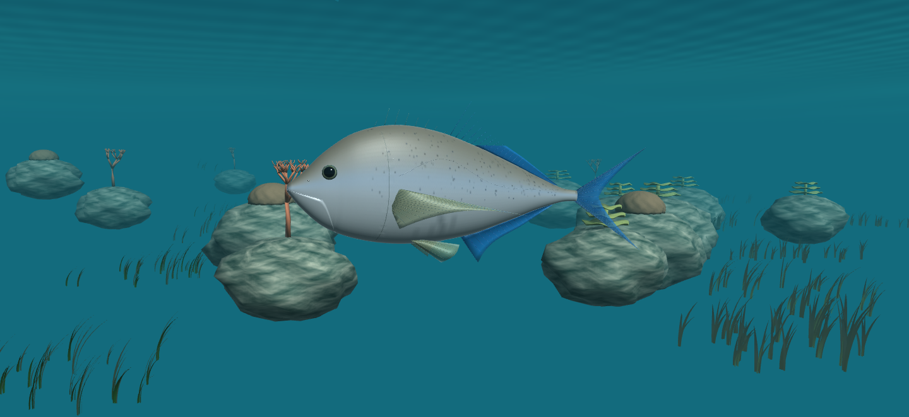
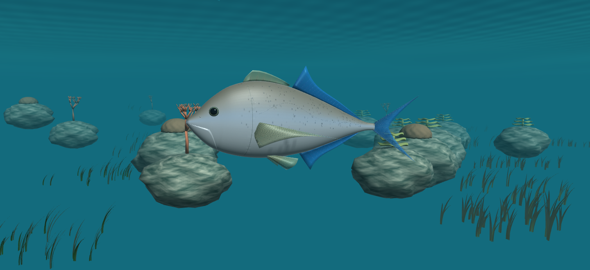
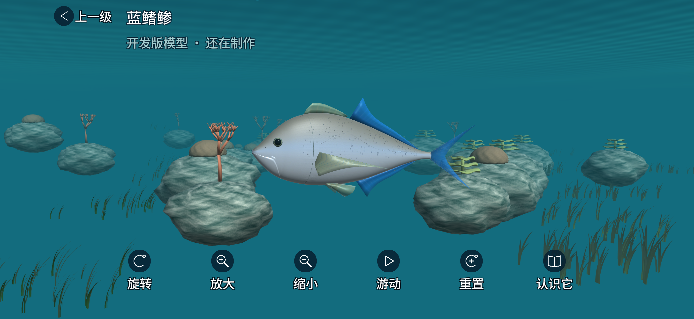
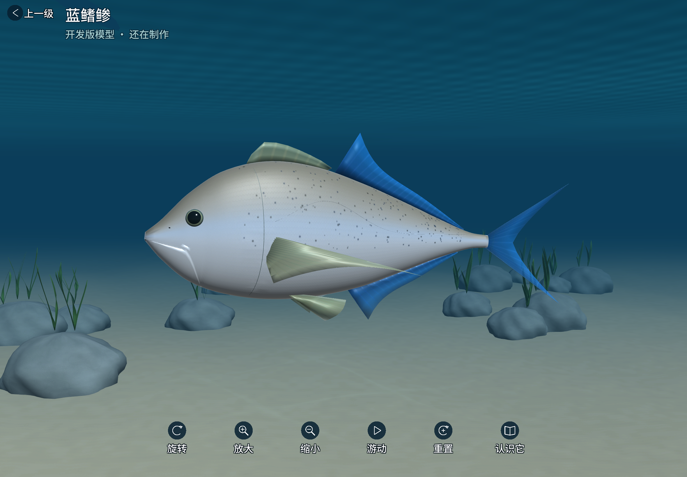

# 水下鳍膜与本人模式复核

水下完整鳍膜显示已修正，三海域共享实现。**实现 IMPLEMENTED；双端原生模拟器 PASS；GPU 场景首绘与完整美术 PARTIAL。** 没有移除鳍条、隐藏水面或扩大图鉴画框。当前源码 `2ac60df02e556efde5d53f4ac4c767ea0a0ee324`，游戏／工具摘要 `453f895d2aa014d492dced9541fc533e425bbdf5f41bc886d7fbeed10ddb8a05`，App 摘要 `1c916ca590d8b2092bd7499151c7468a59966af1df7c7b527cd3daa921fe91db`。

## 实际结果

| 模拟器 | 独立进程 | UI 检查 | PNG | 三海域定向视图 | 测试鱼获积分 |
|---|---:|---:|---:|---:|---:|
| phone | 3 | 464 | 58 | 18 | 260 |
| tablet | 3 | 464 | 58 | 18 | 229 |

每端以零积分开启本人模式，使用三海域、二十件钓具、十二图鉴模型及三观察；新增三海域的水面、水下和暂停四向蓝鳍鲹共十八视图，模型实际投影没有越界。真实玩法各产生一条测试鱼获／三观察；关闭后正常进度仍零分，正常主文件与备份字节相同，失败不切换，外部进程重启保持选择及测试历史。仍通过实际页面操作，不代表 OS 触摸或儿童理解验收。

240 份既有 v1/v2 存档文件逐字节保持；331 份源／导入美术、模型及元数据与原 `584a893` Git blob 字节一致。没有重写鱼体、贴图、骨骼或动画。每端仅新增一条真实测试鱼获，不冒称重新运行了上一轮普通模式20／26轮完整成长。

## 排查与验证边界

全部源鳍条只读测量：115／16／16 根、七动作各八相位，8232 条按根／动作／相位记录；最大源距离约5.75毫米，属于诊断，不能算完整鳍面合格。隔离的真实导入模型24视角／120图逐像素重复稳定。在实际海湾仅改变水面排序可复现／消除背鳍膜缺失，原排序每个视角至少造成4644像素变化。生产修正按最终相机水位决定水面层级，水面视角及停用恢复原值，不克隆材质或改队列。

场景24视角／216图仍为 **PARTIAL**：第一个视角首绘与重复图有111像素、最大4色阶差异，修正前后掩码完全相同；其余23生产视角及24原排序对照零差异。没有删除首绘、替换样本或放宽门槛。初次隔离诊断状态串未符合工具协议、EditMode生命周期夹具错误和组合Play根目录前置失败均保留；合计 6 个非零测量（含预期红测），详见 JSON 与本次记录完整性报告。

88项Editor通过，覆盖三个海域、材质保持等；随后只扩展QA触发参数，生产水下源码保持。五个独立Play用例最终通过，其中扩展本人模式、完整世界使用各自全新根目录；12项工具测试通过。[源码静态CI](https://github.com/arthurwangwsx-code/OceanAngler/actions/runs/45660868127) 对应冻结源码2ac60df，不能代替Unity或设备验收。

## 实际画面

以下是同姿态的 Editor 诊断原排序对照与当前生产排序；对照不属于 Player 修正版。

两种模拟器当前原图：

已查看12张GPU接触表与四张原图，及12张原生接触表（全部116张PNG总览）和八张原图。公开20份已审阅的本游戏自有媒体，完整原始对照、失败日志和设备数据保留私有；没有私人媒体或旧项目素材。

## 交付与未完成项

当前为 unsigned ARM64 Simulator／ReleaseForRunning／Unity Development 本地0.1.0(9)，**不是已发TestFlight9的二进制**。此前TestFlight9已包含开发者模式，本轮没有更新App Store Connect或个人手机，也没有新确认邀请接受／安装。

全流程通过14GiB共享门；稳定导出／原生缓存复用，保留当前2ac与上一2f的完整原生原件，较旧5e4生成原件先归档并真实解压校验字节／模式／链接后收尾。原代码、旧存档、失败证据和实际发行包保留；本地归档不是独立备份。

细鳃线、硬高光／塑料感、环境块面和其他样板物种仍未达到成品标准。此排序针对当前海域水面与水下内容的层级，不宣称解决所有透明交叉问题。用户／科学／儿童、A1-A3、最低系统、实际触控、双真机20分钟及完整产品未验收。任务2.9、原成品美术任务和apply继续开放；详见[方案](../docs/49-underwater-fin-contour.md)及[机器回执](underwater-fin-contour.json)。

本轮28条新增测量均已结束，6条非零保留；局部记录对象／回执哈希／阶段绑定及串行顺序检查通过，审计自身也已结束为0。[记录回执](underwater-fin-contour-records.json)的pending字段仅表示其取样时自身尚未结束；独立历史审计仍INCOMPLETE。
