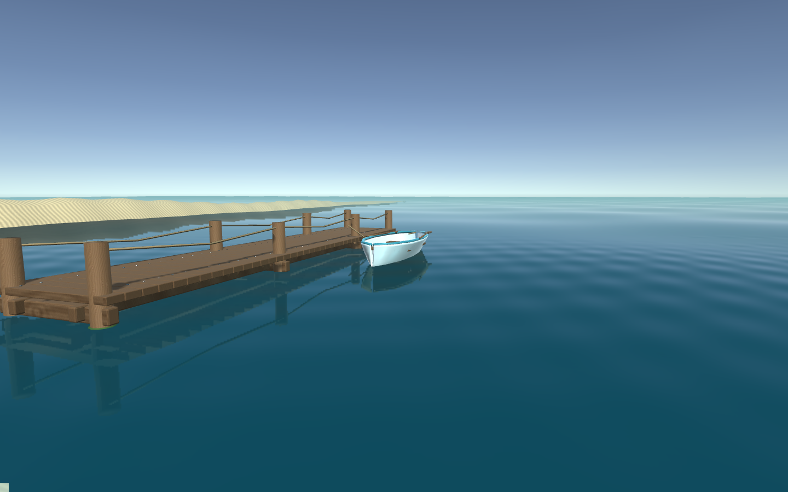
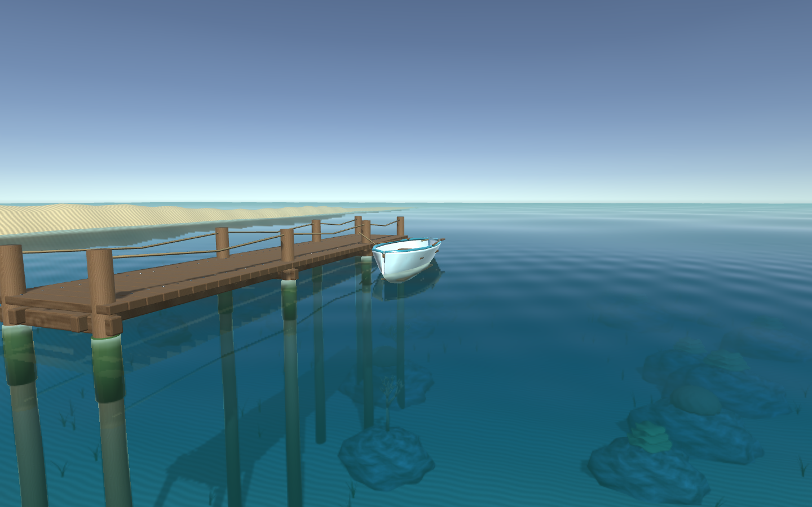
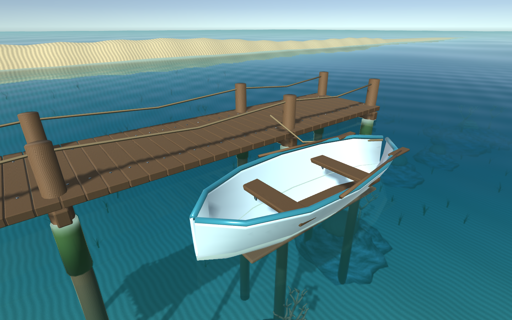
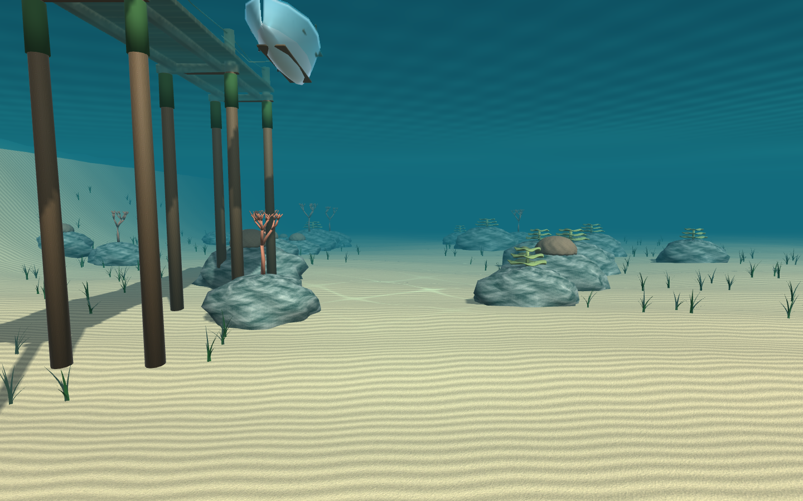

# 海湾水面、倒影与深度顺序修复

2026-11-24。首处珊瑚海湾新增实际平面倒影、按深度衰减的透射、连续低频波面和随距离淡出的细波纹，校正天空颜色及水下焦散强度。实现已进入候选源码；**本轮GPU证据来自隔离的Unity Editor离屏场景，不包含玩家UI、原生游戏窗口或iPhone/iPad验收**。成品美术和完整产品仍为PARTIAL。

## 水面实现

水面使用当前场景的opaque颜色与深度，一次输出经过衰减的合成色，避免再次半透明混合背景。波面波长适配现有网格间距，细节法线在片元计算，并根据屏幕导数淡出远处细纹；没有新增来源不明的海水贴图。

镜像相机以水位反射视图，用斜裁剪面排除水下几何，剔除水面和UI层，生成最长边不超过768像素、最多原画面一半分辨率的ARGB32倒影。相同视图复用结果，换角度或尺寸改变时才重绘；进入水下不提交倒影渲染，组件禁用/销毁释放相机与纹理。两种水上视角实际生成两次倒影，图像方差只排查空白，不能证明美术通过。实现使用[URP官方渲染请求接口](https://docs.unity3d.com/cn/6000.0/Manual/urp/User-Render-Requests.html)，不分发引擎源码。

船舱排水掩模直接读取与船壳源生成器共用的7条船体剖面；没有用外接椭圆将船边海水一起挖空。原先硬编码的剖面移到boat-profile.json，数值保持一致，本轮未重新制作或声称重新生成船体FBX/Blend。

## 深度错误与修复

先前GPU检查虽通过非空、视角缓存和波纹变化，但实际审图仍发现左下角16像素方块。关闭水面的对照图没有此缺陷；临时着色诊断表明，该处水深为零，而大部分画面深度又过大。进一步核对当前URP包及renderer资产，确认CopyDepthMode为AfterTransparents：透明水面渲染时还没有当前帧的opaque深度。改为AfterOpaques，并在工程生成入口及海湾准备入口保留配置，Editor检查也验证实际renderer配置。此后方块消失，近处海底随深度可见。没有遮盖、裁切或修图。

这是修复前的相同离屏镜头；底角亮块和错误水深仍存在：

修复后的同镜头：

以上未经修改的图像由本项目场景直接渲染，原始像素文件和哈希登记在资产清单中。它们不是手机截图。地形岸线、沙纹重复、珊瑚/海草形态与配色、船体细节和整体拟真程度仍需继续改善与人工审阅。

## 验证边界

最终29项Editor、7项无画面PlayMode通过，覆盖反射平面的几何性质、相机切换、深度顺序、暂停与减弱动态，以及既有钓鱼/存档/机构流程。隔离GPU检查1440×900、Metal、4倍MSAA，验证真实倒影非空、静态复用、换视角重绘、水下跳过、波纹参数改变造成画面变化及禁用后释放。波纹参数对照不是游戏时间或暂停的视觉证明。Mac编译结果与测量ID见[脱敏记录](water-rendering.json)。

本轮原生游戏窗口流程在首帧截图前140秒超时，仅记录到流程开始；未生成任何截图或通过回执。桌面窗口读取也超时，未证明具体是锁屏还是其他桌面状态；已请求用户确认，不将旧版三档原生通过记录沿用到新水面。没有在缺少状态变化时重复启动同一失败流程。扩充后的14截图原生回归检查已实现，尚待实际运行通过。

首轮GPU流程曾因Editor禁用回调未运行而未释放资源；补齐显式编辑器生命周期后通过。初版天空偏绿、船舱进水、深度问题及失败测量均保留。ispec测量绑定当前apply attempt，但CLI独立receipt审计仍INCOMPLETE；没有宣称阶段完成。

TestFlight 0.1.0 (2)仍冻结于2971b11，不含本轮改进。实际安装、iPhone/iPad画面与触控、20分钟内存/温升/流畅度、儿童首鱼时间和完整内容均未通过；本轮不新增外部测试或公开邀请。
